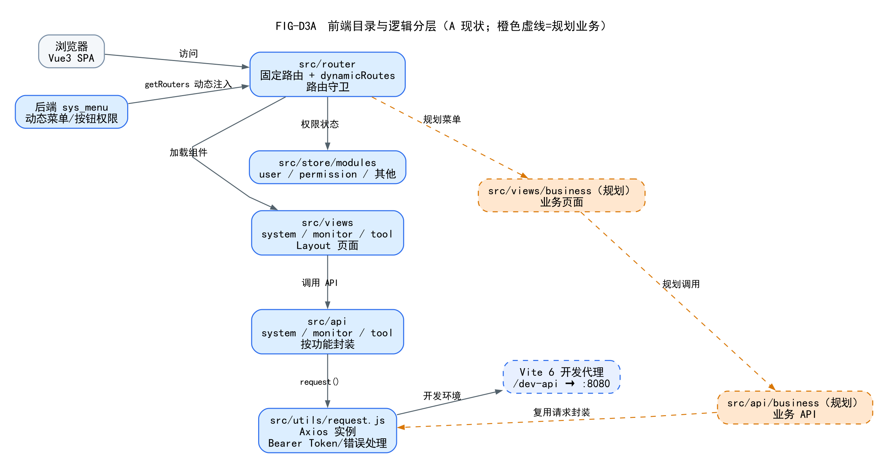
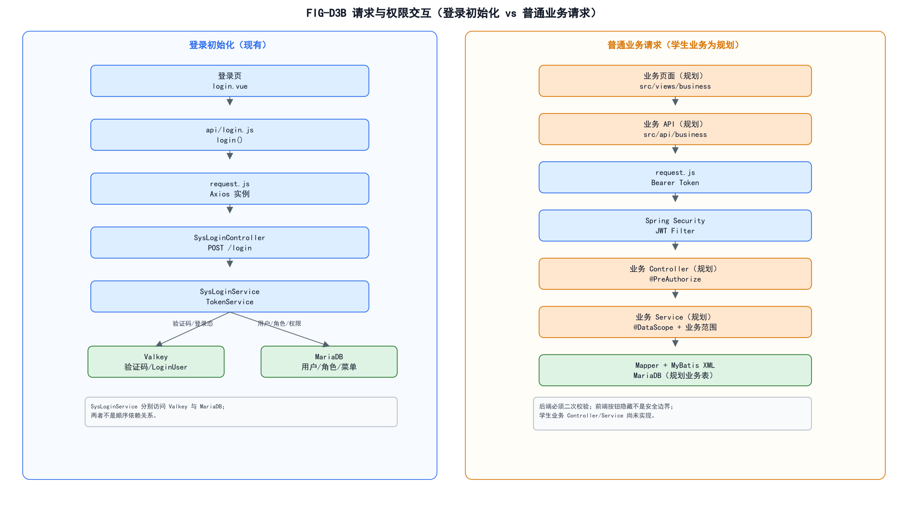
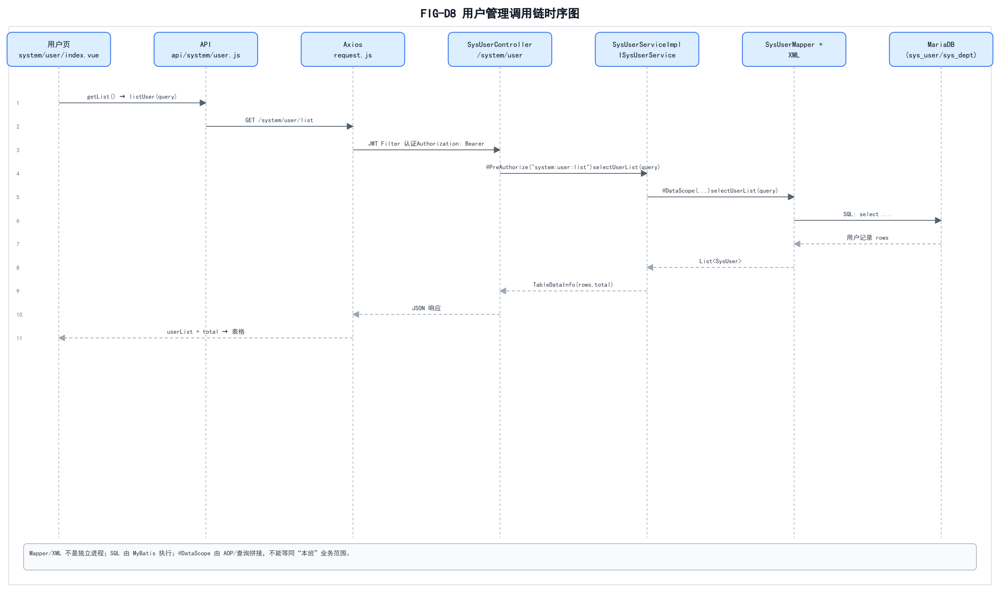

# 02 前端结构与交互架构

> 依据：`frontend/package.json`、`vite.config.js`、`src/main.js`、`src/router/index.js`、`src/store/modules/*`、`src/utils/request.js`、`src/api/system/user.js`、`src/views/system/user/index.vue`。

## 1. 前端目录与逻辑分层



源文件：`diagrams/source/FIG-D3A-前端目录与逻辑分层.dot`  
SVG：`diagrams/svg/FIG-D3A-前端目录与逻辑分层.svg`

### 1.1 实际目录

| 目录 | 职责 | 现状 |
| --- | --- | --- |
| `frontend/src/main.js` | Vue3 应用入口 | 现有 |
| `frontend/src/router/` | 固定/动态路由 | 现有 |
| `frontend/src/layout/` | 顶栏、侧栏、主区域 | 现有 |
| `frontend/src/views/system/` | 系统管理页面 | 现有 |
| `frontend/src/views/monitor/` | 监控页面 | 现有 |
| `frontend/src/views/tool/` | 工具页面 | 现有 |
| `frontend/src/api/system/` | 系统 API | 现有 |
| `frontend/src/api/monitor/`、`tool/` | 监控/工具 API | 现有 |
| `frontend/src/store/modules/` | Pinia 用户/权限/字典等 | 现有 |
| `frontend/src/utils/request.js` | Axios 实例 | 现有 |
| `frontend/src/views/business/` | 学生业务页面 | **规划，不存在** |
| `frontend/src/api/business/` | 学生业务 API | **规划，不存在** |

## 2. 请求与权限交互



源文件/ SVG：`diagrams/source/FIG-D3B-请求与权限交互.svg`  
PNG：`diagrams/png/FIG-D3B-请求与权限交互.png`

### 2.1 登录初始化

```text
login.vue
  -> api/login.js#login
  -> utils/request.js
  -> POST /login
  -> SysLoginController
  -> SysLoginService / TokenService
  -> Valkey（验证码、LoginUser）与 MariaDB（用户/角色/权限）分别访问
  -> 返回 JWT Token
  -> getInfo -> roles/permissions
  -> getRouters -> 动态菜单
```

### 2.2 普通业务请求

```text
业务页面（规划）
  -> api/business/**（规划）
  -> request.js（Bearer Token）
  -> Spring Security/JWT
  -> 业务 Controller（@PreAuthorize）
  -> 业务 Service（@DataScope + 业务范围）
  -> Mapper XML
  -> MariaDB
```

- 前端 `v-hasPermi` 按钮控制只改善体验，**后端必须再次校验**；
- 动态菜单来自 `sys_menu`，不是前端硬编码；
- 学生业务要新增 `sys_menu` 记录和 `business:*` 权限；
- 不修改 `request.js` 的公共认证/错误处理逻辑，不另建 Axios 实例；
- 不使用 `system:*` 权限复用学生业务。

## 3. 真实用户管理调用链



| 层 | 文件 | 关键方法 |
| --- | --- | --- |
| 页面 | `frontend/src/views/system/user/index.vue` | `getList()` → `listUser(query)`；表格/查询/新增/编辑/删除 |
| API | `frontend/src/api/system/user.js` | `listUser`、`getUser`、`addUser`、`updateUser`、`delUser`、`resetUserPwd`、`deptTreeSelect` |
| 请求 | `frontend/src/utils/request.js` | Bearer Token、401/500 处理、重复提交保护 |
| 后端 Controller | `ruoyi-admin/.../SysUserController.java` | `@GetMapping("/list")` + `system:user:list` |
| Service | `ruoyi-system/.../SysUserServiceImpl.java` | `@DataScope` 查询 |
| Mapper | `ruoyi-system/.../SysUserMapper.java` + XML | SQL |

## 4. 路由与权限

- `constantRoutes`：登录、注册、首页、个人中心、锁屏、401/404；
- `dynamicRoutes`：隐藏详情页，按 `permissions` 控制；
- `usePermissionStore.generateRoutes()` 调 `/getRouters`，`filterAsyncRouter` 映射组件；
- `router.addRoute` 注入；
- 登录页 `/login`、`/register` 不进入主布局；
- 学生业务页面应通过后端菜单动态注入，不写死在 constantRoutes 主菜单。

## 5. 前端边界

- 前端当前未运行（3000 无监听），未做浏览器端到端验证；
- 学生业务页面/API 尚未创建；
- 不改前端依赖、Vite 配置或构建脚本；
- 不在本阶段生成真实业务 Vue 页面。
