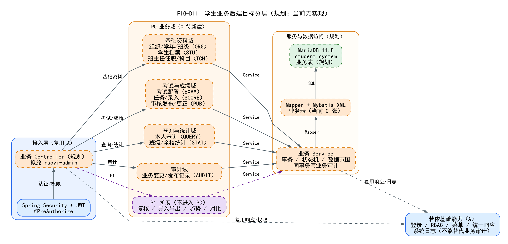

# 02 学生业务目标模块设计

> 这是**目标设计**，不是当前实现。当前源码没有学生业务 Controller/Service/Mapper/表/页面。  
> 输入：SRS v1.1 的 35 P0 + 11 P1；输出：模块边界、服务职责、复用/隔离规则。

## 1. 目标分层图



源文件：`diagrams/source/FIG-D11-学生业务后端目标分层.dot`  
SVG：`diagrams/svg/FIG-D11-学生业务后端目标分层.svg`

## 2. 目标模块

| 编号 | 模块 | 存在状态 | 主要职责 | 关联 FR |
| --- | --- | --- | --- | --- |
| N01 | 组织学年与班级 | 待新建 | 学年/学期/年级/班级 | FR-ORG-001～005 |
| N02 | 学生档案与账号绑定 | 待新建 | 学生档案、班级归属、状态、账号关联 | FR-STU-001～004 |
| N03 | 班主任任职与科目 | 待新建 | 班主任档案、任职历史、科目 | FR-TCH-001～002 |
| N04 | 考试及科目配置 | 待新建 | 考试、范围、科目/满分/线 | FR-EXAM-001～004 |
| N05 | 成绩任务与录入 | 待新建 | 任务生成、草稿、校验、提交/重提 | FR-SCORE-001～005 |
| N06 | 审核与发布 | 待新建 | 审核、退回、发布、撤回、更正/版本 | FR-PUB-001～004 |
| N07 | 本人成绩查询与统计 | 待新建 | 学生本人已发布、班级/全校基础统计 | FR-QUERY-001～002、FR-STAT-001～002 |
| N08 | 业务审计 | 待新建 | 成绩/任务/发布/更正前后值、版本 | FR-AUDIT-001～002 |
| N09 | P1 扩展 | P1 规划 | 复核、导入导出、趋势、多班对比 | 11 项 P1 |

## 3. 目标分层

```text
Controller（admin，薄）
  -> Service（事务/状态机/业务范围）
  -> Mapper + XML
  -> MariaDB 业务表（规划）
```

- 业务 Controller 建议放 `ruoyi-admin` 的 `com.ruoyi.web.controller.business`；
- 业务 Service/Mapper/domain 建议放 `ruoyi-student`（ADR 推荐，待评审）；
- 所有写操作 `@Transactional`；
- 状态前置条件、提交人/审核人分离、发布/撤回/更正版本由 Service 控制；
- 审计与业务同事务；不能用 `sys_oper_log` 代替。

## 4. 四类角色与数据边界

| 角色 | 数据范围 | 关键限制 |
| --- | --- | --- |
| 系统管理员 | `SCOPE_SYSTEM` | 不看成绩明细；不审核/发布/更正；审计脱敏 |
| 教务管理员 | `SCOPE_ALL` | 不代替班主任录入；不审核自己提交的任务 |
| 班主任 | `SCOPE_CLASS` | 只处理当前有效任职班级；本班全科；不跨班；不直接改已发布成绩 |
| 学生 | `SCOPE_SELF` | 只看本人已发布成绩；不能看他人/未发布/已撤回 |

不恢复任课教师、任教关系或按科目分配教师。

## 5. 关键业务隔离

### 5.1 `@DataScope` 不是本班隔离

- `@DataScope` 默认按 `sys_dept`/用户部门拼接数据权限；
- 行政班不是 `sys_dept`；
- 学生业务 Service 必须：
  - 读取当前登录用户与业务身份绑定；
  - 班主任：查询当前有效任职的班级集合；
  - 学生：`student_id = 当前账号绑定学生`；
  - 教务：`SCOPE_ALL`；
  - 系统管理员：拒绝成绩明细。

### 5.2 职责分离

- 班主任提交后任务锁定；
- 审核人不能等于提交人；多角色账号也逐条比对；
- 教务发布/撤回/更正；
- 学生不能触发发布/更正；
- 系统管理员不能借审计查看成绩明细。

### 5.3 三态与精度

- 缺考 `SCORE_ABSENT`、未录入 `SCORE_NOT_ENTERED`、真实零分 `SCORE_NORMAL + 0.0`；
- 0.5 分步长、一位小数，禁止浮点直接比较；
- 完整总分才参与 1,2,2,4 排名；
- 缺考/未录入不自动转 0。

### 5.4 发布版本

- 发布前所有适用任务 `TASK_APPROVED` 且无未录入；
- 发布 `PUB_PUBLISHED` v1；
- 撤回 `PUB_WITHDRAWN`；重新发布版本 +1；
- 更正保持已发布，生成新不可变版本；
- 审计记录前后值/原因/操作人/角色/时间/版本。

## 6. 复用若依的能力

| 若依能力 | 学生业务用法 | 注意 |
| --- | --- | --- |
| 登录/JWT | 四类角色统一入口 | 不另建认证 |
| 用户/角色/菜单/按钮 | 业务角色映射、`business:*` | 不用 `system:*` 混用 |
| 统一响应 `AjaxResult` | Controller 响应 | 不改变全局协议 |
| 分页 `TableDataInfo` | 列表 | 统计接口可返回专用 DTO |
| 基础日志 | 系统/接口日志 | 不能替代业务审计 |
| Excel 工具 | P1 导入导出 | 预检/事务/范围过滤 |
| 代码生成 | 生成 CRUD 骨架 | 状态机/权限/审计人工实现 |

## 7. 建议接口边界（规划，不是已实现）

| 模块 | 规划路径 |
| --- | --- |
| 组织 | `/business/org/**` |
| 学生 | `/business/students/**` |
| 班主任/科目 | `/business/head-teachers/**`、`/business/subjects/**` |
| 考试 | `/business/exams/**` |
| 成绩任务 | `/business/score-tasks/**` |
| 发布 | `/business/publications/**` |
| 本人查询 | `/business/my-scores/**` |
| 统计 | `/business/stats/**` |
| 审计 | `/business/audit/**` |
| P1 复核 | `/business/reviews/**` |
| P1 导入导出 | `/business/imports/**`、`/business/exports/**` |
| P1 趋势/对比 | `/business/trends/**`、`/business/compare` |

**这些路径当前没有 Controller/Service/Mapper；不得写入现有 Swagger。**

## 8. 关键设计问题

1. 账号—档案绑定放 `ruoyi-system` 还是 `ruoyi-student`？
2. 班级/年级是否完全独立于 `sys_dept`？
3. 业务审计表是独立表还是复用发布/成绩版本表？
4. 班主任跨班时，任务第一责任人快照如何保存？
5. 成绩任务生成时机（考试开放/手动）与人数变更限制。
6. 统计口径：缺考/未录入单列、完整总分排名、跨班合并。

以上需在概要设计评审确认，不擅自改写 SRS。
