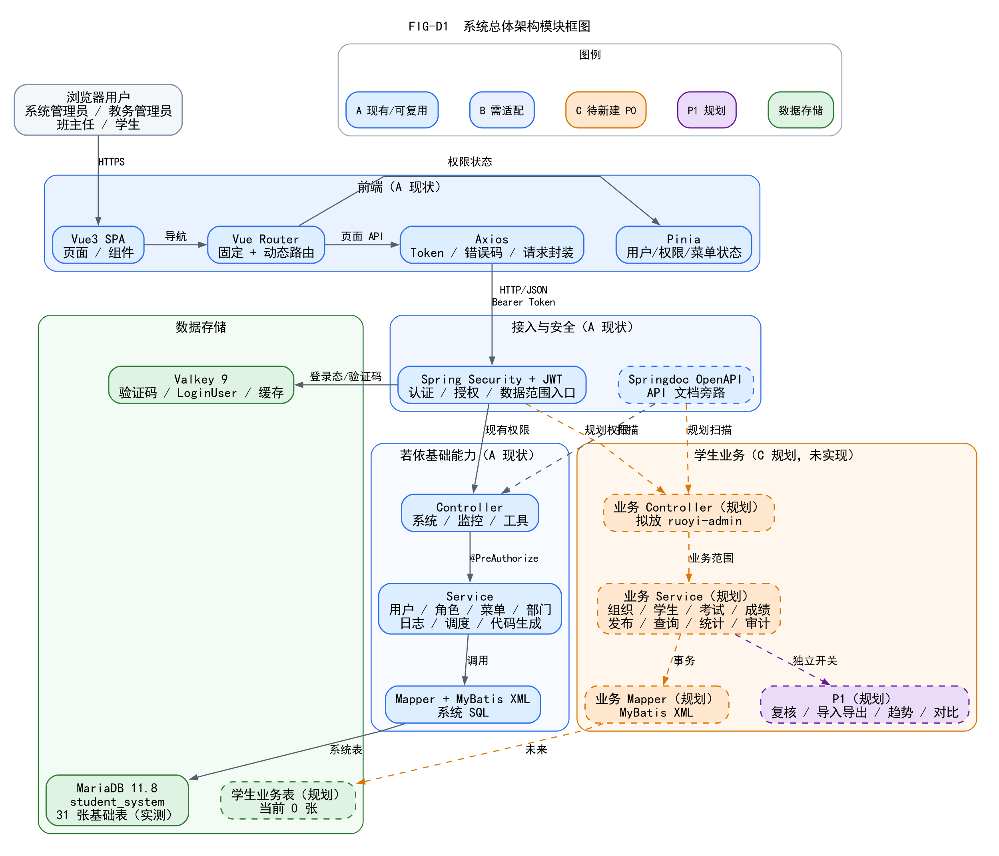

# 02 总体架构设计

> 依据：`FIG-D1`、真实 `pom.xml`、Vue3 源码、`SecurityConfig`、`application*.yml`、实际 MariaDB/Valkey 状态。  
> 状态：现有若依基础（A）与规划学生业务（C）分层表达；学生业务未实现。

## 1. 架构图



**图 FIG-D1** 不是一条“浏览器→Controller→数据库”的直线，而是分为用户、前端、接入安全、现有若依基础、规划学生业务、数据存储六个区域。详细职责见第 2 节。

- 源文件：`diagrams/source/FIG-D1-系统总体架构模块框图.dot`
- SVG：`diagrams/svg/FIG-D1-系统总体架构模块框图.svg`
- PNG：`diagrams/png/FIG-D1-系统总体架构模块框图.png`

## 2. 组件职责

| 区域 | 组件 | 职责 | 状态 |
| --- | --- | --- | --- |
| 用户 | 浏览器用户 | 四类角色访问系统 | 现状 |
| 前端 | Vue3 SPA / Element Plus | 页面、表单、表格、弹窗 | 现状 |
| 前端 | Vue Router | 固定路由 + 后端动态菜单路由 | 现状 |
| 前端 | Pinia | 用户、权限、菜单状态 | 现状 |
| 前端 | Axios | Bearer Token、统一错误码、重复提交保护 | 现状 |
| 接入 | Spring Security + JWT | 认证、`@PreAuthorize` 权限、无状态会话入口 | 现状 |
| 接入 | `JwtAuthenticationTokenFilter` | 从请求解析 Token；加载 LoginUser | 现状 |
| 文档 | Springdoc OpenAPI | `/v3/api-docs`、`/swagger-ui.html` 旁路 | 现状（服务未运行） |
| 基础 | `ruoyi-admin` Controller | 系统/监控/工具 REST 入口 | 现状 |
| 基础 | `ruoyi-system` Service/Mapper | 用户/角色/菜单/部门/字典/日志 | 现状 |
| 规划 | 学生业务 Controller | 拟放 `ruoyi-admin` 的 `web.controller.business` | **规划** |
| 规划 | 学生业务 Service/Mapper | 组织、学生、班主任、考试、成绩、发布、查询、统计、审计 | **规划** |
| 规划 | P1 扩展 | 复核/导入导出/趋势/对比 | **P1 规划** |
| 数据 | MariaDB 11.8 `student_system` | 31 张现有基础表；0 张学生业务表 | 现状/规划 |
| 缓存 | Valkey 9 | 验证码、LoginUser、配置/在线用户缓存 | 现状（PONG） |

## 3. 分层规则

```text
前端页面/路由/状态
  -> Axios
  -> Spring Security/JWT
  -> Controller（薄）
  -> Service（业务规则/事务/范围）
  -> Mapper + XML
  -> MariaDB
```

- `Controller` 不写业务状态机，不直接拼业务 SQL；
- `Service` 负责事务、状态前置条件、角色/范围校验、审计；
- `Mapper` 只做数据访问；
- `Valkey` 不存成绩真值；成绩真值在 MariaDB；
- Springdoc 只做接口文档旁路，不参与业务请求；
- 前端只隐藏按钮，不作为安全边界。

## 4. 现状与规划的硬边界

### A 现有/可复用

- 登录、验证码、JWT、`/getInfo`、`/getRouters`；
- 用户、角色、菜单、部门、岗位、字典、参数；
- 操作日志、登录日志、在线用户、缓存监控；
- 代码生成器、Springdoc。

### B 需适配

- 账号—学生/班主任档案绑定；
- 业务角色/权限字符串；
- 数据范围（`@DataScope` 默认部门树不能表达本班/本人）；
- 业务审计（`sys_oper_log` 不能替代成绩前后值/版本）。

### C 待新建

- 组织学年、学生档案、班主任任职、考试、成绩任务、录入、审核发布、查询、统计、业务审计；
- 教师/学生业务视图/API；
- 业务表；当前 0 张。

## 5. 与实验一需求的关系

- 实验一 SRS v1.1 的 35 P0、11 P1、17 DR 是设计输入；
- 实验二当前只完成基础框架源码分析；
- 图中橙色/紫色节点均为规划，不是已实现功能；
- 四类角色保留；无任课教师/任教关系。

## 6. 架构约束

1. 不重写若依登录/JWT/RBAC；
2. 不把业务实体放 `ruoyi-common`；
3. 不把成绩业务状态机放 Controller；
4. 不把 `sys_dept` 当行政班；
5. 不把 P1 与 P0 混在同一发布条件中；
6. 业务表主键按课程要求使用 `id INT AUTO_INCREMENT`；
7. 业务接口权限用 `business:*` 命名空间，具体命名待评审。
