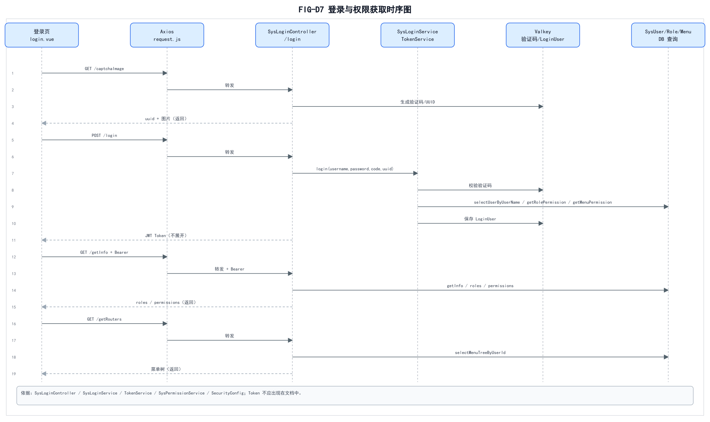

# 02 认证与用户管理调用链

> 依据：`SysLoginController`、`SysLoginService`、`TokenService`、`SysPermissionService`、`SysUserController`、`SysUserServiceImpl`、`SysUserMapper.xml`、`SecurityConfig`、`JwtAuthenticationTokenFilter`。  
> 图中不展开真实 Token；不把 Mapper XML 画成独立进程。

## 1. 登录与权限获取



源文件/ SVG：`diagrams/source/FIG-D7-登录与权限获取时序图.svg`  
PNG：`diagrams/png/FIG-D7-登录与权限获取时序图.png`

### 消息与源码对应

| 步骤 | 消息 | 真实源码 |
| ---: | --- | --- |
| 1 | `GET /captchaImage` | `CaptchaController` |
| 2 | 生成/保存验证码 | `CaptchaController` → Valkey |
| 3 | `POST /login` | `login.vue` → `api/login.js` |
| 4 | `login(username,password,code,uuid)` | `SysLoginController.login` |
| 5 | 校验验证码/账号 | `SysLoginService.login` |
| 6 | 查询用户/角色/权限 | `SysLoginService` / `SysPermissionService` |
| 7 | 保存 `LoginUser` | `TokenService` → Valkey |
| 8 | 返回 JWT | `SysLoginController` |
| 9 | `GET /getInfo` + Bearer | `SysLoginController.getInfo` |
| 10 | `GET /getRouters` | `SysLoginController.getRouters` |
| 11 | 菜单树 | `ISysMenuService.selectMenuTreeByUserId` / `buildMenus` |

### 关键约束

- 验证码在 Valkey 有效期校验；
- JWT 只证明登录态，权限/数据范围要后端再次计算；
- Token 不输出到文档/日志/截图；
- `getInfo` 返回 `user/roles/permissions`；
- `getRouters` 返回动态菜单，前端 `filterAsyncRouter` 映射组件；
- 登录失败统一提示，不泄露账号是否存在（依现有实现）。

## 2. 用户管理调用链


源文件/ SVG：`diagrams/source/FIG-D8-用户管理调用链时序图.svg`  
PNG：`diagrams/png/FIG-D8-用户管理调用链时序图.png`

### 调用链

```text
views/system/user/index.vue#getList
  -> api/system/user.js#listUser
  -> utils/request.js
  -> GET /system/user/list
  -> SysUserController#list
  -> ISysUserService#selectUserList
  -> SysUserServiceImpl#selectUserList (@DataScope)
  -> SysUserMapper#selectUserList
  -> resources/mapper/system/SysUserMapper.xml
  -> MariaDB
  -> TableDataInfo(rows,total)
  -> 前端表格
```

### 真实源码依据

| 层 | 路径 |
| --- | --- |
| 页面 | `frontend/src/views/system/user/index.vue`（`getList` 约第 246 行） |
| API | `frontend/src/api/system/user.js`（`listUser`） |
| 请求 | `frontend/src/utils/request.js` |
| Controller | `ruoyi-admin/src/main/java/com/ruoyi/web/controller/system/SysUserController.java` |
| Service | `ruoyi-system/src/main/java/com/ruoyi/system/service/impl/SysUserServiceImpl.java` |
| Mapper | `ruoyi-system/src/main/java/com/ruoyi/system/mapper/SysUserMapper.java` |
| XML | `ruoyi-system/src/main/resources/mapper/system/SysUserMapper.xml` |

### 权限与数据范围

- `@PreAuthorize("@ss.hasPermi('system:user:list')")` 是方法级功能权限；
- `@DataScope(deptAlias="d", userAlias="u")` 只解决若依部门/用户数据范围；
- **不能直接把它当“本班/本人”业务范围**；学生业务必须在 Service 层重新推导当前绑定身份和班级关系；
- `TableDataInfo` 是分页响应，不是业务状态对象。

## 3. 前端/后端边界

- 前端菜单/按钮权限来自 `sys_menu`/`permissions`，按钮用 `v-hasPermi`；
- 前端隐藏按钮不等于后端授权；
- Controller 不信任前端传的 `deptId/userId` 作为范围依据；
- 业务 Service 必须重新读取当前登录用户、班主任任职/学生绑定关系。

## 4. 未验证

- 服务未运行，未对 `/login`、`/getInfo`、`/getRouters`、`/system/user/list` 发起真实请求；
- 时序依据源码静态阅读，不能声称端到端通过；
- 未验证 Valkey 中实际 key 的 TTL/结构。
