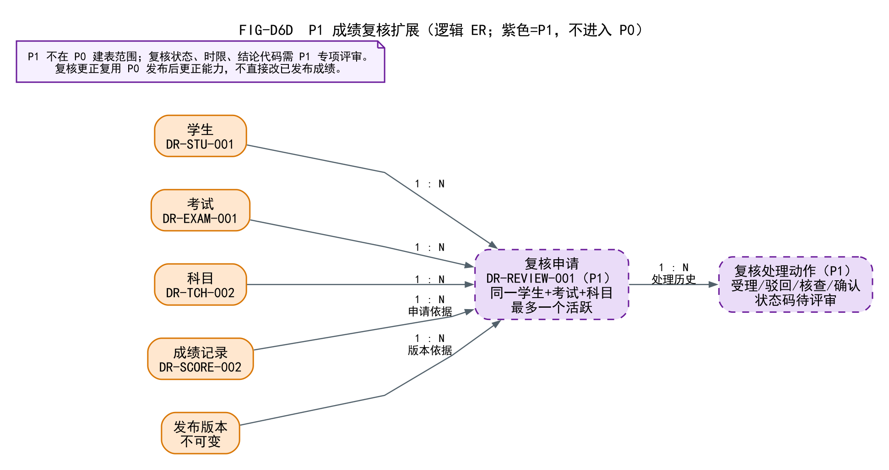

# 03 P1 数据模型扩展规划

> P1 是实验一 11 项扩展需求，**不进入 P0 退出条件**。  
> 本文只做扩展设计；不建表、不实现 API、不改变 P0 状态机。

## 1. P1 范围

- 复核：`FR-REVIEW-001/002/004/005`
- 导入导出：`FR-IMPORT-001～004`
- 趋势：`FR-TREND-001/002`
- 多班对比：`FR-COMPARE-001`

## 2. P1 计划表（3 张，不建）

| 表 | 用途 | 关键约束 | 状态 |
| --- | --- | --- | --- |
| `stu_review_application` | 复核申请 | 学生+考试+科目最多一个活跃；必须引用发布版本 | 设计占位 |
| `stu_review_action` | 受理/驳回/核查/确认处理历史 | 每申请 1:N 动作 | 设计占位 |
| `stu_import_batch` | 导入批次/预检结果摘要 | 任务 1:N 批次；不覆盖已提交/发布 | 设计占位 |

**趋势/对比不建表**：按 `publication_version_detail`/当前发布版本查询；若以后需要物化，另立派生表并以版本键关联。

## 3. 逻辑关系

- 学生/考试/科目/成绩/发布版本 → 复核申请；
- 复核申请 → 处理动作；
- 复核更正复用 P0 发布后更正，不直接改已发布明细；
- P1 状态码、时限、结论类型待专项评审；当前字段 `review_status` 可空、无硬编码枚举，避免提前冻结需求。

## 4. 复核关键设计

- 申请必须指向**本人已发布**成绩（当前版本）；
- 同一学生+考试+科目最多一个活跃申请；用 `closed_at IS NULL` 的生成列唯一槽位；
- 申请时记录 `score_id`/`publication_version_id`，便于追踪；
- 处理人/角色/意见/时间保留；
- 学生只能看本人；
- 教务确认更正时，走 P0 的受控更正流程，生成新发布版本；
- P1 不能改变 P0 的 `TASK_*`/`PUB_*` 状态机。

## 5. 导入设计

- 按“考试×班级×科目”任务生成模板；
- 先全量预检，错误定位行号/学号/原因，不部分写入；
- 预检通过后事务导入；版本冲突拒绝；
- 不新增/删除花名册，不覆盖已提交/通过/发布；
- 导入批次记录操作人/文件/成功失败数；错误摘要不含敏感信息；
- 导出按权限过滤，记录导出行为。

## 6. 趋势/对比

- 只使用已发布版本数据；
- 不同满分用得分率，不混算；
- 同考试/同科目/同口径才对比；
- 不做班级好坏评价；
- 多班对比仅授权班级；P0 不做跨班混合排名。

## 7. P1 不改变 P0

- P1 表不进入 P0 建表/上线必须清单；
- P1 失败不回滚 P0；
- P1 权限单独；
- P1 代码/表在 P0 验收后再排期；
- 当前不执行 P1 SQL，不建表。

## 8. 待确认

- 复核时限/状态/结论代码；
- 复核是否允许班主任受理本班（SRS 是，需与职责分离核对）；
- 导入是否支持撤回/补偿；
- 趋势/对比是否需要物化；
- 多班班主任是否 P1 汇总。
