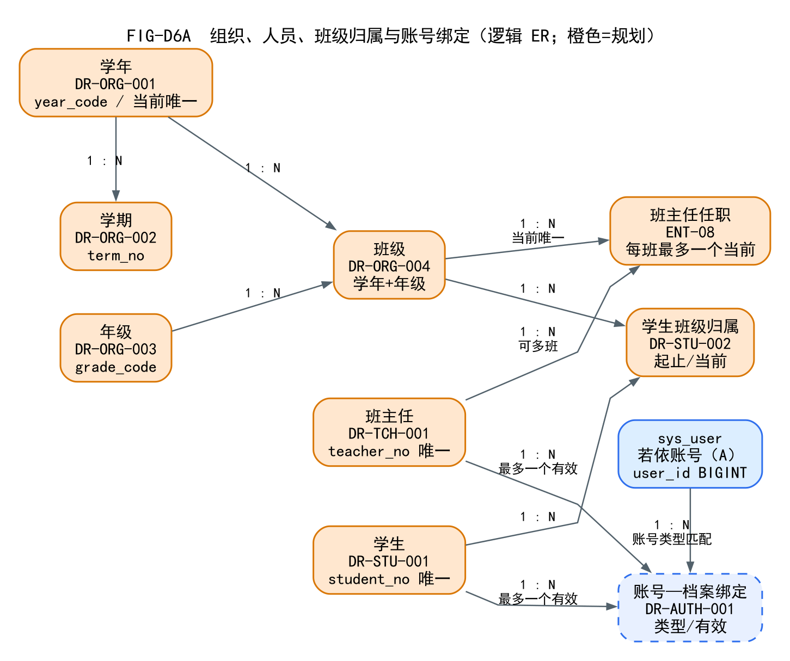
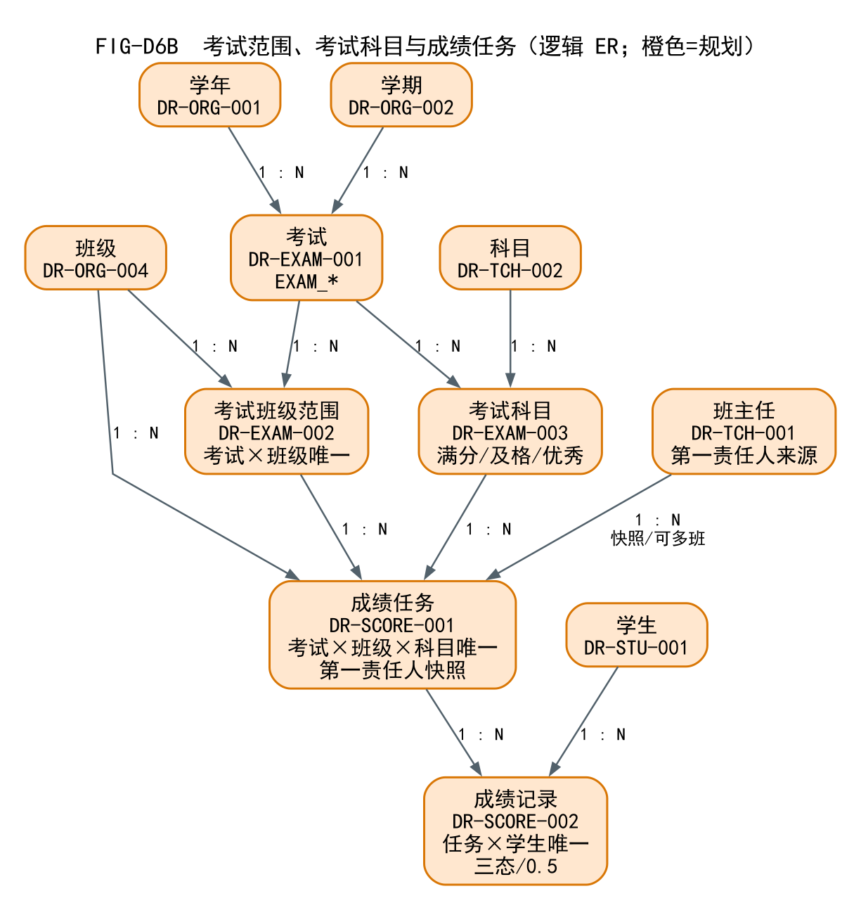
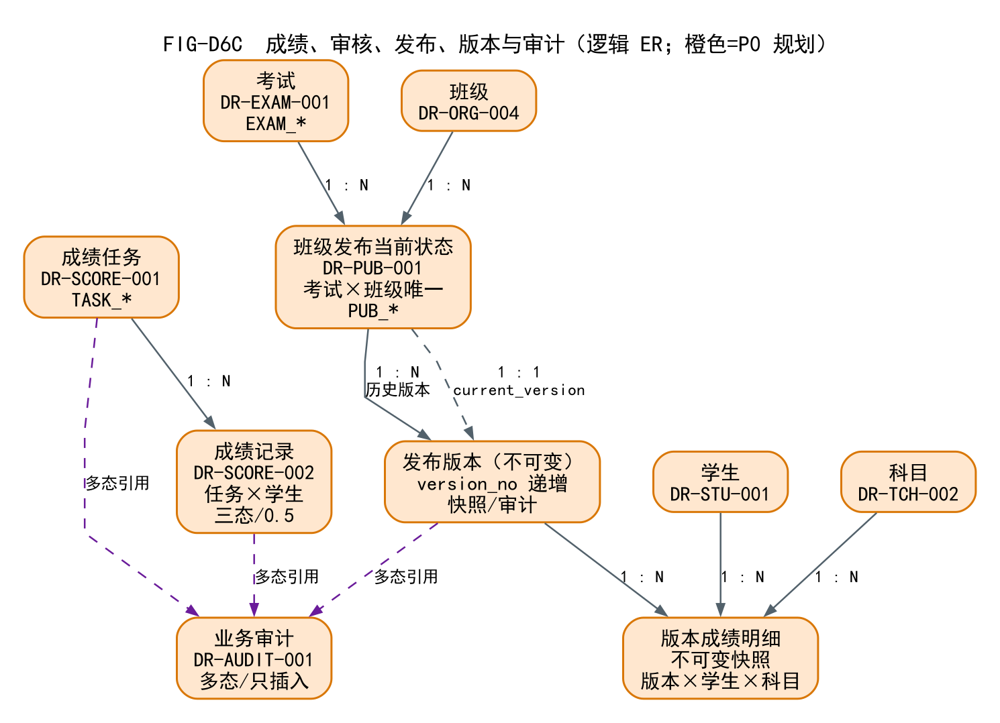

# 03 学生业务逻辑数据模型

> 依据：SRS v1.1 的 17 DR + `ENT-08`，不新增需求实体。  
> 本文是**逻辑模型**；对应物理表在 `03-学生业务物理表结构设计.md`，尚未建表。

## 1. 逻辑实体总表

| DR/ENT | 逻辑实体 | 物理候选 | 关键约束 | 关联 FR |
| --- | --- | --- | --- | --- |
| DR-ORG-001 | 学年 | `stu_year` | `year_code` 唯一；当前学年最多一个 | FR-ORG-001 |
| DR-ORG-002 | 学期 | `stu_term` | 同一学年 `term_no` 唯一 | FR-ORG-002 |
| DR-ORG-003 | 年级 | `stu_grade` | 年级代码/名称唯一 | FR-ORG-003 |
| DR-ORG-004 | 班级 | `stu_class` | 同一学年班级名称/代码唯一；有历史不可物理删 | FR-ORG-004 |
| DR-STU-001 | 学生 | `stu_student` | 学号全校唯一；不含身份证/住址/家长电话 | FR-STU-001 |
| DR-STU-002 | 学生班级归属 | `stu_student_class` | 同一学生最多一条当前归属；历史保留 | FR-STU-002 |
| DR-TCH-001 | 班主任 | `stu_head_teacher` | 工号唯一；可负责多个班 | FR-TCH-001 |
| ENT-08 | 班主任任职 | `stu_head_teacher_assignment` | 同一班级同一时刻最多一条有效；历史保留 | FR-ORG-005、FR-TCH-001 |
| DR-TCH-002 | 科目 | `stu_subject` | 科目代码唯一 | FR-TCH-002 |
| DR-EXAM-001 | 考试 | `stu_exam` | 同一学年/学期名称唯一；`EXAM_*` | FR-EXAM-001/004 |
| DR-EXAM-002 | 考试班级范围 | `stu_exam_class` | 考试×班级唯一 | FR-EXAM-002 |
| DR-EXAM-003 | 考试科目 | `stu_exam_subject` | 考试×科目唯一；满分/线 0.5 步长 | FR-EXAM-003 |
| DR-SCORE-001 | 成绩任务 | `stu_score_task` | 考试×班级×科目唯一；第一责任人快照 | FR-SCORE-001～004 |
| DR-SCORE-002 | 成绩记录 | `stu_score` | 任务×学生唯一；三态 | FR-SCORE-002～005 |
| DR-PUB-001 | 班级成绩发布 | `stu_publication` + `stu_publication_version` + `stu_publication_version_detail` | 考试×班级唯一；版本递增；版本不可变 | FR-PUB-001～004、FR-QUERY-001 |
| DR-AUDIT-001 | 业务变更记录 | `stu_audit_log` | 多态引用；只插入；同事务 | FR-AUDIT-001/002 |
| DR-AUTH-001 | 账号—角色—档案关联 | `stu_account_binding` | 一个档案最多一个有效账号；类型匹配 | FR-AUTH-003、FR-STU-003 |
| DR-REVIEW-001 | 复核申请（P1） | `stu_review_application` + `stu_review_action` | P1；同一学生+考试+科目最多一个活跃 | FR-REVIEW-001～005 |

**分解说明：**

- `DR-PUB-001` 在逻辑上是一个发布业务对象，物理上拆成 **当前状态表**、**不可变版本头**、**版本成绩明细** 三张表；这样“当前可见状态”和“历史版本”不会互相覆盖。
- `ENT-08` 是班主任任职历史关联实体，不强行造一个“任职 DR”。
- `DR-AUTH-001` 不把账号塞进学生表；单独绑定表，保留历史/撤销。
- P1 复核不进入 P0 表，独立规划。

## 2. 实体关系与基数

### FIG-D6A 组织/人员/账号

- 学年 1:N 学期；学年 1:N 班级；年级 1:N 班级；
- 学生 1:N 学生班级归属；班级 1:N 学生班级归属；归属是关联实体，不是简单外键；
- 班主任 1:N 班主任任职；班级 1:N 班主任任职；每班最多一个当前任职；
- 学生/班主任 1:N 账号绑定；`sys_user` 1:N 绑定（业务上一个账号最多一个有效）；
- 四类角色：系统管理员、教务管理员、班主任、学生；**没有任课教师**。

### FIG-D6B 考试/范围/科目/任务

- 学年/学期 1:N 考试；
- 考试 1:N 考试班级范围；班级 1:N 范围；考试×班级唯一；
- 考试 1:N 考试科目；科目 1:N 考试科目；考试×科目唯一；
- 考试班级范围/考试科目/班级/班主任 1:N 成绩任务；
- 任务唯一：考试×班级×科目；
- 任务 1:N 成绩；学生 1:N 成绩；任务×学生唯一；
- 第一责任人指班主任任职快照，不是任课教师。

### FIG-D6C 成绩/发布/版本/审计

- 任务 1:N 成绩；
- 考试/班级 1:N 当前发布；考试×班级唯一；
- 当前发布 1:N 历史版本；当前发布 1:1 当前版本；
- 发布版本 1:N 版本成绩明细；学生/科目 1:N 明细；
- 任务/成绩/版本 → 审计：多态引用，不建普通外键；
- 当前 `PUB_*` 与历史版本分离；版本不可变。

### FIG-D6D P1 复核

- 学生/考试/科目/成绩/发布版本 → 复核申请；
- 复核申请 1:N 处理动作；
- P1 独立，不进入 P0 退出条件。

## 3. 历史与当前关系

### 3.1 学生转班

- `stu_student_class` 保存 `effective_from/effective_to/is_current`；
- 同一学生最多一条 `is_current=1`；转班时同一事务：
  1. 关闭旧归属（`is_current=0`，填 `effective_to`）；
  2. 新增新归属（`is_current=1`）；
- 已生成 `stu_score_task.class_id` 保留原班级，不因转班改写；
- 历史成绩按任务/班级归属查询，不按当前班级重算。

### 3.2 班主任换班

- `stu_head_teacher_assignment` 保存任职区间/当前标记；
- 同一班级最多一个当前任职；一个班主任可多班；
- 任务 `first_owner_teacher_id` 是**创建时快照**，换班不覆盖；
- 班主任只能操作“当前有效任职班级”的任务；历史班由教务处理。

### 3.3 多班班主任统计（两种方案，待评审）

| 方案 | 做法 | 优点 | 缺点 |
| --- | --- | --- | --- |
| A（推荐 P0） | 按班级/任务分别统计；多班班主任看到“班级选择器 + 每班独立指标”，不做跨班混合平均 | 口径清晰、不混淆班级 | 多班汇总需额外页面 |
| B（P1） | 允许跨班汇总平均/排名，指标必须带班级维度与人数 | 便于多班管理 | 汇总口径复杂，易误导 |

**推荐 A**：P0 不做跨班混合排名；如教师需要跨班视图，P1 单独设计。  
**状态：未最终确认，待小组评审。**

## 4. 关键唯一性（逻辑）

- 同一班级同一时刻最多一个有效班主任；
- 一名班主任可负责多个班；
- 同一学生同一时刻最多一个当前班级（比“同一学年”更强，便于查询）；
- 考试×班级、考试×科目、任务三元组、任务×学生、考试×班级发布唯一；
- 发布版本号在 publication 内递增；
- 复核申请：同一学生+考试+科目最多一个活跃（P1）。

## 5. 不建模的内容

- 不建立任课教师/任教关系；
- 不把 `sys_dept` 当行政班；
- 不把 `sys_user` 当学生档案；
- 不把 `sys_oper_log` 当成绩审计；
- 不在本阶段建表或写数据。

## 6. 逻辑模型到物理模型的边界

- 逻辑 ER 中的实体/关系是设计，不是现有数据库表；
- 物理表 19 张 P0 + 3 张 P1，见 `03-学生业务物理表结构设计.md`；
- 物理 ER 的 PK/FK/UK 见 `FIG-D6P` 系列；
- 所有新主表 `id INT AUTO_INCREMENT`，业务唯一性另设 UK。
