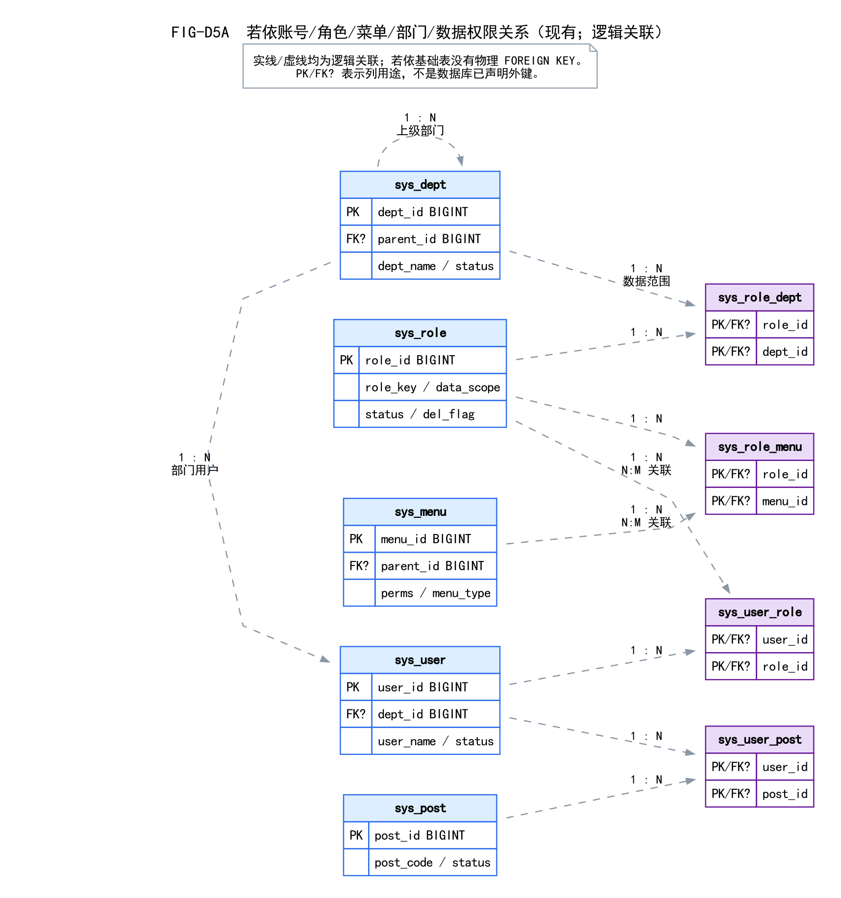
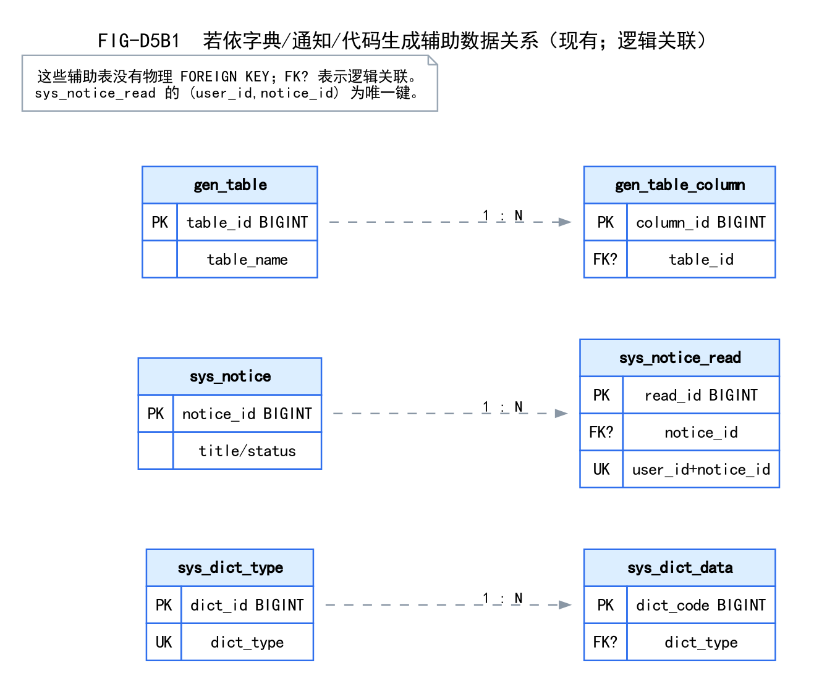
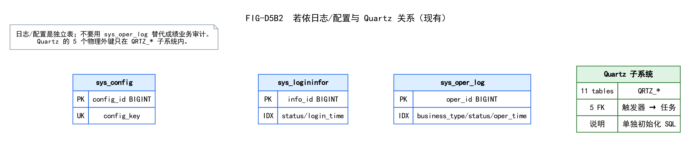

# 03 若依现有数据库表关系分析

> 复核日期：2026-10-29  
> 方式：只读 `SHOW TABLES`、`information_schema.columns`、`information_schema.statistics`、`information_schema.referential_constraints`；未执行任何写操作。  
> 数据库：`student_system`；应用账号 `student_app`；密码不进入文档。

## 1. 实际统计

| 项 | 结果 |
| --- | ---: |
| 表总数 | **31** |
| 若依系统表 | **18** |
| 代码生成表 | **2** |
| Quartz 表 | **11** |
| 学生/班级/考试/成绩业务表 | **0** |
| 基础表物理外键 | **0** |
| Quartz 物理外键 | **5** |

关键行数：

| 表 | 行数 |
| --- | ---: |
| `sys_user` | 2 |
| `sys_role` | 2（仅 admin/common） |
| `sys_menu` | 85 |
| `sys_dept` | 10 |
| `sys_dict_type` / `sys_dict_data` | 10 / 29 |
| `sys_config` | 9 |
| `sys_notice` | 3 |
| `sys_job` | 3 |
| `sys_role_menu` | 85 |
| `sys_role_dept` | 3 |
| `sys_user_role` / `sys_user_post` | 2 / 2 |

> 四类业务角色是实验一设计基线，不是当前 `sys_role` 已建成的四条记录；当前只有 `admin`、`common`。

## 2. 31 张表清单

### 18 张若依系统表

`sys_config`、`sys_dept`、`sys_dict_data`、`sys_dict_type`、`sys_job`、`sys_job_log`、`sys_logininfor`、`sys_menu`、`sys_notice`、`sys_notice_read`、`sys_oper_log`、`sys_post`、`sys_role`、`sys_role_dept`、`sys_role_menu`、`sys_user`、`sys_user_post`、`sys_user_role`。

### 2 张代码生成表

`gen_table`、`gen_table_column`。

### 11 张 Quartz 表

`QRTZ_JOB_DETAILS`、`QRTZ_TRIGGERS`、`QRTZ_SIMPLE_TRIGGERS`、`QRTZ_CRON_TRIGGERS`、`QRTZ_BLOB_TRIGGERS`、`QRTZ_CALENDARS`、`QRTZ_PAUSED_TRIGGER_GRPS`、`QRTZ_FIRED_TRIGGERS`、`QRTZ_SCHEDULER_STATE`、`QRTZ_LOCKS`、`QRTZ_SIMPROP_TRIGGERS`。

## 3. 核心表结构（实际列/索引）

| 表 | 主键 | 关键列 | 唯一键/索引 | 关联 |
| --- | --- | --- | --- | --- |
| `sys_dept` | `dept_id` BIGINT | `parent_id`、`ancestors`、`dept_name`、`status`、`del_flag` | PK | 自关联 parent；`sys_user.dept_id` 逻辑 |
| `sys_user` | `user_id` BIGINT | `dept_id`、`user_name`、`nick_name`、`status`、`del_flag` | PK；**无 user_name 唯一索引** | `dept_id` 逻辑；关联表 |
| `sys_role` | `role_id` BIGINT | `role_key`、`data_scope`、`status`、`del_flag` | PK；角色 key 实际未见唯一索引 | 关联表；`sys_role_dept` |
| `sys_menu` | `menu_id` BIGINT | `parent_id`、`perms`、`menu_type`、`status` | PK | 自关联；`sys_role_menu` |
| `sys_post` | `post_id` BIGINT | `post_code`、`status` | PK | `sys_user_post` |
| `sys_user_role` | (`user_id`,`role_id`) | 两列 | 复合 PK | 用户×角色 |
| `sys_role_menu` | (`role_id`,`menu_id`) | 两列 | 复合 PK | 角色×菜单 |
| `sys_role_dept` | (`role_id`,`dept_id`) | 两列 | 复合 PK | 角色数据范围 |
| `sys_user_post` | (`user_id`,`post_id`) | 两列 | 复合 PK | 用户×岗位 |
| `sys_dict_type` | `dict_id` BIGINT | `dict_type` | PK；`dict_type` 唯一 | 逻辑关联 `sys_dict_data.dict_type` |
| `sys_dict_data` | `dict_code` BIGINT | `dict_type`、`dict_value` | PK | 逻辑关联字典类型 |
| `sys_notice` | `notice_id` BIGINT | `title`、`status` | PK | `sys_notice_read` |
| `sys_notice_read` | `read_id` BIGINT | `user_id`、`notice_id` | PK；唯一 (`user_id`,`notice_id`) | 逻辑关联用户/通知 |
| `sys_oper_log` | `oper_id` BIGINT | `business_type`、`status`、`oper_time` | PK；3 个普通索引 | 系统日志，无业务 FK |
| `sys_logininfor` | `info_id` BIGINT | `status`、`login_time` | PK；2 个普通索引 | 无 FK |
| `sys_config` | `config_id` BIGINT | `config_key`、`config_value` | PK | 无 FK |
| `sys_job` | (`job_id`,`job_name`,`job_group`) | 调度配置 | 复合 PK | Quartz |
| `sys_job_log` | `job_log_id` BIGINT | 任务日志 | PK | 无物理 FK |
| `gen_table` | `table_id` BIGINT | `table_name` | PK | `gen_table_column` |
| `gen_table_column` | `column_id` BIGINT | `table_id` | PK | 逻辑关联生成表 |

> 实际没有给 `sys_user.user_name`、`sys_role.role_key` 建唯一索引；这是若依现状，不改原表。学生业务不能把这些字段当业务唯一键。

## 4. 关系图

### FIG-D5A 账号/角色/菜单/部门/数据权限

- 源文件：`diagrams/source/FIG-D5A-账号角色菜单部门数据权限ER.dot`
- SVG：`diagrams/svg/FIG-D5A-账号角色菜单部门数据权限ER.svg`
- 所有连线均为**逻辑关联**；`sys_user_role`、`sys_role_menu`、`sys_role_dept`、`sys_user_post` 是关联实体。
- 数据范围：`sys_role.data_scope` + `sys_role_dept`；只解决部门/自定义范围，不能表达“本班/本人/已发布”。

### FIG-D5B1 辅助数据

### FIG-D5B2 日志/配置/Quartz

Quartz 的 5 个物理 FK：

- `QRTZ_TRIGGERS` → `QRTZ_JOB_DETAILS`
- `QRTZ_SIMPLE_TRIGGERS` / `QRTZ_CRON_TRIGGERS` / `QRTZ_BLOB_TRIGGERS` / `QRTZ_SIMPROP_TRIGGERS` → `QRTZ_TRIGGERS`

这些外键只在调度子系统；不能推断学生业务表也必须/必须不建物理外键。

## 5. 复用判断

| 能力 | 结论 |
| --- | --- |
| `sys_user` | 复用登录/账号；**不能当学生档案** |
| `sys_role`/`sys_menu`/关联表 | 复用 RBAC/菜单/按钮；业务权限用新 `business:*` |
| `sys_dept` | 可作内部组织辅助；**不能当行政班** |
| `sys_post` | 辅助岗位；不是班主任 |
| 字典 | 可存性别/状态显示等稳定枚举；业务状态代码仍需代码校验 |
| `sys_oper_log` | 系统操作日志；**不能替代成绩业务审计** |
| Quartz | 可做定时任务基础设施；不参与成绩主链 |
| 代码生成 | 可生成 CRUD 骨架；状态机/权限/审计必须人工实现 |

## 6. 结论

- 现有 31 张表已只读验证；
- 学生业务表 0 张；
- 若依基础表没有物理 FK，学生业务内部可以采用混合外键策略（见设计决策记录）；
- 不修改 `sys_*` 表结构、主键类型或数据。
