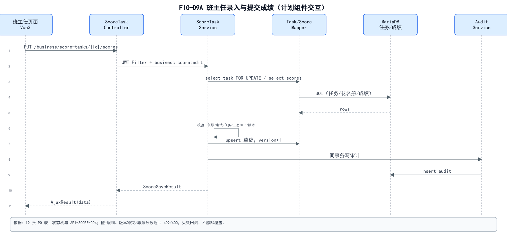
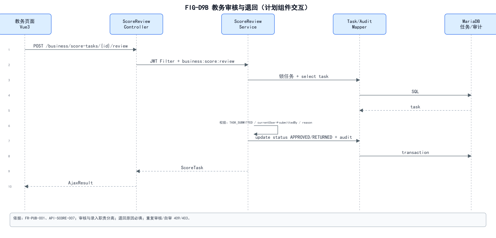
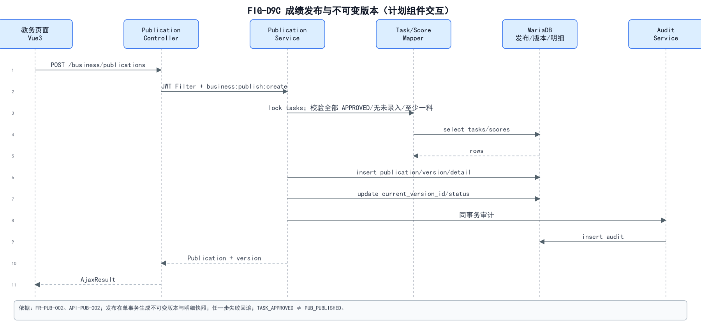
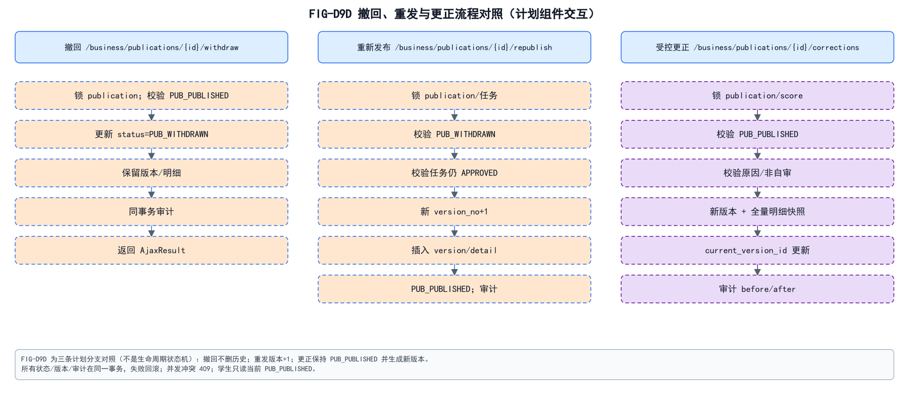
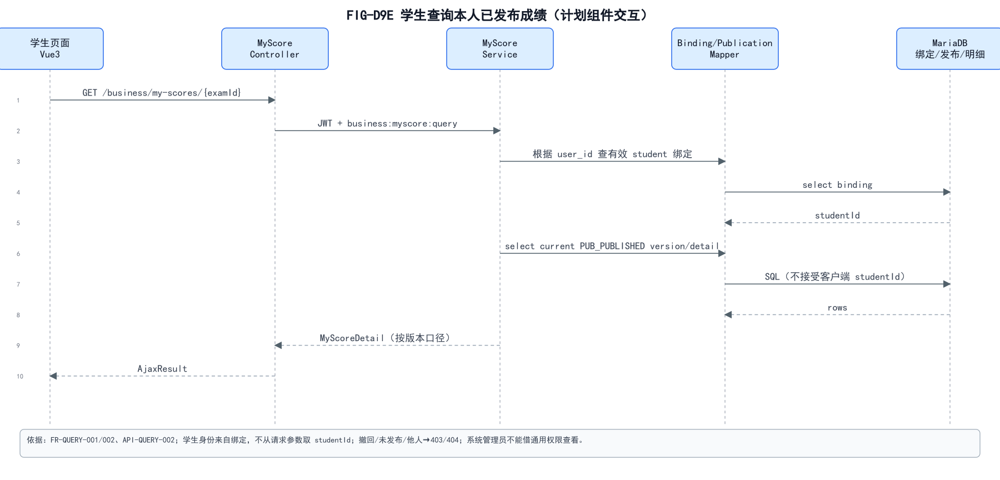

# 04 前后端模块交互与技术时序分析

> 所有 D9 图均为**计划组件交互**；当前没有业务 Controller/Service/Mapper，也没有实际 Vue 业务页面。  
> 依据：`request.js`、`/dev-api` 代理、`/business/**` 规划路径、19 张 P0 表、状态机。

## 1. 实际前端请求链

```text
Vue 页面（src/views/business/**，规划）
  -> src/api/business/*.js（规划）
  -> src/utils/request.js（现有 Axios 封装）
  -> baseURL = VITE_APP_BASE_API（开发为 /dev-api）
  -> Vite dev proxy 去掉 /dev-api
  -> Spring Boot 实际路径 /business/**
  -> JWT Filter -> Controller -> Service -> Mapper -> MariaDB
```

- `/dev-api` 只在开发代理层；**不是** Controller 路由；
- 生产构建后由静态服务器/反向代理提供，API 前缀以实际部署为准；
- Token 存 Cookie `Admin-Token`，请求头 `Authorization: Bearer`；
- 现有 `request.js` 统一处理 401/500/601；业务 `data.errorCode` 需在业务页面/公共错误映射中处理；
- 前端菜单/按钮用 `v-hasPermi`/动态菜单，后端仍二次校验。

## 2. 前端计划模块

| 前端文件（规划） | 用途 | 主要 API |
| --- | --- | --- |
| `src/api/business/identity.js` | 身份/绑定 | API-AUTH-001 |
| `src/api/business/binding.js` | 账号绑定 | API-AUTH-002/003 |
| `src/api/business/org.js` | 学年/学期/年级/班级/任职 | API-ORG-001～016 |
| `src/api/business/student.js` | 学生/归属/绑定 | API-STU-001～010 |
| `src/api/business/teacher.js` | 班主任/任职 | API-TCH-001～005 |
| `src/api/business/subject.js` | 科目 | API-SUB-001～003 |
| `src/api/business/exam.js` | 考试/任务生成 | API-EXAM-001～010 |
| `src/api/business/score.js` | 任务/录入/提交/审核 | API-SCORE-001～007 |
| `src/api/business/publication.js` | 发布/撤回/更正/版本 | API-PUB-001～008 |
| `src/api/business/query.js` | 学生本人成绩 | API-QUERY-001/002 |
| `src/api/business/stat.js` | 班级/全校统计 | API-STAT-001/002 |
| `src/api/business/audit.js` | 业务审计 | API-AUDIT-001/002 |
| `src/views/business/**` | 业务页面 | 菜单 `sys_menu` 动态下发 |

## 3. D9A 班主任录入/提交



- 页面 `PUT /business/score-tasks/{id}/scores`；
- Controller `JWT + @PreAuthorize('business:score:edit')`；
- Service 锁任务/成绩，校验当前任职班级、`EXAM_OPEN`、`TASK_DRAFT/RETURNED`、花名册、三态/0.5/满分、version；
- Mapper 批量 upsert 草稿；Audit 同事务；
- 成功 `ScoreSaveResult`；409/400 不静默覆盖。

## 4. D9B 教务审核/退回



- `POST /business/score-tasks/{id}/review`；
- 锁任务，校验 `TASK_SUBMITTED`、`reviewer != submittedBy`、退回原因；
- 通过 `TASK_APPROVED`，退回 `TASK_RETURNED`；
- 更新任务 + 审计同事务；重复审核/自审 409/403。

## 5. D9C 发布/不可变版本



- `POST /business/publications`；
- 锁相关任务，校验全部 `TASK_APPROVED`、无 `SCORE_NOT_ENTERED`、至少一科；
- 插入 `stu_publication`、`stu_publication_version`、`stu_publication_version_detail`；
- 当前发布状态/current_version 更新；审计同事务；
- `TASK_APPROVED` 不等于 `PUB_PUBLISHED`。

## 6. D9D 撤回/重发/更正



三条计划分支：

- **撤回**：锁 publication，`PUB_PUBLISHED → PUB_WITHDRAWN`，历史版本/明细保留，学生不可见；
- **重新发布**：`PUB_WITHDRAWN` → 校验任务仍 APPROVED → 新版本 `version_no+1`；
- **受控更正**：保持 `PUB_PUBLISHED`，新版本 + 全量明细快照 + 审计前后值；旧版本不覆盖。

## 7. D9E 学生本人查询



- `GET /business/my-scores/{examId}`；
- Service 用当前 `user_id` 查有效 `stu_account_binding`，**不接受客户端 studentId 作为授权依据**；
- 只查当前 `PUB_PUBLISHED` 版本/明细；
- 撤回/未发布/他人 → 403/404；
- 系统管理员不能借 `ALL_PERMISSION` 读取成绩明细。

## 8. 现有 D7/D8 时序的边界

- `FIG-D7` 登录/权限获取、`FIG-D8` 用户管理调用链是**现有真实源码**；
- D9A-E 是**计划业务**，不能把类名/URL 说成已实现；
- 两者共用 `AjaxResult`/`TableDataInfo`/JWT/`@PreAuthorize`。

## 9. 时序一致性检查

| 项 | 结果 |
| --- | --- |
| Controller 薄、Service 事务 | 通过设计 |
| Mapper/DB 不画成独立进程 | 通过 |
| 提交/审核/发布分离 | 通过 |
| 乐观锁/状态检查 | 通过设计 |
| 审计同事务 | 通过设计 |
| 学生身份来自绑定 | 通过设计 |
| 管理员阻断 | 通过设计（未实现） |
| 图与状态码 | 使用 SRS 原代码 |
