# 学生管理系统概要设计说明书

**版本：V1.0-draft**  
**阶段：软件工程实验二 · 概要设计**  
**日期：2026-10-29**  
**状态：课程设计初稿，待小组/教师评审；不是已部署系统说明**

---

## 1. 导言

### 1.1 编写目的

本文描述高中学生信息与成绩管理系统的概要设计，说明系统边界、总体架构、界面组织、数据模型、模块职责和主要接口，为后续详细设计、编码和测试提供依据。预期读者为课程教师、评审人员和小组成员。

### 1.2 项目背景

实验一已完成需求规格说明书 v1.1-review，形成四类业务角色、35 项 P0、11 项 P1、17 个业务数据对象及 `ENT-08` 班主任任职关联实体。实验二以真实 RuoYi-Vue 源码为底座，完成源码分析、架构设计、数据库概要设计和 API 契约设计。

### 1.3 系统目标

在若依已有的登录、RBAC、菜单、部门、字典、日志、代码生成能力之上，建立学生管理业务域：组织学年、学生档案、班主任任职、考试配置、成绩任务、录入、审核、发布、学生本人查询、统计与业务审计。系统保持前后端分离，成绩以数据库为真值，发布版本不可变，关键操作可审计。

### 1.4 设计范围

| 范围 | 内容 |
| --- | --- |
| 现有若依 | 3.9.2、Spring Boot 3.5.16、6 个 Maven 模块、31 张现有表 |
| 计划学生业务 | 19 张 P0 表、3 张 P1 表、68 个 P0 API、11 个 P1 API |
| 角色 | 系统管理员、教务管理员、班主任、学生 |
| 不在本版 | 任课教师/任教关系、真实业务代码、实际建表、最终 DOCX/PDF |

### 1.5 术语

| 术语 | 含义 |
| --- | --- |
| RuoYi / 若依 | 本项目的 Spring Boot 3 + Vue3 基础框架 |
| RBAC | 基于角色的访问控制 |
| JWT | 登录令牌 |
| FR/BR/DR/AC | 功能需求/业务规则/数据对象/验收条件 |
| TASK_* / EXAM_* / PUB_* | 成绩任务/考试/发布三套独立状态 |
| P0/P1 | 本期必须范围/扩展规划 |

### 1.6 参考资料

- 《学生管理系统需求规格说明书》v1.1-review（实验一）；
- 课程 `实验二.ppt` 与《网上招聘系统概要设计》参考实例；
- 当前 RuoYi 3.9.2 源码、`pom.xml`、Vue3 源码；
- 本目录 `01-*`～`04-*` 分析、数据库、API 设计文档；
- `openapi/p0-business-api.yaml`、`openapi/p1-extension-api.yaml`。

### 1.7 版本与评审状态

| 版本 | 日期 | 说明 |
| --- | --- | --- |
| V1.0-draft | 2026-10-29 | 由前四阶段成果整合；待评审 |

**评审状态：未批准。** 所有学生业务模块、表、API 均为计划；数据库 DDL 未执行，接口未实现。

---

## 2. 系统分析

### 2.1 系统定位

系统面向高中教务场景，支持学年/学期/年级/班级、学生档案、班主任任职、考试与科目配置、成绩录入、教务审核发布、学生本人查询、统计和业务审计。系统不是通用教务平台，也不包含任课教师/任教关系。

### 2.2 四类角色

| 角色 | 主要职责 | 数据范围 |
| --- | --- | --- |
| 系统管理员 | 账号、绑定、系统参数、脱敏审计 | 系统范围；**无成绩明细** |
| 教务管理员 | 组织、考试、审核、发布、撤回、更正、全校统计 | `SCOPE_ALL` |
| 班主任 | 当前有效任职班级的全科成绩录入/提交/本班统计 | `SCOPE_CLASS` |
| 学生 | 本人已发布成绩查询、P1 复核申请 | `SCOPE_SELF` |

### 2.3 需求基线

- P0：35 项；P1：11 项；DR：17 个 + `ENT-08`；
- 成绩 0.5 分步长、一位小数；
- 未录入/缺考/真实零分三态分离；
- 班主任提交、教务审核、教务发布三权分离；
- 发布版本不可变，撤回保留历史，更正生成新版本。

本版不重复实验一全部需求分析，只保留设计所需约束。

### 2.4 主要业务流程

```text
教务维护组织/学生/班主任/科目
  -> 教务创建考试、范围、科目/满分/线
  -> 生成考试×班级×科目成绩任务（第一责任人快照）
  -> 班主任录入本班全科、校验、提交
  -> 教务审核通过/退回
  -> 教务按考试×班级发布，生成不可变版本
  -> 学生查看本人当前已发布成绩
  -> 撤回/重发/受控更正，保留版本和审计
```

### 2.5 若依复用与新增边界

| 类别 | 内容 | 状态 |
| --- | --- | --- |
| A 现有 | 登录/验证码/JWT、用户/角色/菜单/部门/岗位、字典/参数、日志、监控、代码生成、Springdoc | 有源码证据 |
| B 适配 | 业务角色映射、账号—档案绑定、数据范围、业务审计、菜单/按钮权限 | 需扩展 |
| C 新建 | 组织、学生、班主任、考试、成绩、发布、查询、统计、业务审计 | 计划，未实现 |
| P1 | 复核、导入导出、趋势、对比 | 独立规划 |

**不把 `sys_user` 当学生档案，不把 `sys_dept` 当行政班，不恢复任课教师。**

---

## 3. 界面设计

实验一原型为需求阶段静态原型，不代表 Vue3 业务页面已实现。正文选取 8 张代表界面；其余见 `../requirements/prototype/screenshots/` 索引。

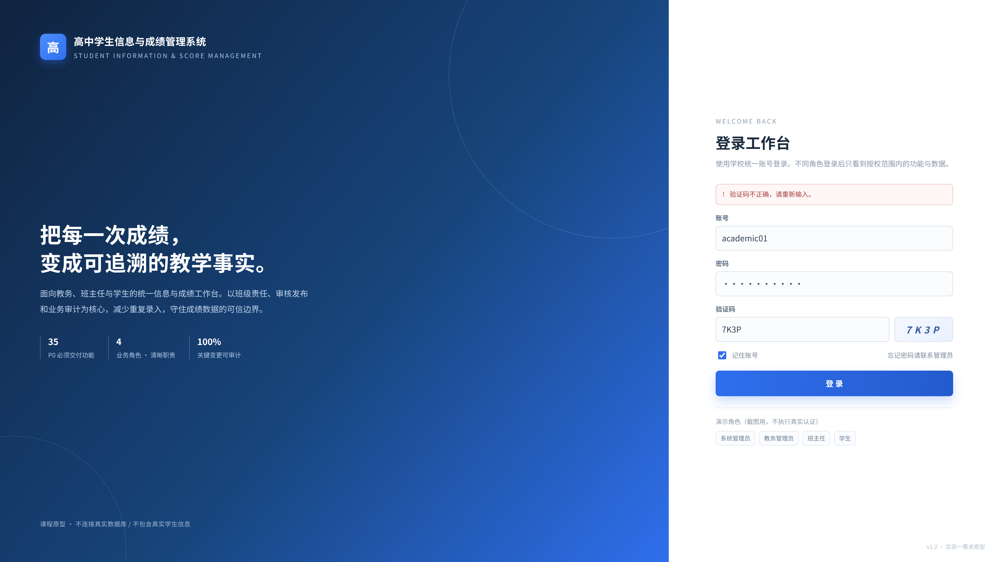

**图 3-1** 登录页：沿用若依登录/验证码；Token 由 Axios 携带，后端二次认证。

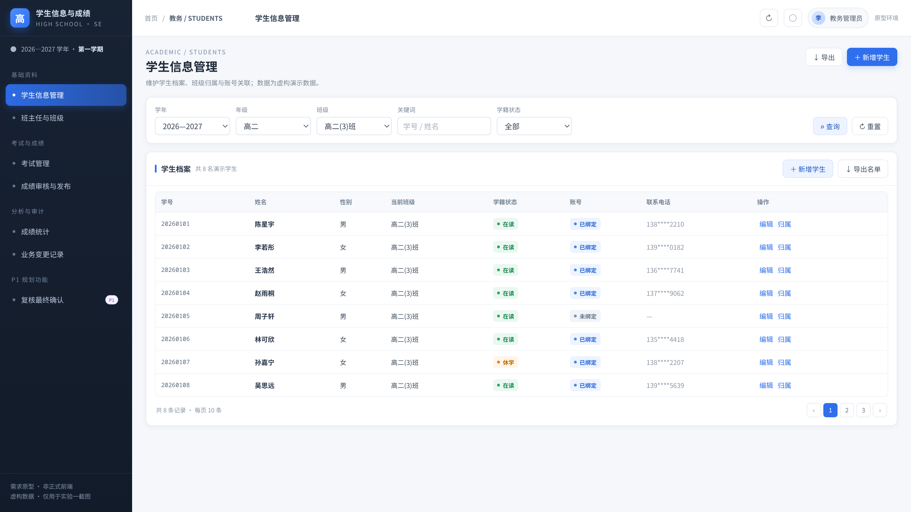

**图 3-2** 学生信息管理：学生档案、班级归属、状态；账号绑定独立操作。

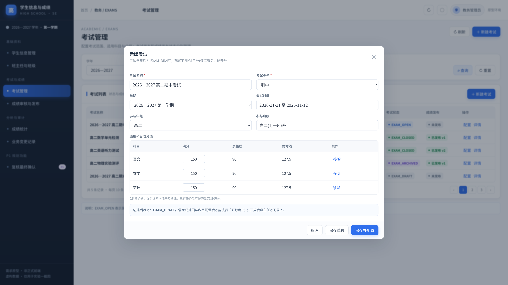

**图 3-3** 考试配置：考试、参与班级、适用科目、满分/及格线/优秀线。

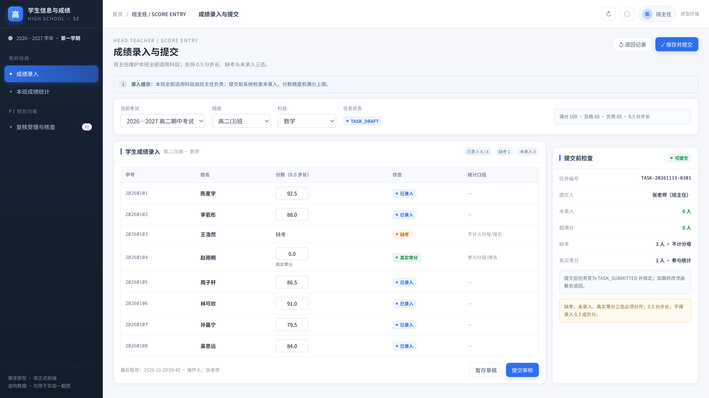

**图 3-4** 班主任成绩录入：本班全科、0.5 分、三态、提交前校验。

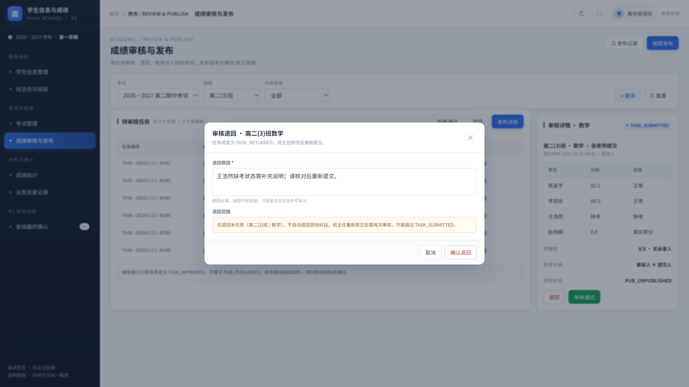

**图 3-5** 教务审核：通过/退回，退回原因必填；审核人不能是提交人。

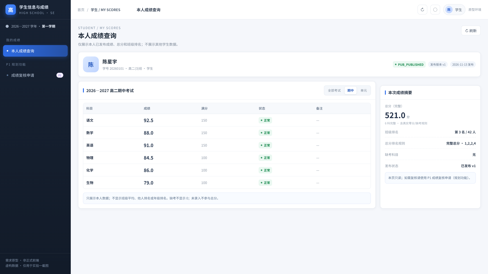

**图 3-6** 学生查询：只显示本人当前已发布成绩；撤回后不可见。

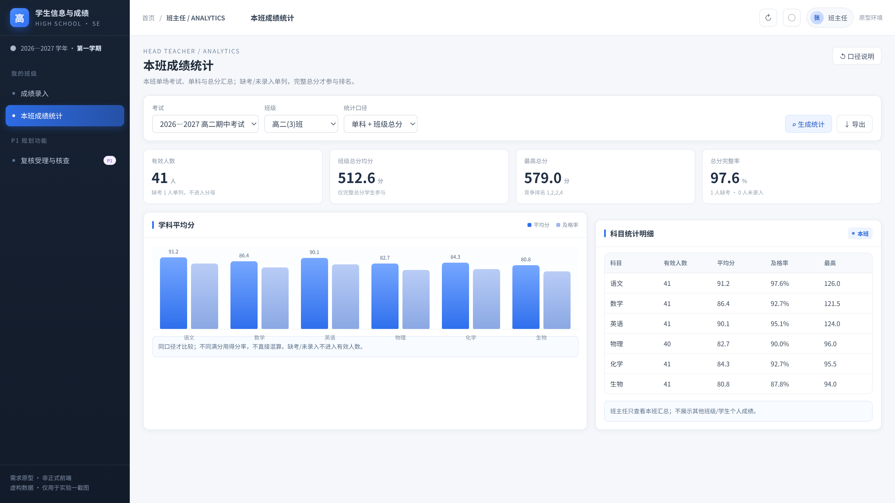

**图 3-7** 班主任本班统计：缺考/未录入不伪造 0；完整总分才排名。

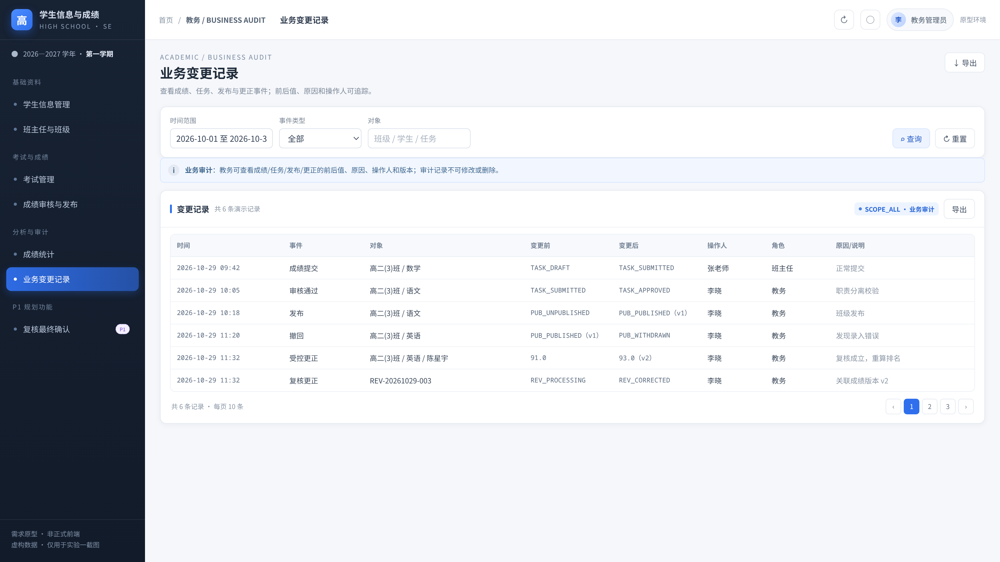

**图 3-8** 业务审计：按对象/版本查看变更；系统管理员仅脱敏元数据。

> 以上为实验一需求原型，不是已实现 Vue3 页面；正式业务页面需在后续阶段开发。

---

## 4. 体系结构设计

### 4.1 总体架构


**图 4-1** 采用 Vue3 SPA + Spring Boot 前后端分离。浏览器经本地 HTTP/可选 HTTPS 访问；JWT 进入 Security；现有若依 Controller/Service/Mapper 与学生业务（规划）分层；MariaDB 保存业务真值，Valkey 保存验证码/LoginUser/缓存；Springdoc 为文档旁路。

### 4.2 Maven 模块

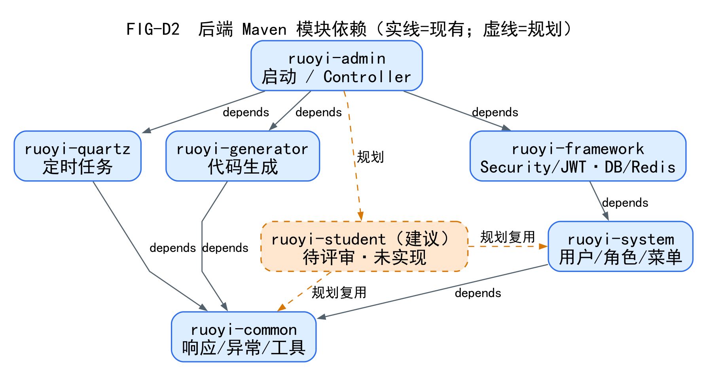

**图 4-2** 现有 6 个模块：`ruoyi-admin`、`ruoyi-framework`、`ruoyi-system`、`ruoyi-common`、`ruoyi-quartz`、`ruoyi-generator`。`ruoyi-student` 为建议新增，虚线，**未创建、未改 POM**。

### 4.3 分层与调用

```text
Vue3 页面 -> src/api -> Axios(/dev-api 开发代理)
  -> Spring Security/JWT -> Controller
  -> Service（事务/状态/范围） -> Mapper/XML -> MariaDB
  -> AjaxResult / TableDataInfo
```

- Controller 薄；Service 负责事务、状态机、权限范围、审计；
- Mapper 不承载业务状态；
- 前端菜单/按钮不是安全边界；
- `/dev-api` 只是 Vite 代理，不是后端路由。

### 4.4 开发与部署拓扑

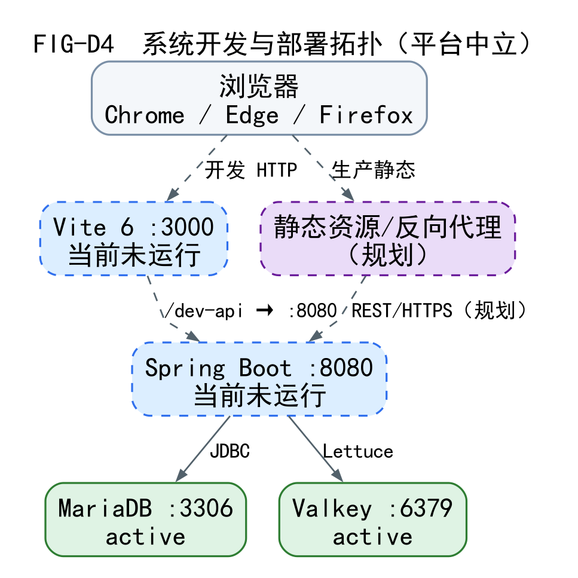

**图 4-3** 浏览器、Vite :3000、Spring Boot :8080、MariaDB :3306、Valkey :6379 的组件关系；前后端当前未运行，数据库/缓存为现状服务。生产静态资源/反向代理为规划，不绑定特定操作系统。

### 4.5 学生业务目标模块

学生业务建议放 `ruoyi-student`（domain/service/mapper/resources），Controller 放 `ruoyi-admin` 的 `business` 包；集中复用若依登录、RBAC、菜单、统一响应、日志。该模块未创建，属待评审方案。

---

## 5. 数据模型设计

### 5.1 现有若依数据库

只读核实 `student_system`：**31 张表** = 18 张若依系统表 + 2 张代码生成表 + 11 张 Quartz 表。基础表无物理外键；Quartz 有 5 个物理外键；当前学生业务表 0 张。

### 5.2 计划 P0/P1 表

- P0：**19 张**（16 P0 DR + `ENT-08`，发布拆 3 表，账号绑定表）；
- P1：**3 张**（复核申请/动作、导入批次）；
- 所有 P0 业务主表 `id INT AUTO_INCREMENT`；
- `sys_user.user_id` 保持 **BIGINT**，绑定 `user_id` BIGINT；
- 成绩/线 `DECIMAL(6,1)`，0.5 步长。

| 组 | 表 |
| --- | --- |
| 组织 | `stu_year`、`stu_term`、`stu_grade`、`stu_class` |
| 学生 | `stu_student`、`stu_student_class`、`stu_account_binding` |
| 班主任 | `stu_head_teacher`、`stu_head_teacher_assignment` |
| 科目/考试 | `stu_subject`、`stu_exam`、`stu_exam_class`、`stu_exam_subject` |
| 成绩 | `stu_score_task`、`stu_score` |
| 发布 | `stu_publication`、`stu_publication_version`、`stu_publication_version_detail` |
| 审计 | `stu_audit_log` |

### 5.3 核心关系示意

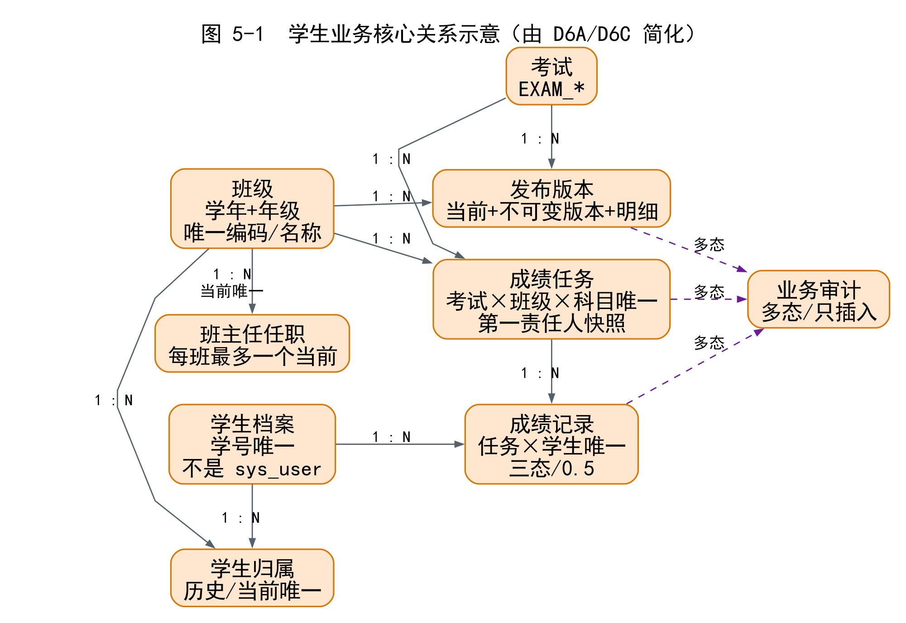

**图 5-1** 为正文可读的核心关系示意（由 D6A/D6C 简化）：班级—学生归属—任务—成绩；考试—任务—发布版本；审计为多态引用。完整逻辑/物理 ER 见 `FIG-D6A～D6D`、`FIG-D6P*`，字段见 `03-完整数据库字段字典.md`。

### 5.4 账号绑定

`sys_user` → `stu_account_binding` → 学生/班主任档案。一个档案最多一个有效账号；一个账号最多一个有效绑定；类型/档案二选一；系统管理员不因超级权限获得成绩明细。

### 5.5 成绩三态与发布版本

| 状态 | 值 |
| --- | --- |
| `SCORE_NORMAL` | 0.0～满分，0.5 步长 |
| `SCORE_ABSENT` | NULL，显示缺考 |
| `SCORE_NOT_ENTERED` | NULL，阻止提交 |

`stu_publication` 当前状态；`stu_publication_version` 不可变版本头；`stu_publication_version_detail` 不可变明细。撤回只改当前状态，历史保留；更正新增版本。

### 5.6 约束与审计

- 任务唯一（考试×班级×科目）；成绩唯一（任务×学生）；发布唯一（考试×班级）；版本唯一（发布×版本号）；
- 当前归属/任职/绑定用生成列+UNIQUE；时间区间不重叠需事务+行锁+Service；
- 业务审计与业务同事务、只插入；不依赖 `sys_oper_log`；
- SQL 草稿在 `03-.../sql-draft/`，**未执行**。

> 本版不声称 19 张表已创建；数据库现状仍是 31 张若依/Quartz 表。

---

## 6. 模块与接口设计

### 6.1 模块职责

| 模块 | 职责 | FR | 主要表 | 计划 Controller/Service |
| --- | --- | --- | --- | --- |
| 认证/绑定 | 身份、绑定、范围 | AUTH-003/004 | binding | `BusinessIdentityController/Service` |
| 组织 | 学年/学期/年级/班级/任职 | ORG-001～005 | year/term/grade/class/assignment | `Org*Controller/Service` |
| 学生 | 档案/归属/状态/绑定 | STU-001～004 | student/student_class/binding | `StudentController/Service` |
| 班主任/科目 | 班主任/任职/科目 | TCH-001/002 | teacher/assignment/subject | `HeadTeacher/Subject*` |
| 考试 | 考试/范围/科目/任务 | EXAM-001～004、SCORE-001 | exam* | `ExamController/Service` |
| 成绩 | 任务/录入/提交/审核 | SCORE-001～005、PUB-001 | task/score/audit | `ScoreTask/Review*` |
| 发布 | 发布/撤回/重发/更正/版本 | PUB-001～004 | publication/version/detail/audit | `PublicationController/Service` |
| 查询/统计 | 本人/班级/全校 | QUERY/STAT | version/detail | `MyScore/Stat*` |
| 审计 | 业务审计/脱敏 | AUDIT-001/002 | audit_log | `AuditController/Service` |

### 6.2 接口概览

- 现有若依：**25 Controller / 146 Mapping**（源码级，运行未验证）；
- 新业务：**68 P0 API / 53 路径**；**11 P1 API**；
- 统一 `/business/**`；认证复用 `/login`、`/getInfo`、`/getRouters`；
- 成功 `AjaxResult`/`TableDataInfo`；错误 `data.errorCode`；
- OpenAPI：`openapi/p0-business-api.yaml`、`openapi/p1-extension-api.yaml`；
- 68 个 API 完整规约见 `04-P0业务API完整规约.md`，正文只列关键接口。

### 6.3 关键接口

| API | 方法/路径 | 角色 | 关键约束 |
| --- | --- | --- | --- |
| API-SCORE-004 | `PUT /business/score-tasks/{id}/scores` | 班主任 | 本班、三态/0.5/版本、事务+审计 |
| API-SCORE-005 | `POST /business/score-tasks/{id}/submit` | 班主任 | 无未录入、锁定、幂等 |
| API-SCORE-007 | `POST /business/score-tasks/{id}/review` | 教务 | 非自审、APPROVED/RETURNED |
| API-PUB-002 | `POST /business/publications` | 教务 | 全部 APPROVED、不可变版本 |
| API-PUB-004 | `POST /business/publications/{id}/withdraw` | 教务 | 撤回不删历史 |
| API-PUB-006 | `POST /business/publications/{id}/corrections` | 教务 | 新版本、审计前后值 |
| API-QUERY-002 | `GET /business/my-scores/{examId}` | 学生 | 绑定本人、当前 PUB_PUBLISHED |

### 6.4 计划时序


**图 6-1** 班主任页面 → Controller → Service → Mapper/DB → Audit；本班、状态、三态/0.5/版本校验，成绩与审计同事务。


**图 6-2** 教务审核；非自审；通过/退回分支；原因和审计保留。


**图 6-3** 发布前校验、版本/明细快照、current_version、审计单事务；TASK_APPROVED ≠ PUB_PUBLISHED。


**图 6-4** 三条计划分支（流程对照，不是状态机）：撤回保留历史；重发版本+1；更正生成新版本。


**图 6-5** 学生身份从绑定解析，不接受客户端 studentId；只读当前 PUB_PUBLISHED 版本。

> D9A-E 为计划组件交互，不是已实现代码截图；完整 API 契约见 OpenAPI。

### 6.5 权限与事务摘要

- 系统管理员成绩明细**禁止**；教务 ALL；班主任本班；学生本人；
- 前端菜单/按钮不是边界；`@PreAuthorize` + Service 范围；
- 任务/考试/发布状态独立；发布/撤回/更正单事务；
- 版本不可变，审计同事务；P1 不进入 P0。

---

## 7. 设计追踪与待确认

### 7.1 覆盖

- 35 P0：均有模块/API/表/AC 落点；
- 11 P1：独立映射，不进入 P0；
- 19 P0 表 / 3 P1 表；68/11 API；
- 四类角色一致；无任课教师；
- 详见 `SDD模块与接口覆盖检查报告.md`、`04-API与需求数据库追踪矩阵.md`。

### 7.2 BR 137/122

SRS 附录 E 的 **137** 是基线规则表行数；正文唯一引用 **122**；差异 15 条未逐条引用，14 个编号缺口可识别，另 1 条因基线删除无法复原。**不重编号、不伪造**。

### 7.3 待确认

- `/business` 前缀与 68 P0 API；
- `current_version_id` 逻辑/物理；
- 多班班主任统计 A/B；
- 账号绑定归属；
- 四类角色与 `sys_role` 映射；
- P1 是否本期；
- 测试库 DDL 演练；
- 管理员的脱敏审计边界。

### 7.4 明确未做

未创建业务代码/表、未执行 DDL、未运行接口测试、未生成 DOCX/PDF；现有 31 张表未改。
