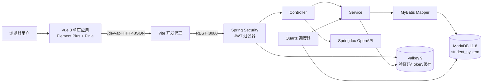
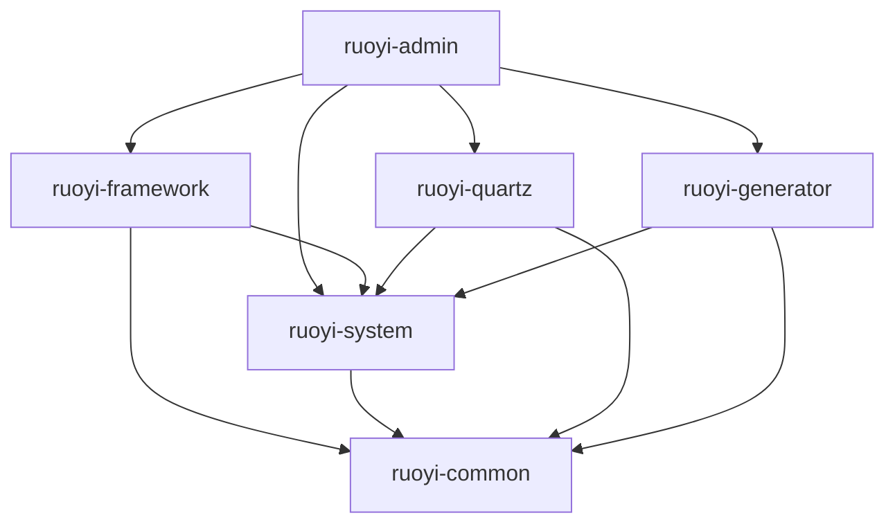
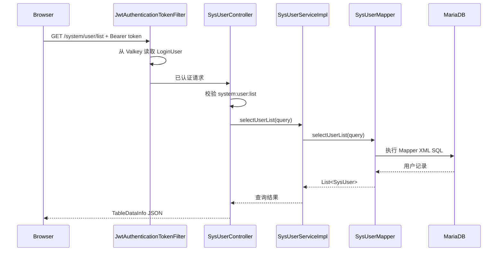
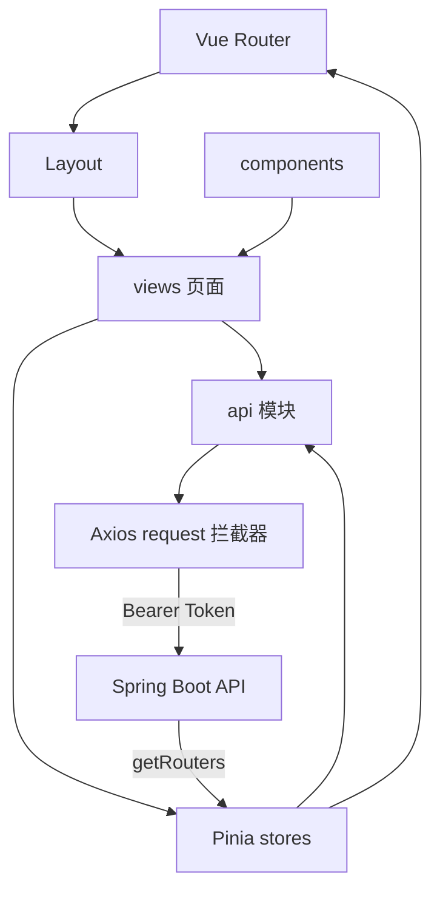
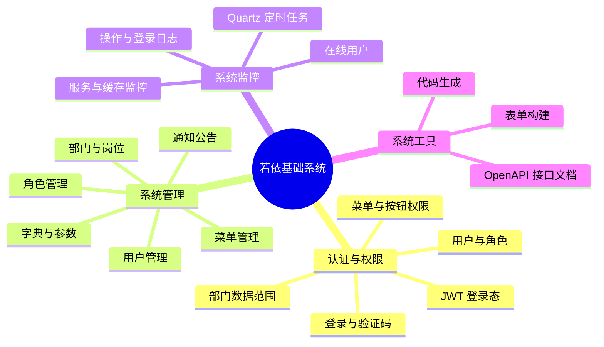
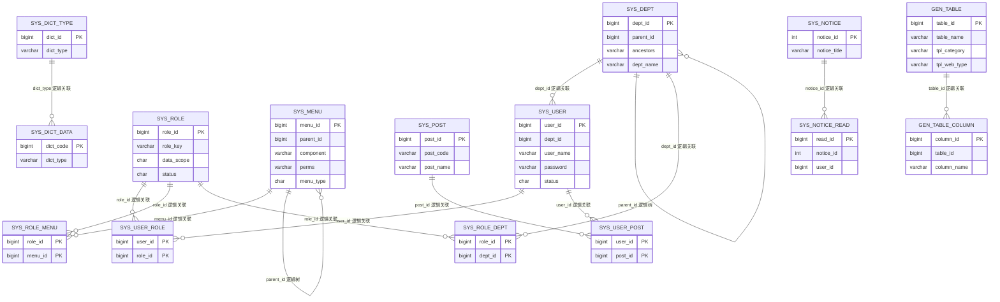
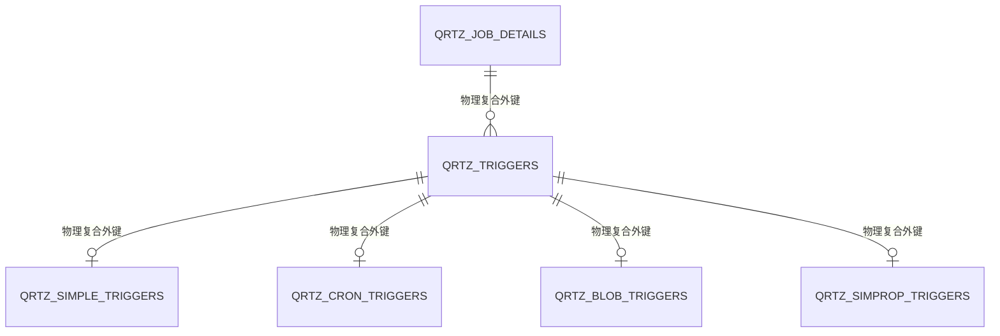
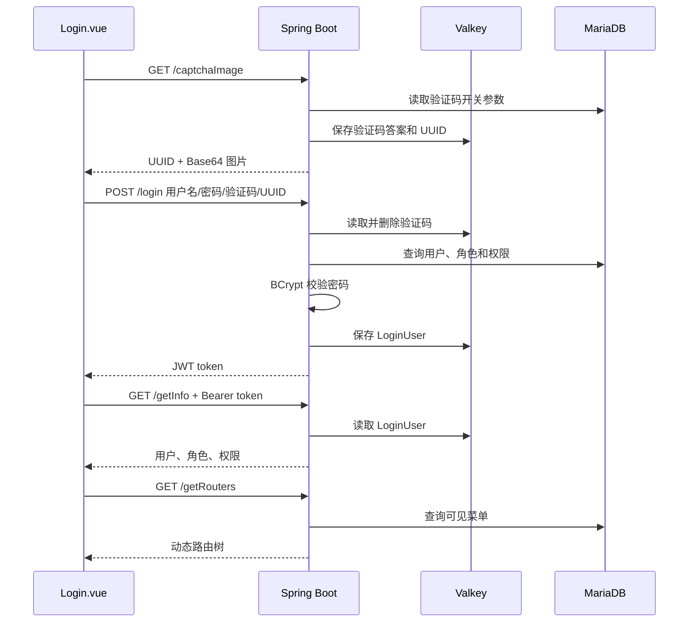
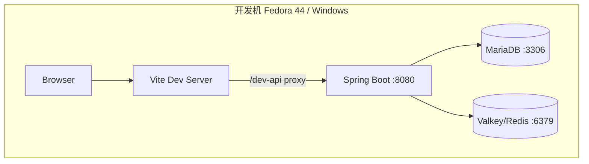

# 学生管理系统架构分析附录（若依基础框架阶段）

版本：0.1 技术初稿  
日期：2026-10-23  
适用范围：RuoYi-Vue Spring Boot 3 + RuoYi-Vue3 基础系统

> 本附录依据当前仓库源码、SQL 和实验二材料编写。主说明书已经按《概要设计实例》的六章结构重排；本文件保留更细的技术分析。学生、教师、课程、班级和成绩模块尚未设计评审，也未实现；本文不把它们写成现有功能。

## 1. 引言

### 1.1 编写目的

本说明书记录学生管理系统开发底座的总体结构、基础功能、数据关系、接口约定和部署方式。它一方面用于完成实验二对若依架构阅读、模块框图、数据库关系图和接口说明的要求，另一方面为后续小组评审学生业务模型提供可追溯的技术基线。

### 1.2 设计范围

当前范围是若依自带的用户、角色、菜单、部门、岗位、字典、参数、通知、日志、在线用户、定时任务、缓存监控、表单构建、代码生成和系统接口功能。后续业务模块只有在需求分析与数据库设计确认后才进入本说明书。

### 1.3 依据与源码基线

- 后端：RuoYi-Vue `springboot3` 分支，RuoYi 3.9.2，提交 `a51a838b71b446ea27256900efe7ed2faa2a02fd`；
- 前端：RuoYi-Vue3 3.9.2，提交 `838965c5a18d2c61b73ec30c6e288057aaa08b63`；
- 基础 SQL：`sql/ry_20260417.sql`；
- Quartz SQL：`sql/quartz.sql`；
- 课程材料：四份原文件与要求提取结果保存在 `docs/reference/`。

### 1.4 术语

RBAC 指基于角色的访问控制。用户通过角色获得菜单和按钮权限，角色还可关联部门以限定数据范围。JWT 指 JSON Web Token，本系统把登录态标识放在 HTTP `Authorization` 请求头中，并把服务端登录用户状态保存在 Valkey。OpenAPI 是接口描述规范，当前实现由 Springdoc 生成文档。

## 2. 系统目标与设计原则

本阶段的目标是让前后端分离底座能够在 Fedora 44 上复现，并保留 Windows + MySQL + Redis 的迁移路径。设计遵循以下约束：复用若依的认证和权限体系；敏感配置只由本地环境提供；数据库变更有脚本；前后端接口以源码和 OpenAPI 为准；业务模块未经评审不提前生成；核心版本不做无依据升级。

## 3. 技术选型

| 层次 | 选择 | 选择依据 |
| --- | --- | --- |
| 后端框架 | Spring Boot 3.5.16 | 满足 Jakarta API 和 Java 17 基线，源码已完成若依适配 |
| 安全 | Spring Security + JWT | 与若依登录、按钮权限、角色和数据权限实现一致 |
| 持久层 | MyBatis + PageHelper + Druid | 与现有 Mapper XML、分页和多数据源结构一致 |
| 数据库 | MariaDB 11.8 | 复用现有服务，通过 MySQL 协议连接 |
| 缓存 | Valkey 9 | 复用现有 Redis 协议服务，Lettuce 客户端无需改业务代码 |
| 前端 | Vue 3 + Vite + Element Plus + Pinia | 官方 RuoYi-Vue3 当前源码组合 |
| 接口文档 | Springdoc OpenAPI 3 | 后端已经集成，不引入旧 Swagger 2 依赖 |
| 代码生成 | Apache Velocity 模板 | 若依原生生成器，能够选择 Vue 3 JavaScript 模板 |

老师旧教程中若出现 Spring Boot 2、`javax.*`、Vue 2、Element UI 或 Swagger 2，本项目的等价实现分别是 Spring Boot 3 / `jakarta.*`、Vue 3、Element Plus 和 Springdoc OpenAPI 3。实验目标没有要求依赖这些旧版本，因此不为复现旧截图而降级整个工程。

## 4. 总体架构

系统采用浏览器单页应用与 REST 后端分离的结构。Vite 开发服务器把 `/dev-api` 请求代理到 8080 端口；Spring Security 在 Controller 前校验 JWT；Controller 调用 Service，Service 通过 MyBatis Mapper 操作 MariaDB，并按功能读写 Valkey。

生产部署可把 `frontend/dist` 交给 Web 服务器，并把 API 反向代理到 Spring Boot。当前实验阶段沿用两个开发进程，便于观察前后端交互。

## 5. 后端模块设计

### 5.1 Maven 模块职责

| 模块 | 主要职责 | 关键路径 |
| --- | --- | --- |
| `ruoyi-admin` | 应用入口、Web Controller、Springdoc 和运行配置 | `com.ruoyi.RuoYiApplication`、`com.ruoyi.web.controller` |
| `ruoyi-framework` | Security、JWT、Druid、Redis、MyBatis、异常和切面 | `com.ruoyi.framework.config`、`security`、`web.service` |
| `ruoyi-system` | 用户、角色、菜单、部门、岗位、字典、参数等领域服务 | `domain`、`mapper`、`service` |
| `ruoyi-quartz` | 调度任务、执行日志和 Quartz 配置 | `com.ruoyi.quartz` |
| `ruoyi-generator` | 读取元数据、维护生成配置、Velocity 渲染与 ZIP 下载 | `com.ruoyi.generator`、`resources/vm` |
| `ruoyi-common` | 通用注解、响应对象、工具、常量和 Redis 封装 | `com.ruoyi.common` |

### 5.2 典型调用关系

系统用户查询从 `SysUserController` 开始。Controller 根据 `@PreAuthorize` 检查权限，再调用 `ISysUserService`；实现类组织部门、角色或岗位关联逻辑，最终由 `SysUserMapper` 与对应 Mapper XML访问数据库。分页由 `BaseController.startPage()` 和 PageHelper 完成，列表结果包装为 `TableDataInfo`。

## 6. 前端结构设计

`frontend/src/router/index.js` 定义登录、注册、首页和错误页等固定路由。登录后，Pinia 的 `user` store 调用 `/getInfo` 获取角色与权限，`permission` store 调用 `/getRouters` 获取数据库菜单，并通过 `import.meta.glob('./../../views/**/*.vue')` 把组件路径映射为懒加载页面。

| 前端区域 | 职责 | 路径 |
| --- | --- | --- |
| 页面 | 登录、系统管理、监控和工具页面 | `frontend/src/views` |
| API | 按后端模块封装 Axios 请求 | `frontend/src/api` |
| 状态 | 用户、权限、标签页、设置和字典 | `frontend/src/store/modules` |
| 路由 | 固定路由、动态路由和组件装载 | `frontend/src/router/index.js` |
| 请求 | Token 注入、错误处理、重复提交保护 | `frontend/src/utils/request.js` |
| 组件 | 分页、编辑器、上传、字典标签等复用组件 | `frontend/src/components` |

## 7. 功能模块划分

认证模块由验证码、登录校验、JWT 生成与刷新组成。验证码答案和登录用户对象写入 Valkey；浏览器只保存 Token。权限模块在后端通过 `@PreAuthorize` 做最终判断，前端指令和动态路由只负责界面可见性，不能替代后端校验。

## 8. 数据库概要设计

### 8.1 表分类

当前 SQL 共创建 31 张表：若依基础与生成器 20 张，Quartz 11 张。系统管理的核心表包括 `sys_user`、`sys_role`、`sys_menu`、`sys_dept` 和 `sys_post`；多对多关系由 `sys_user_role`、`sys_role_menu`、`sys_role_dept` 和 `sys_user_post` 维护。基础 SQL 不声明物理外键，这些连线是由字段、Mapper 和业务服务验证的逻辑关联。

Quartz 的 `QRTZ_TRIGGERS` 通过复合外键引用 `QRTZ_JOB_DETAILS`，简单、Cron、Blob 和属性触发器表再引用 `QRTZ_TRIGGERS`。这些是 SQL 中实际声明的物理外键，与若依基础表的逻辑关联应在图注和正文中分开描述。

后续学生业务表必须在需求与ER设计评审后创建。按照老师提醒，新增业务表使用名为 `id` 的 `INT` 自增主键；不能因为若依系统表使用 `user_id` 等命名就忽略课程验收规则。

## 9. 接口概要设计

前端开发环境以 `/dev-api` 为基地址，Vite 代理在转发时去掉此前缀。普通响应使用 `AjaxResult`，包含 `code`、`msg` 和可选 `data`；分页响应使用 `TableDataInfo`。请求拦截器把 Token 写成 `Authorization: Bearer <token>`。

| 功能 | 方法与路径 | 认证 | 主要返回 |
| --- | --- | --- | --- |
| 验证码 | `GET /captchaImage` | 匿名 | `captchaEnabled`、`uuid`、`img` |
| 登录 | `POST /login` | 匿名 | `token` |
| 当前用户 | `GET /getInfo` | Bearer Token | 用户、角色、权限、密码提示 |
| 动态菜单 | `GET /getRouters` | Bearer Token | 路由树 |
| 用户列表 | `GET /system/user/list` | `system:user:list` | 分页用户 |
| 角色、菜单管理 | `/system/role/**`、`/system/menu/**` | 对应权限标识 | `AjaxResult` 或分页数据 |
| 生成器数据库表 | `GET /tool/gen/db/list` | `tool:gen:list` | 可导入表列表 |
| 导入生成配置 | `POST /tool/gen/importTable` | `tool:gen:import` | 操作结果 |
| 预览代码 | `GET /tool/gen/preview/{tableId}` | `tool:gen:preview` | 模板路径到源码的映射 |
| 下载代码 | `GET /tool/gen/download/{tableName}` | `tool:gen:code` | ZIP 二进制 |
| OpenAPI JSON | `GET /v3/api-docs` | 匿名 | OpenAPI 3 JSON |
| Swagger UI | `GET /swagger-ui.html` | 匿名 | 交互式文档页面 |

`application.yml` 的 Springdoc 分组明确扫描 `com.ruoyi.web.controller`、`com.ruoyi.generator.controller` 和 `com.ruoyi.quartz.controller`，分别覆盖启动模块、代码生成器和定时任务 Controller。本轮服务未启动，因此配置范围已经确认，但 OpenAPI JSON 的实际完整性仍需运行验证。

### 9.1 登录时序

## 10. 安全设计

Spring Security 使用无状态会话，JWT 过滤器在用户名密码过滤器之前执行。后端方法权限由 `@PreAuthorize` 和 `PermissionService` 判断；数据范围由切面根据角色配置附加查询条件。密码使用 BCrypt 存储。验证码、登录错误次数和登录用户状态保存在 Valkey，并设置过期时间。

数据库应用账号仅授权 `student_system.*`，不使用 root 运行应用。真实密码和 Token 密钥通过环境变量注入，Druid 页面默认关闭。日志、上传目录、`.m2`、`node_modules`、构建产物和本地环境文件都被 Git 忽略。示例 SQL 自带若依演示账号，只能用于本地框架验证；后续不得导入真实学生个人信息。

当前 `SecurityConfig` 允许匿名访问 OpenAPI 和 Druid 路径。Druid 已默认关闭；OpenAPI 在课程开发环境可保留，生产环境应按部署边界限制访问。是否关闭注册功能、修改演示账号和验证码策略，应在部署前单独评审。

## 11. 代码生成器设计

生成器先从 `information_schema` 读取表和列，把配置保存到 `gen_table` 与 `gen_table_column`。`VelocityUtils.getTemplateList` 根据 `tplCategory` 选择单表、树表或主子表模板，根据 `tplWebType` 选择前端技术：`element-plus` 对应 `vm/vue/v3`，`element-plus-typescript` 对应 `vm/vue/v3ts`，未选择时才会落到旧 `vm/vue`。

输出包括 Domain、Mapper 接口、Mapper XML、Service、ServiceImpl、Controller、菜单 SQL、前端 API 和 Vue 页面。当前项目应使用 `element-plus`，保持 JavaScript 前端。`generator.yml` 默认 `allowOverwrite: false`，因此推荐预览或下载 ZIP 后审查，不直接覆盖工作区。

后续使用步骤为：评审建表 SQL；创建表；在“系统工具/代码生成”导入表；选择 Vue 3 Element Plus；配置字段控件和权限前缀；预览；下载；审查 Java、XML、Vue、SQL 和权限标识；最后按模块放置并运行测试。代码生成只完成模板化样板，业务约束、事务、权限边界和测试仍由开发者实现并由 Codex 辅助审查。

## 12. 部署架构

开发环境由 MariaDB、Valkey、Spring Boot 和 Vite 四个本地进程组成。数据库与缓存只绑定本地地址，不需要修改系统全局监听。前端通过代理避免开发期跨域；后端默认 8080，前端上游默认 80。发生端口冲突时先识别占用者，再选择项目端口，不终止其他项目。

## 13. 已知限制与后续工作

本轮已经完成源码基线确认、静态架构分析、安全配置、初始化脚本和可维护的 Mermaid 图。由于执行环境禁止网络依赖解析和本地 socket，数据库导入、Maven 编译、前后端启动、登录、菜单操作和 OpenAPI 页面仍需在宿主机复验。课程 RAR 读取后还要按老师模板调整章节顺序与提交规范。

后续设计阶段应先形成学生、课程、班级和成绩的需求词典与用例，再确定实体边界、逻辑关联和权限模型。任何业务表和生成代码都应在这一步之后产生。
