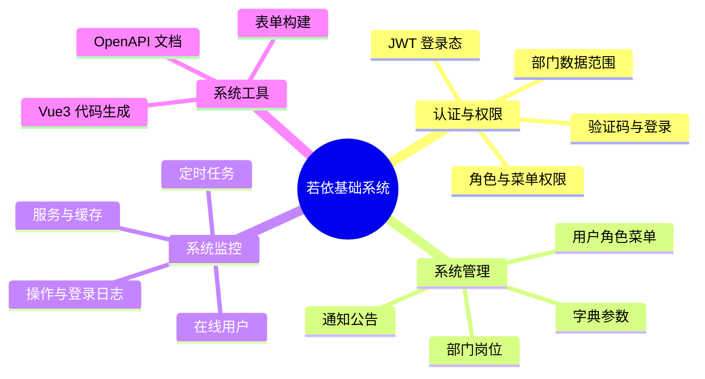
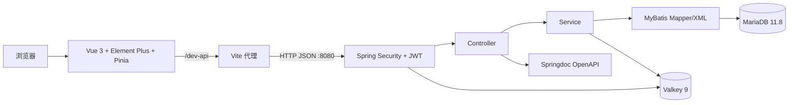
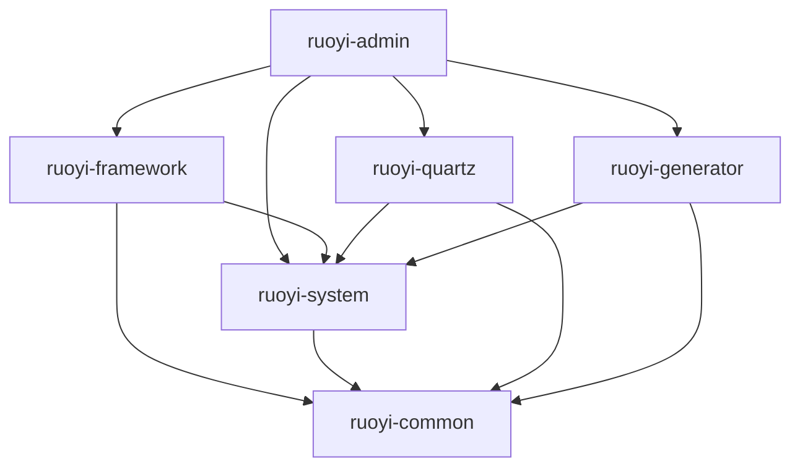
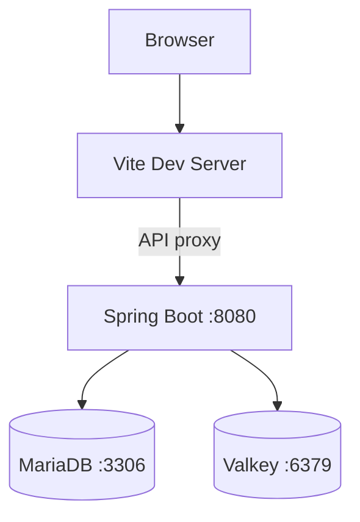
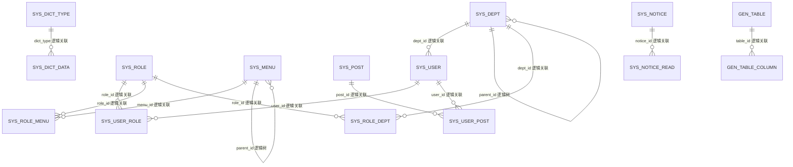
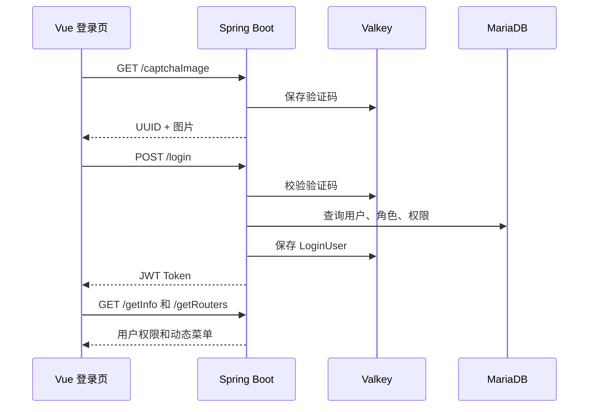

# 学生管理系统概要设计说明书

版本：0.2（若依基础框架阶段）  
日期：2026-10-23

本文按照老师提供的《概要设计实例》六章骨架编排。旧实例中的 Struts、JSP 和 SQL Server 只作为文档结构参考，本项目结论均来自当前 Spring Boot 3、Vue 3 源码和初始化 SQL。更细的类、模块、接口与数据分析见《架构分析附录.md》。

## 1. 导言

### 1.1 目的

本文描述学生管理系统开发底座的系统边界、界面、总体架构、数据模型和模块职责，用于实验二评审，也为后续学生业务需求分析和详细设计提供基线。预期读者包括课程教师、小组开发成员和测试人员。

### 1.2 范围

当前只设计并分析若依已有的认证、权限、系统管理、系统监控和系统工具。学生、教师、班级、课程和成绩模块尚未完成需求评审，因此不在本版中声明为已实现功能。

### 1.3 缩写说明

| 缩写 | 含义 | 在本项目中的作用 |
| --- | --- | --- |
| RBAC | Role-Based Access Control | 用户通过角色获得菜单、按钮和数据权限 |
| JWT | JSON Web Token | 浏览器请求携带的登录令牌 |
| REST | Representational State Transfer | 前后端 HTTP 接口风格 |
| ORM | Object-Relational Mapping | 本项目由 MyBatis 完成对象与 SQL 映射 |
| API | Application Programming Interface | 前后端交互接口 |

### 1.4 术语定义

“逻辑关联”指表之间通过字段和业务代码维护的关系，数据库中没有 `FOREIGN KEY` 约束。“物理外键”指 SQL 中实际声明、由数据库检查的引用完整性约束。“代码生成器”指若依基于 Apache Velocity 模板生成样板代码的工具，不是人工智能。

### 1.5 引用标准与资料

- 课程材料四份，提取结果见 `docs/reference/实验二要求提取.md`；
- RuoYi-Vue `springboot3` 提交 `a51a838b71b446ea27256900efe7ed2faa2a02fd`；
- RuoYi-Vue3 提交 `838965c5a18d2c61b73ec30c6e288057aaa08b63`；
- Spring Boot 3.5.16 System Requirements；
- Vite 6 官方发布说明；
- `sql/ry_20260417.sql` 与 `sql/quartz.sql`。

### 1.6 版本更新信息

| 版本 | 日期 | 修改范围 | 内容 |
| --- | --- | --- | --- |
| 0.1 | 2026-10-23 | 全文 | 依据源码形成技术初稿 |
| 0.2 | 2026-10-23 | 章节结构 | 按老师参考模板重排，并补充材料提取结论 |

## 2. 系统分析

本系统采用前后端分离结构。浏览器运行 Vue 3 单页应用，后端提供 REST API，MariaDB 保存持久数据，Valkey 保存验证码、登录用户、失败计数和配置缓存。当前底座服务两类使用者：普通系统用户根据被分配角色访问功能；管理员维护用户、角色、菜单、部门、岗位、字典、参数和系统工具。

系统已有功能分为四组：认证与权限、系统管理、系统监控、系统工具。业务模块必须复用这套登录和权限机制，不能另建一套用户体系。



## 3. 界面设计

### 3.1 公共界面

固定路由包括登录、注册、首页、个人中心、锁屏、401 和 404 页面。登录成功后，前端从 `/getInfo` 获取角色和权限，再从 `/getRouters` 获取菜单树。后端返回的组件路径由 `frontend/src/store/modules/permission.js` 映射到 `views` 下的 Vue 文件。

### 3.2 管理界面

| 页面组 | 主要页面 | 后端接口前缀 |
| --- | --- | --- |
| 用户与组织 | 用户、角色、菜单、部门、岗位 | `/system/user`、`/system/role`、`/system/menu`、`/system/dept`、`/system/post` |
| 配置 | 字典、参数、通知 | `/system/dict`、`/system/config`、`/system/notice` |
| 监控 | 在线用户、日志、服务、缓存、任务 | `/monitor`、`/system/job` |
| 工具 | 表单构建、代码生成、接口文档 | `/tool`、`/v3/api-docs` |

### 3.3 登录页面流

```mermaid
flowchart LR
    L[登录页] -->|获取验证码| C[/captchaImage]
    L -->|提交账号、密码、验证码| A[/login]
    A -->|返回 Token| I[/getInfo]
    I --> R[/getRouters]
    R --> H[首页与授权菜单]
    H --> P[系统管理/监控/工具页面]
```

前端 Token 只用于证明登录态，按钮隐藏不能代替后端权限检查。每个受保护 Controller 方法仍由 `@PreAuthorize` 判断权限。

## 4. 体系结构

### 4.1 设计原则

系统选择成熟的若依前后端分离结构，公共能力集中在框架模块，业务模块通过明确接口调用；凭据不进入源码；数据库变更保留脚本；未执行的验证不标记为通过。系统保持 Java 17 字节码目标和 JavaScript 前端，兼顾 Fedora 与 Windows 小组环境。

### 4.2 总体体系结构



### 4.3 后端模块结构



`ruoyi-admin` 提供启动入口和 Web Controller；`ruoyi-framework` 提供 Security、JWT、Druid、Redis 和 MyBatis 配置；`ruoyi-system` 实现系统领域服务；`ruoyi-quartz` 处理任务调度；`ruoyi-generator` 生成样板代码；`ruoyi-common` 放置公共类型和工具。

### 4.4 前端结构

前端页面位于 `frontend/src/views`，API 封装位于 `frontend/src/api`，Pinia 状态位于 `frontend/src/store/modules`，固定与动态路由位于 `frontend/src/router`。Axios 拦截器统一增加 `Authorization: Bearer <token>`，并处理业务状态码、超时和重复提交。

### 4.5 运行环境

开发环境为 Fedora 44、OpenJDK 25.0.4.1、Maven 3.9.11、Node.js 24.18.0、npm 11.16.0、MariaDB 11.8.8 和 Valkey 9.0.6。Spring Boot 3.5.16 的源码目标为 Java 17，官方声明兼容到 Java 25；真实构建仍需在依赖网络恢复后完成。开发端口为前端 80、后端 8080、数据库 3306 和缓存 6379。



## 5. 数据模型

### 5.1 概念结构

用户属于一个部门，可以关联多个角色和岗位；角色关联多个菜单，并可关联部门以确定数据范围；菜单自身形成树结构。字典类型包含多条字典数据，通知与阅读记录、代码生成表与字段表也形成一对多逻辑关系。

### 5.2 逻辑结构



若依基础与生成器 SQL 创建 20 张表，Quartz SQL 创建 11 张表。基础表没有声明物理外键，上图只表达源码可验证的逻辑关系。Quartz 的触发器表使用复合外键引用任务表，简单、Cron、Blob 和属性触发器表再物理引用触发器表。

### 5.3 物理结构

数据库为 `student_system`，字符集 `utf8mb4`，排序规则 `utf8mb4_unicode_ci`，存储引擎继承上游 SQL 的 InnoDB。应用账号 `student_app` 只获得该数据库权限。初始化顺序为 `ry_20260417.sql` 后 `quartz.sql`。新增学生业务表必须按课程要求使用 `id INT AUTO_INCREMENT` 主键。

## 6. 模块设计

### 6.1 认证与权限模块

表示层由 `login.vue`、用户 store 和权限 store 组成。控制层包括 `CaptchaController`、`SysLoginController` 与 JWT 过滤器。模型与业务层由 `SysLoginService`、`TokenService`、用户/角色/菜单 Service 和 Mapper 组成。登录调用链如下：



### 6.2 系统管理模块

表示层位于 `frontend/src/views/system`，控制层位于 `com.ruoyi.web.controller.system`，业务层位于 `ruoyi-system`。模块管理用户、角色、菜单、部门、岗位、字典、参数和通知。典型请求经过 Controller、Service、Mapper XML 后访问 MariaDB，列表结果使用 `TableDataInfo`，普通结果使用 `AjaxResult`。

### 6.3 系统监控与定时任务模块

监控模块提供在线用户、登录日志、操作日志、服务信息和缓存信息。Quartz 模块由 `ruoyi-quartz` 提供任务与任务日志 Controller、Service 和 Mapper，并使用 11 张 `QRTZ_` 表保存调度状态。运行验证必须覆盖任务列表、日志和至少一次安全的测试任务执行。

### 6.4 代码生成模块

`GenController` 提供数据库表列表、导入、编辑、同步、预览和 ZIP 下载接口。`VelocityUtils` 根据 `tplWebType` 选择模板：`element-plus` 使用 `vm/vue/v3`，`element-plus-typescript` 使用 `vm/vue/v3ts`。本项目使用前者，保持 JavaScript。生成内容包括 Java、Mapper XML、Vue、API、菜单 SQL 和权限标识；生成后必须审查，不允许直接用旧 Vue 2 模板或开启任意覆盖。

### 6.5 接口模块

| 功能 | 方法与路径 | 认证与权限 | 返回形式 |
| --- | --- | --- | --- |
| 验证码 | `GET /captchaImage` | 匿名 | `AjaxResult` |
| 登录 | `POST /login` | 匿名 | Token |
| 用户信息 | `GET /getInfo` | Bearer Token | 用户、角色、权限 |
| 动态菜单 | `GET /getRouters` | Bearer Token | 路由树 |
| 用户列表 | `GET /system/user/list` | `system:user:list` | `TableDataInfo` |
| 生成器预览 | `GET /tool/gen/preview/{tableId}` | `tool:gen:preview` | 模板到源码映射 |
| 生成器下载 | `GET /tool/gen/download/{tableName}` | `tool:gen:code` | ZIP |
| OpenAPI | `GET /v3/api-docs` | 匿名 | OpenAPI JSON |

Springdoc 扫描 Web、Generator 和 Quartz 三个 Controller 包。Swagger UI 配置地址为 `/swagger-ui.html`。配置已经与源码一致，但服务尚未启动，文档完整性仍待运行验证。

### 6.6 安全与部署模块

Spring Security 使用无状态会话和 BCrypt 密码哈希，后端方法权限是最终控制点。数据库、Valkey 和 Token 密钥由环境变量提供，Druid 监控默认关闭。开发部署和测试状态分别记录在 `docs/deployment/环境与部署记录.md` 与 `docs/testing/验收记录.md`。

本版本完成的是框架级概要设计。学生业务实体、接口、页面和权限只有在需求分析、小组分工与数据库设计确认后才能加入下一版。
