# 高中学生信息与成绩管理系统需求规格说明书

**文档版本：** v1.0-draft  
**文档状态：** 初稿（待小组/教师评审；尚未形成正式批准基线）  
**需求基线：** `BL-REQ-001 v1.2-provisional` 及其已记录修订  
**编制日期：** 2026-10-29  
**适用范围：** 电子科技大学软件工程课程实验一需求分析阶段  
**文档性质：** 描述目标系统“应做什么”的需求规格说明，不是设计说明书、测试报告或已上线系统证明。

## 文档控制

| 版本 | 日期 | 状态 | 说明 |
| --- | --- | --- | --- |
| v0.1 | 2026-10-23 | 调研/初稿 | 课程要求、范围、角色与规则调研 |
| v0.2 | 2026-10-28 | 需求分析初稿 | 功能、非功能、数据需求与验收标准形成 |
| v1.0-draft | 2026-10-29 | 整合初稿 | 整合 DFD/ER/UML/原型，形成本 SRS，待评审 |

**评审记录：** 尚未获得教师或小组的正式评审签字；本文不虚构评审结论。  
**批准状态：** 未批准；不得将本稿表述为“已通过需求评审”或“已通过业务测试”。

## 目录

1. 引言  
2. 系统总体描述  
3. 需求分析模型  
4. 功能需求  
5. 数据需求  
6. 非功能需求  
7. 用户界面需求  
8. 需求验证与可追踪性  
附录 A 功能需求索引  
附录 B 用例与追踪索引  
附录 C 图表选用清单  
附录 D 原型截图索引  
附录 E 业务规则索引  
附录 F 变更与待确认事项

## 1. 引言

### 1.1 编写目的

本文定义高中学生信息与成绩管理系统的业务边界、用户角色、功能需求、数据需求、非功能需求、界面需求和验证追踪方式，作为后续设计、数据库设计、接口设计、测试用例和课程验收的共同依据。

本文只描述目标系统的外部行为与约束，不把 Spring Boot、Vue3、MariaDB、Valkey 或若依框架的内部实现写成需求；不宣称业务模块已经全部开发完成。

### 1.2 项目背景

学校需要把学生档案、班级归属、班主任责任、考试配置、成绩录入、审核发布、学生查询、统计和审计放在同一套可追溯的业务系统中。现有通用若依后台提供登录、账号、角色、菜单、字典和数据权限基础，但学生与成绩业务仍需按本需求建设。

当前项目已有需求基线、结构化分析、UML 模型和高保真界面原型；这些成果用于需求确认和课程文档，不代表生产部署或真实学校数据已经接入。

### 1.3 系统目标

系统应达到以下业务目标：

1. 建立“账号身份—业务角色—数据范围”的权限链，四类角色只访问授权数据和功能；
2. 维护学年、学期、年级、班级、学生、班主任、科目、考试等基础数据；
3. 以“考试×班级×科目”生成唯一成绩任务，由本班班主任录入本班全部适用科目；
4. 将成绩录入、提交、审核、发布、撤回、更正分成可审计的状态与职责；
5. 学生只能查询本人已发布成绩，不能查看他人、未发布或已撤回成绩；
6. 提供班级、科目、总分和排名的基础统计，区分缺考、未录入和真实零分；
7. 为关键成绩业务变更保留前后值、原因、操作人、时间、版本和审计；
8. P1 复核、导入导出、趋势和对比作为扩展能力单独规划，不进入 P0 退出条件。

### 1.4 适用范围

**适用：**

- 高中学生信息与成绩管理系统的需求评审、课程实验文档、后续概要与详细设计输入；
- 四类角色在 P0 主链路中的业务行为与权限；
- P1 复核、导入导出、趋势和对比的规划性需求。

**不适用：**

- 真实学校生产环境的 7×24 运维承诺；
- 高考志愿推荐、走班排课、在线缴费等未纳入范围的业务；
- 具体数据库表、Controller/Service/Mapper、接口 URL 或前端组件实现；
- 真实学生个人信息、真实成绩或生产数据库。

### 1.5 术语与缩略语

| 术语/缩写 | 含义 |
| --- | --- |
| SRS | Software Requirements Specification，需求规格说明书 |
| P0 | 必须交付的基础范围；课程验收的主链路 |
| P1 | 规划扩展范围；不进入 P0 退出条件 |
| FR | Functional Requirement，功能需求 |
| NFR | Non-Functional Requirement，非功能需求 |
| BR | Business Rule，业务规则 |
| DR | Data Requirement，业务数据对象 |
| UC | Use Case，用例 |
| AC | Acceptance Criteria，验收条件 |
| DFD | Data Flow Diagram，数据流图 |
| ER | Entity-Relationship，实体关系 |
| RBAC | Role-Based Access Control，基于角色的访问控制 |
| 成绩任务 | 一场考试×一个班级×一个科目生成的录入单元，`TASK_*` |
| 成绩发布 | 班级级发布，`PUB_*`；与任务审核状态不同 |
| 缺考 | `SCORE_ABSENT`；无分数值，不按 0 分处理 |
| 未录入 | `SCORE_NOT_ENTERED`；阻止提交，学生不可见 |
| 真实零分 | `SCORE_NORMAL` 且分数为 `0.0`；参与统计/排名规则 |
| P1 复核 | 学生对本人已发布成绩申请复核的扩展流程 |

### 1.6 参考资料

| 编号 | 资料 | 用途 |
| --- | --- | --- |
| R-01 | `docs/requirements/baseline/` BL-REQ-001 v1.2-provisional 及修订 | 范围、角色、业务规则、状态字典 |
| R-02 | `docs/requirements/draft/02-功能需求规格.md` | 35 P0 + 11 P1 功能需求 |
| R-03 | `docs/requirements/draft/02-详细用例规约.md` | 17 个用例及主/备选流 |
| R-04 | `docs/requirements/draft/02-数据需求与数据字典.md` | 17 个 DR、属性、唯一性 |
| R-05 | `docs/requirements/draft/02-角色权限矩阵.md` | 四类角色与范围 |
| R-06 | `docs/requirements/draft/02-需求验收标准.md` | AC 与边界场景 |
| R-07 | `docs/requirements/analysis/03-*` | 结构化分析、DFD/ER 平衡 |
| R-08 | `docs/requirements/analysis/04-*` | UML、专项语义修订、视觉检查 |
| R-09 | `docs/requirements/prototype/` | 24 张界面原型截图及说明 |
| R-10 | `docs/requirements/图表与原型规划-v1.2.md` | 图号、状态与原型规划 |
| R-11 | `docs/requirements/research/01-课件要求与建模方法核对.md` | 课程要求边界、IEEE 830 参考 |

> 未找到独立的“实验一任务书/提交规范”文件；课程要求以需求分析课件和现有研究记录为依据。该证据缺口在 `SRS章节与课程要求映射表.md` 和本文第 8 章标注为待确认，不编造页数、模板或评分细则。

### 1.7 文档版本与状态

本文是 **Markdown 初稿**。已完成的验证仅是“文档级自检”和“原型静态渲染检查”：

- 不表示业务代码已完成；
- 不表示功能测试、性能测试、权限渗透测试已通过；
- 不表示教师已批准需求；
- 不表示数据库、API、Vue 页面已实现。

## 2. 系统总体描述

### 2.1 系统定位

系统是面向高中教务、班主任和学生的**信息与成绩业务管理工作台**，建立在若依通用身份/RBAC/菜单/字典能力之上，目标是把“建班—建考—录分—审核—发布—查询—审计”形成可追责闭环。

系统不替代学校学籍管理平台，不接入真实身份证、家庭住址、家长电话等敏感字段；不提供任课教师角色或按科目分配任课教师。

### 2.2 业务背景与问题

当前工作如果依赖表格和线下传递，容易出现：

1. 同一场考试多个班级、多个科目的成绩分散，任务边界不清；
2. 班主任变更后历史责任与当前录入权限混淆；
3. 成绩提交、审核、发布混为一个动作，发布前完整性无法保证；
4. 缺考、未录入、真实零分被统一当作 0，污染统计和排名；
5. 学生可能看到未发布或他人成绩；
6. 发布后更正缺少前后值、原因和版本，无法追溯；
7. 系统管理员借系统日志越权查看成绩明细。

本系统用明确角色、数据范围、任务状态、发布状态和审计记录回应上述问题。

### 2.3 系统范围与边界

**系统边界内：**

- 身份认证、账号/角色/菜单/按钮权限、业务角色与档案绑定；
- 学年、学期、年级、班级、学生、班主任、班主任任职、科目；
- 考试、考试班级范围、考试科目、成绩任务、成绩记录；
- 成绩录入/暂存/提交、审核/退回/重提、发布/撤回/受控更正；
- 学生本人成绩查询、基础统计；
- 业务变更记录、系统/安全审计元数据的受限查看；
- P1 复核、导入导出、趋势、多班级对比（单独标记）。

**系统边界外：**

- 学籍系统、排课系统、高考志愿系统、第三方身份提供方；
- 真实支付、短信、邮件、文件云盘；
- 生产级容灾、7×24 运维、真实学校数据治理；
- 任课教师角色、任教关系、按科目分配教师；
- 与课程无关的社交、通知、移动端原生 App。

### 2.4 四类用户角色

| 角色 | 主要职责 | 数据范围 | 明确限制 |
| --- | --- | --- | --- |
| 系统管理员 | 账号、角色、菜单/按钮、字典/参数、系统安全审计元数据 | `SCOPE_SYSTEM` | 不默认看成绩明细；不审核/发布/更正；不借日志展开成绩 |
| 教务管理员 | 学年学期、班级、学生、班主任指派、科目、考试、审核、发布、撤回、更正、全校统计、业务审计 | `SCOPE_ALL` | 不代替班主任录入；不审核自己提交的任务 |
| 班主任 | 本班全部适用科目的录入/暂存/提交；本班统计；P1 受理/核查 | `SCOPE_CLASS`（有效任职班级集合） | 不跨班录入；不自行撤回 `TASK_SUBMITTED`；不最终确认/更正 |
| 学生 | 本人已发布成绩查询、本人 P1 复核申请/查看 | `SCOPE_SELF` | 不看他人、未发布、已撤回成绩；不直接改分 |

> **任课教师不是本系统角色。** 不设置任课教师 Actor、任教关系实体、按科目授权页面。

### 2.5 主要业务流程

1. **基础配置**：教务维护学年/学期/年级/班级/学生/班主任/科目；系统管理员维护账号与角色绑定。
2. **考试与任务**：教务创建考试、配置范围/科目/满分线，开放考试；系统按“考试×班级×科目”生成唯一任务。
3. **班主任录入**：班主任只能编辑本班 `TASK_DRAFT`/`TASK_RETURNED` 任务；录入/暂存、校验 0.5 分步长与满分、检查未录入。
4. **提交与审核**：完整性通过后提交为 `TASK_SUBMITTED`；教务逐任务审核通过 `TASK_APPROVED` 或退回 `TASK_RETURNED`；提交人不能审核自己的任务。
5. **发布**：班级所有适用任务 `TASK_APPROVED` 且无未录入后，教务按“考试×班级”发布 `PUB_PUBLISHED`，生成版本 v1。
6. **查询与统计**：学生只看本人已发布成绩；班主任看本班汇总；教务看全校统计。
7. **撤回/更正**：教务可撤回为 `PUB_WITHDRAWN`（学生不可见、数据保留），可受控更正并生成新版本；更正不覆盖历史。
8. **审计**：关键变更写业务变更记录；教务看业务前后值；系统管理员只看脱敏系统/安全审计元数据。
9. **P1 复核**：学生申请→班主任受理/核查→教务最终确认/更正；独立于 P0 主状态机。

### 2.6 运行环境及约束

| 类别 | 需求/约束 |
| --- | --- |
| 终端 | 桌面浏览器；基准 1600×900；P0 建议 1366×768 以上 |
| 浏览器 | 当前稳定版 Chrome、Edge、Firefox；不支持 IE；不做移动原生 App |
| 部署基础 | 项目复用若依 Spring Boot 3 + Vue3 基础；MariaDB/Valkey 为技术基础设施，不是业务 Actor |
| 数据 | 课程演示使用合成数据；不接入真实学生个人信息 |
| 网络 | 校内/单机实验环境；不承诺公网高可用 |
| 时间 | 课程实验窗口；不承诺 7×24 生产 SLA |

> “若依已部署”只说明基础设施可复用，不等于学生业务模块已实现，也不等于本 SRS 已通过验收。

### 2.7 业务假设与依赖

1. 学校已有稳定的学生、班主任、班级基础数据来源；本项目使用合成数据验证。
2. 一个班级在同一时刻最多一名有效班主任；一名班主任可负责多个班。
3. 一个学生同一学年最多一条有效班级归属；转班保留历史。
4. 成绩任务由考试范围、考试科目和班级花名册生成；任务生成后学生归属变更受严格限制。
5. 若依负责登录、JWT、角色、菜单、按钮权限和基础日志；业务审计另行定义。
6. P1 复核/导入/趋势/对比依赖 P0 的成绩与发布数据；P1 不改变 P0 退出条件。
7. 真实上线前需补充学校授权、真实数据治理、运维与合规评审；本课程不实施。

### 2.8 P0/P1 开发范围

| 范围 | 数量 | 内容 | 验收口径 |
| --- | --- | --- | --- |
| P0 | **35 项 FR** | 认证权限 5、组织 5、学生 4、班主任/科目 2、考试 4、成绩录入 5、审核发布 4、查询 2、统计 2、审计 2 | 35 条主验收场景全部可执行；P0 主链路可演示 |
| P1 | **11 项 FR** | 复核 4、导入导出 4、趋势 2、多班级对比 1 | 单独规划；不进入 P0 退出条件 |
| 非功能 | **16 项 NFR** | 性能、安全、隐私、可靠性、可用性、易用性、兼容性、可维护性、备份、审计、合规 | 指标为建议验收目标；未实测标记“未验证” |
| 业务规则 | **137 条 BR** | 组织、权限、考试、成绩、发布、查询、统计、审计、复核等 | 以基线规则表为准，不重编号 |
| 业务数据对象 | **17 个 DR** + `ENT-08 班主任任职` 关联实体 | 组织/人员/考试/成绩/发布/审计/复核/账号关联 | 概念/逻辑数据需求，不是物理表 |

## 3. 需求分析模型

> 本章复用第三、第四阶段已经审查的有效图表，不重画新模型。图号、文件与选用说明见 `SRS图表及截图选用清单.md`。

### 3.1 系统功能结构

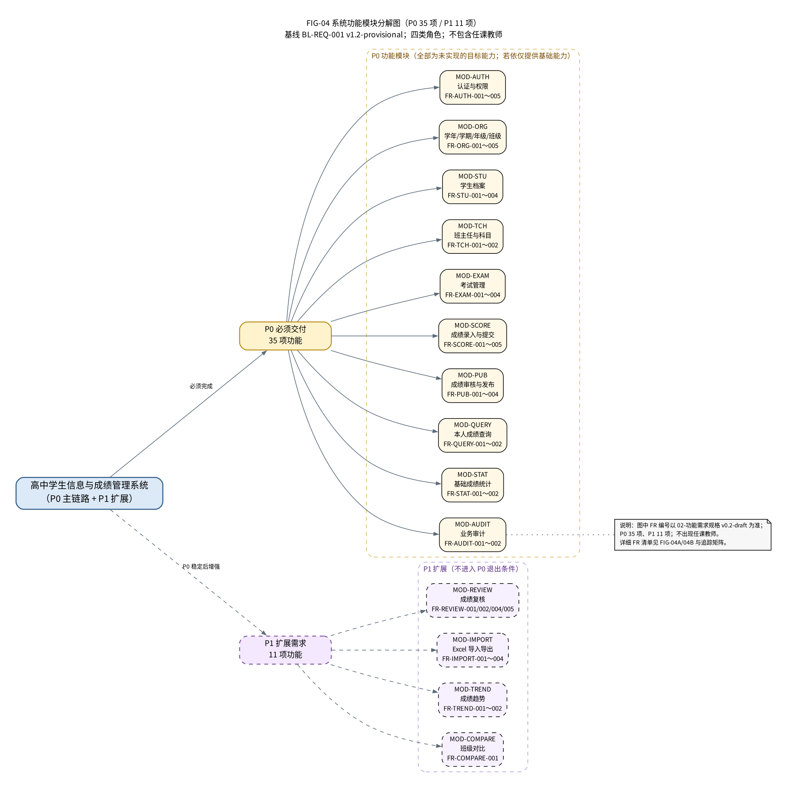

**图 3-1** 展示 P0 教务基础、成绩与审计，以及 P1 复核/导入/趋势/对比的功能树。图中不出现任课教师或按科目分配教师。

### 3.2 系统上下文 DFD

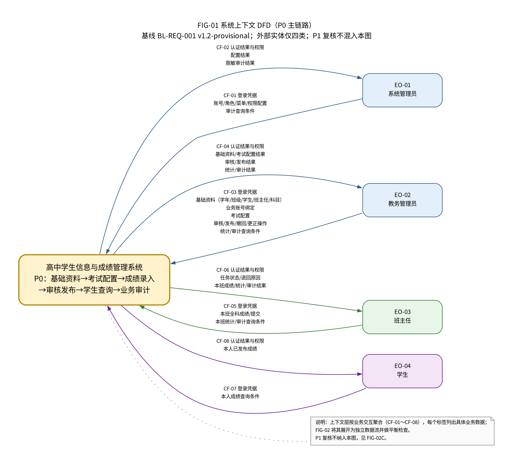

**图 3-2** 以系统整体为一个加工，显示四类外部实体和聚合输入/输出。数据库、缓存、若依组件不作为业务外部实体。P1 复核不在上下文图展开，避免把扩展流程混入 P0 边界。

### 3.3 核心分层 DFD

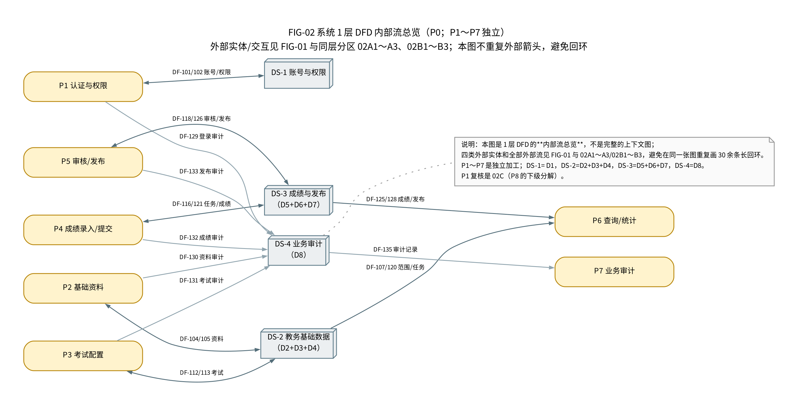

**图 3-3** 保留 P1～P7 七个独立加工和 DS-1～DS-4 主题存储；外部交互的逐流细节由同层分区图（FIG-02A1～A3、02B1～B3）在附录展开。该图不是“完整外部流图”，其“内部流总览”语义已在第三阶段审查中固定。

**分层说明：**

- FIG-02A1/A2/A3、02B1/B2/B3 是**同一层 DFD 分区视图**，不是二层分解；
- FIG-02C 是 P8（P1 复核）的**下级加工分解**，与 P0 分区不同；
- P1 的 12 条流在附录 FIG-02C 展开。

### 3.4 主要用例与总体用例图

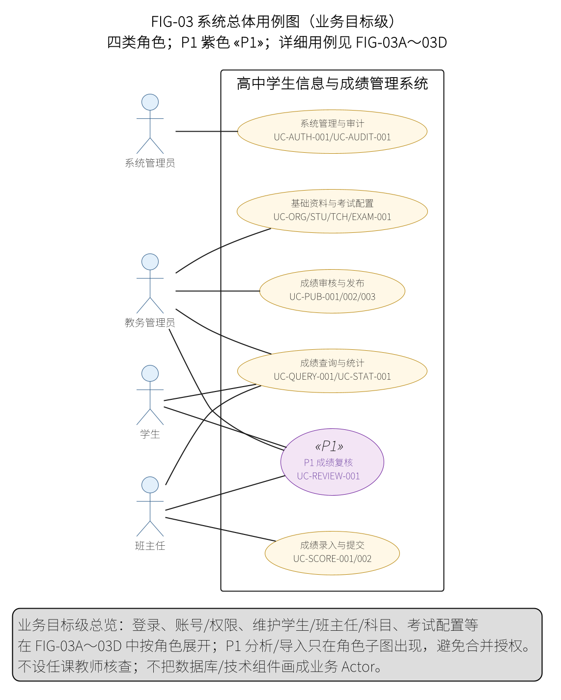

**图 3-4** 是业务目标级总览；角色子图 FIG-03A～03D 在附录。正式用例清单共 **17 个 UC**（P0 13、P1 4 类用例组）。关键修正：

- 学生只拥有 P1 个人成绩趋势（`FR-TREND-001`），不拥有班级对比（`FR-COMPARE-001`）；
- P1 导入/趋势/对比不再合成一个“总扩展”用例，而是按角色/目标分开；
- 系统管理员审计是受限脱敏视图，不是成绩业务明细入口；
- Actor—用例使用普通关联实线，不滥用方向箭头。

### 3.5 核心业务概念 ER

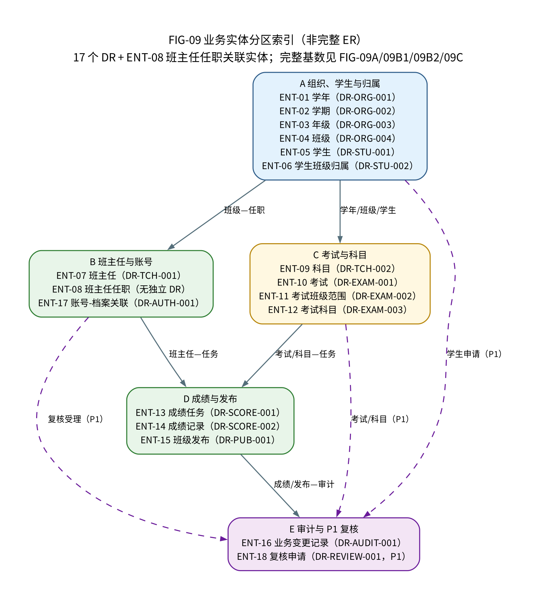

**图 3-5** 是实体分区索引，不是完整 ER；完整基数在 FIG-09A、09B1、09B2、09C。系统有 **17 个 DR**，另含 `ENT-08 班主任任职` 历史关联实体；没有任课教师/任教关系实体。

### 3.6 领域模型概述

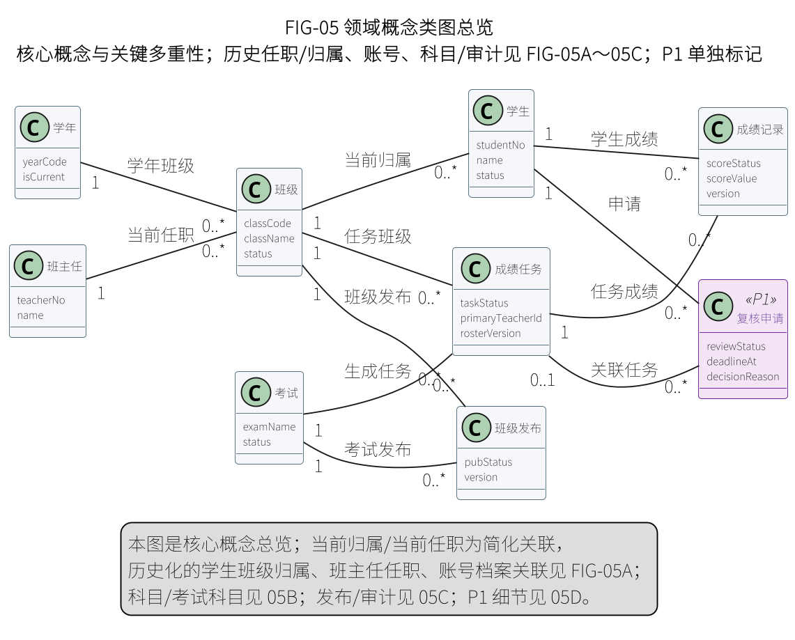

**图 3-6** 表达学年、班级、学生、班主任、考试、任务、成绩、发布与复核的核心概念。总览中的“当前归属/当前任职”是简化关联；精确的班级归属历史、班主任任职历史和账号档案关联见 FIG-05A，考试范围/科目/任务见 FIG-05B，发布/审计见 FIG-05C，P1 见 FIG-05D。

### 3.7 成绩管理关键状态机

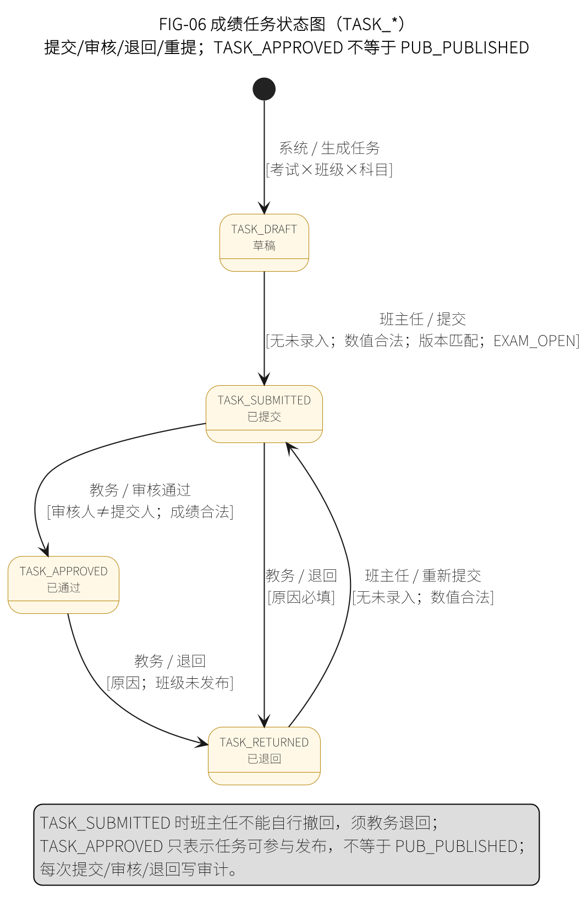

**图 3-7** 只表示 `TASK_*` 任务生命周期；提交前必须无未录入、数值合法且版本匹配，审核人不能是提交人。

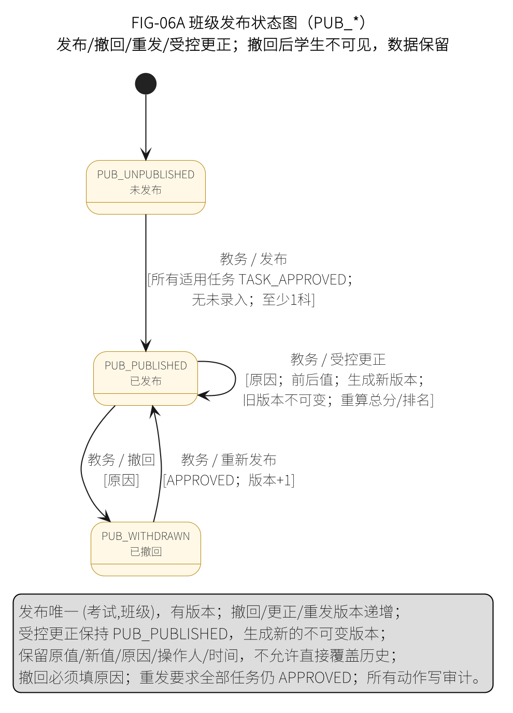

**图 3-8** 只表示 `PUB_*` 班级发布生命周期；`TASK_APPROVED` 不等于 `PUB_PUBLISHED`，撤回后学生不可见但数据保留，受控更正保持已发布并生成新不可变版本。

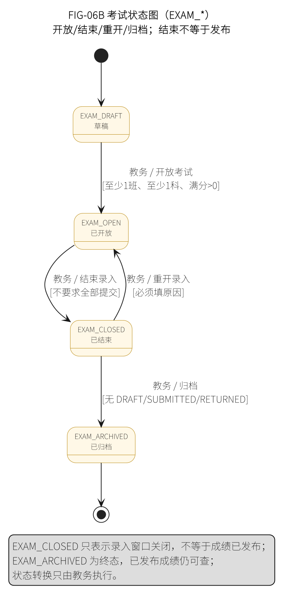

**图 3-9** 只表示 `EXAM_*` 考试生命周期；`EXAM_CLOSED` 不等于成绩已发布，`EXAM_ARCHIVED` 为终态。

**三个生命周期不得合并为一个状态：**

| 生命周期 | 状态代码 | 责任角色 |
| --- | --- | --- |
| 考试 | `EXAM_DRAFT`、`EXAM_OPEN`、`EXAM_CLOSED`、`EXAM_ARCHIVED` | 教务 |
| 成绩任务 | `TASK_DRAFT`、`TASK_SUBMITTED`、`TASK_APPROVED`、`TASK_RETURNED` | 班主任提交、教务审核 |
| 班级发布 | `PUB_UNPUBLISHED`、`PUB_PUBLISHED`、`PUB_WITHDRAWN` | 教务 |

### 3.8 成绩管理主流程

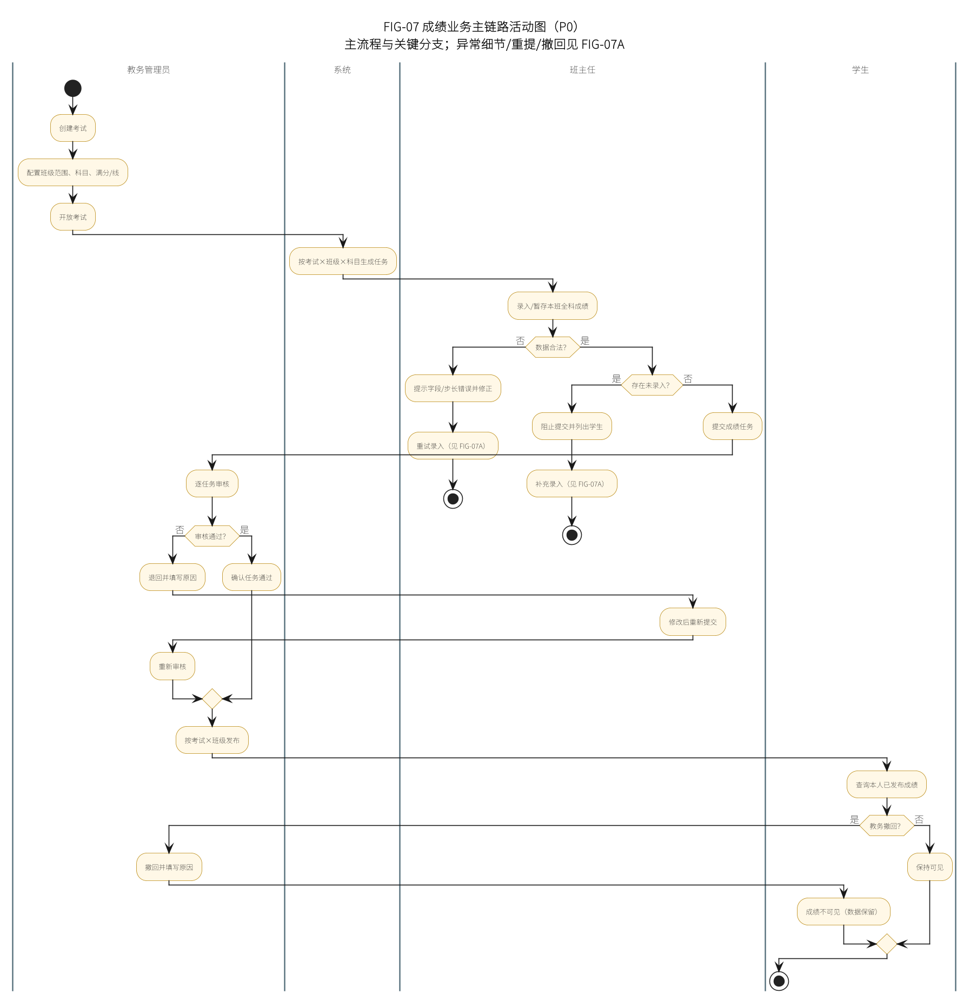

**图 3-10** 展示正常路径：创建/配置考试→生成任务→班主任录入→系统校验→提交→教务审核→发布→学生查询。异常/补录、退回重提、撤回/更正分别见附录 FIG-07A～07D；主图不用一条异常线提前结束整个活动。
## 4. 功能需求

> 本节保留现行 `FR-*` 编号。P0 共 **35 项**；P1 的 11 项在 4.12 单独给出，不混入 P0 必须交付范围。每条需求给出角色、目标、前置条件、输入/校验、系统行为、输出、异常、关键规则、验收条件与追踪；业务规则编号沿用基线，不在本 SRS 重编号。

### 4.1 功能模块与数量索引

| 模块 | P0 FR 数 | 主要角色 | 主要数据对象 |
| --- | --- | --- | --- |
| 认证与权限 | 5 | 全部角色/系统管理员 | DR-AUTH-001 |
| 组织和学年管理 | 5 | 教务 | DR-ORG-001～004 |
| 学生档案管理 | 4 | 教务 | DR-STU-001/002 |
| 班主任与科目管理 | 2 | 教务 | DR-TCH-001/002 |
| 考试管理 | 4 | 教务 | DR-EXAM-001～003 |
| 成绩录入与提交 | 5 | 班主任/教务 | DR-SCORE-001/002 |
| 成绩审核与发布 | 4 | 教务 | DR-PUB-001/DR-AUDIT-001 |
| 学生成绩查询 | 2 | 学生 | DR-SCORE-002/DR-PUB-001 |
| 基础成绩统计 | 2 | 教务/班主任 | DR-SCORE-002 |
| 业务审计 | 2 | 教务/系统管理员/班主任 | DR-AUDIT-001 |

> 计数核对：5+5+4+2+4+5+4+2+2+2 = **35**；P1 另计。

### 4.2 认证与权限

**模块目标：** 身份、角色、账号绑定与数据范围。

#### FR-AUTH-001 登录、登出、验证码

**角色与范围：** 全部角色（登录前无业务数据范围；登录后按角色授予）  
**目标：** 让合法账号安全登录、获得与角色相符的会话，并能主动退出；阻止未认证访问业务功能。  
**前置条件：** 账号已创建且处于启用状态；验证码服务、Redis/Valkey 可用；用户已打开登录页。  
**输入与校验：** 用户名、密码、验证码、验证码 UUID；登出请求。校验：三项必填；验证码在有效期内且匹配；账号未停用。  
**系统行为：** 校验验证码→校验账号密码→生成 JWT→加载角色/权限→记录登录日志→返回令牌；登出时清理服务端登录态。失败提示不得区分“账号不存在/密码错误”。  
**输出与结果：** 成功：令牌、用户基本信息、角色/权限标识；失败：统一错误提示和可重试状态；登出：当前会话失效。  
**异常处理：** 验证码错误/过期→拒绝并刷新验证码；密码错误或账号停用→统一登录失败；连续失败达到若依配置阈值→按配置锁定/限制；缓存不可用→拒绝登录并提示稍后重试，不放行。  
**关键业务规则：** BR-AUTH-001、BR-AUTH-002、BR-AUTH-010、BR-AUTH-011；BR-STU-006、BR-TCH-007  
**验收条件：** `AC-FR-AUTH-001`：合法启用账号在验证码正确时登录成功并获得令牌；错误密码、停用账号、错误验证码均被拒绝；未登录访问受保护接口返回 401。  
**追踪：** `UC-AUTH-001` / `DR-AUTH-001`  

#### FR-AUTH-002 用户、角色、菜单、按钮权限配置

**角色与范围：** 系统管理员（SCOPE_SYSTEM）  
**目标：** 让系统管理员按最小权限配置账号、角色、菜单和按钮权限，并让业务权限与若依 RBAC 对齐。  
**前置条件：** 系统管理员已登录；已明确业务角色与权限字符串命名空间。  
**输入与校验：** 账号、角色、菜单/按钮、权限字符串、启停状态。校验：权限字符串唯一且属于允许命名空间；角色代码唯一；菜单树无环；不得删除内置必要权限。  
**系统行为：** 维护角色与菜单/按钮关联；给账号分配一个或多个业务角色；保存后立即影响授权判断；所有变更记录操作日志。  
**输出与结果：** 账号获得/失去对应功能权限；越权请求被后端拒绝；权限配置可查询。  
**异常处理：** 权限字符串冲突→拒绝；菜单父子成环→拒绝；删除仍被引用的角色/菜单→拒绝或要求先解绑；内置超级管理员配置→只允许初始化/应急使用，不用于验收。  
**关键业务规则：** BR-AUTH-007、BR-AUTH-010、BR-AUTH-011；BR-AUTH-001、BR-AUTH-008  
**验收条件：** `AC-FR-AUTH-002`：给账号分配“班主任”角色后只能进入班主任授权功能；移除角色后原令牌再次请求业务接口被拒绝；权限字符串冲突无法保存。  
**追踪：** `UC-AUTH-001` / `DR-AUTH-001`  

#### FR-AUTH-003 业务角色分配与账号绑定

**角色与范围：** 系统管理员（SCOPE_SYSTEM）、教务管理员（SCOPE_ALL，限业务侧发起）  
**目标：** 把登录账号与唯一的学生/班主任业务档案关联，并分配业务角色，保证“账号身份”和“业务身份”可追溯。  
**前置条件：** 账号已存在或可创建；学生/班主任档案已存在；档案尚未绑定其他账号。  
**输入与校验：** 账号 ID、业务档案 ID（学生或班主任）、角色集合。校验：一个账号最多绑定一个学生或一个班主任；一个档案最多绑定一个账号；账号与档案类型匹配；角色与档案类型匹配。  
**系统行为：** 建立账号—档案关联；分配业务角色；保存后刷新该账号的可见范围；记录绑定/解绑审计。  
**输出与结果：** 账号登录后能解析出唯一学生/班主任身份；未绑定账号不能进入学生/班主任业务功能。  
**异常处理：** 账号已绑定其他档案→拒绝并提示；档案已绑定其他账号→拒绝；学生档案绑定学生角色→拒绝；解绑时存在未完成业务→按规则阻止或要求先处理。  
**关键业务规则：** BR-STU-006、BR-TCH-007、BR-AUTH-004、BR-AUTH-007  
**验收条件：** `AC-FR-AUTH-003`：学生账号绑定学生档案后只能以该学生身份查询；同一档案不能绑定第二个账号；错误类型绑定被拒绝。  
**追踪：** `UC-AUTH-001` / `DR-AUTH-001`  

#### FR-AUTH-004 业务数据范围过滤

**角色与范围：** 全部角色；范围按 SCOPE_SYSTEM/SCOPE_ALL/SCOPE_CLASS/SCOPE_SELF  
**目标：** 在所有业务查询和写操作上执行角色+数据范围双重校验，防止水平/垂直越权。  
**前置条件：** 用户已登录并具备目标功能权限；业务关系数据（班级、班主任、学生账号）已维护。  
**输入与校验：** 当前用户、功能权限、请求中的业务 ID/筛选条件。校验：功能权限必须命中；数据行必须落在当前用户范围；请求参数不能扩大范围。  
**系统行为：** 后端根据当前账号重新推导可访问范围；列表、详情、统计、导出、写操作使用同一范围；越权返回 403/404，不泄露其他数据存在性。  
**输出与结果：** 只返回授权范围内数据；写操作只作用于授权行；拒绝时给出无权限提示。  
**异常处理：** 缺少班级/班主任关系→拒绝；前端隐藏但直接调接口→仍拒绝；批量/导出参数超范围→按范围过滤或拒绝；系统管理员请求成绩明细→拒绝。  
**关键业务规则：** BR-AUTH-001、BR-AUTH-002、BR-AUTH-004、BR-AUTH-005、BR-AUTH-006、BR-AUTH-008、BR-AUTH-009、BR-AUTH-012、BR-AUTH-013  
**验收条件：** `AC-FR-AUTH-004`：学生 A 无法读取学生 B 的成绩；班主任无法读取非本班数据；班主任只能处理本班；教务可看全校；系统管理员不能借审计日志展开成绩明细。  
**追踪：** `UC-AUTH-001` / `DR-AUTH-001`  

#### FR-AUTH-005 账号启停与密码重置

**角色与范围：** 系统管理员（SCOPE_SYSTEM）  
**目标：** 让系统管理员安全地启停账号、重置密码，同时保留业务档案和历史数据。  
**前置条件：** 目标账号存在；操作人具备账号管理权限；重置密码时能安全传递临时密码。  
**输入与校验：** 账号 ID、启停动作、重置密码请求。校验：不得停用当前唯一可用的系统管理员；不得停用内置初始化账号到无法恢复；临时密码符合若依密码策略。  
**系统行为：** 启停账号；重置密码并标记首次登录需修改（若若依支持）；记录操作日志；停用后现有会话失效或后续请求被拒绝。  
**输出与结果：** 账号状态更新；停用账号不能登录；密码重置后旧密码失效；业务档案和历史数据保留。  
**异常处理：** 停用自己导致无管理员可用→拒绝；账号不存在→拒绝；重置密码不符合策略→拒绝；停用后仍持有旧令牌→后续请求拒绝。  
**关键业务规则：** BR-AUTH-001、BR-AUTH-011；BR-STU-006、BR-TCH-007  
**验收条件：** `AC-FR-AUTH-005`：停用账号后无法登录且旧令牌不能访问业务接口；重新启用后可登录；重置密码后旧密码失败、新密码成功。  
**追踪：** `UC-AUTH-001` / `DR-AUTH-001`  

### 4.3 组织和学年管理

**模块目标：** 学年、学期、年级、班级与班主任指派。

#### FR-ORG-001 学年管理

**角色与范围：** 教务管理员（SCOPE_ALL）  
**目标：** 建立可追溯的学年主数据，为学期、班级、考试和班主任任职提供时间边界。  
**前置条件：** 教务管理员已登录；学校已确定学年起止日期。  
**输入与校验：** 学年编码（YYYY-YYYY）、名称、起止日期、当前学年标记。校验：编码格式合法；起止日期合法；编码唯一；同一时间只有一个当前学年。  
**系统行为：** 新增/编辑学年；设置当前学年；历史学年保留；被班级/考试引用后不允许删除。  
**输出与结果：** 学年记录可查询；当前学年唯一；后续学期、班级、考试可引用。  
**异常处理：** 编码重复→拒绝；起止日期倒置→拒绝；删除被引用学年→拒绝；设置第二个当前学年→拒绝或要求先取消旧标记。  
**关键业务规则：** BR-ORG-001、BR-ORG-002、BR-ORG-007、BR-ORG-010  
**验收条件：** `AC-FR-ORG-001`：创建 2026-2027 学年并设为当前；重复编码被拒绝；删除已被班级引用的学年被拒绝。  
**追踪：** `UC-ORG-001` / `DR-ORG-001`  

#### FR-ORG-002 学期管理

**角色与范围：** 教务管理员（SCOPE_ALL）  
**目标：** 在学年下维护第一/第二学期，使考试和班主任任职可按学期归属。  
**前置条件：** 所属学年已存在且未归档。  
**输入与校验：** 所属学年、学期序号（1/2）、起止日期、状态。校验：同一学年学期序号唯一；日期落在学年范围内且开始≤结束。  
**系统行为：** 新增/编辑学期；学期被考试或班主任任职引用后不可删除；历史学期保留。  
**输出与结果：** 学期记录可查询；考试和班主任任职可引用。  
**异常处理：** 重复学期序号→拒绝；日期超出学年→拒绝；删除被引用学期→拒绝。  
**关键业务规则：** BR-ORG-003、BR-ORG-007  
**验收条件：** `AC-FR-ORG-002`：同一学年不能创建两个“第一学期”；日期越界被拒绝；被考试引用的学期不能删除。  
**追踪：** `UC-ORG-001` / `DR-ORG-002`  

#### FR-ORG-003 年级管理

**角色与范围：** 教务管理员（SCOPE_ALL）  
**目标：** 维护高一、高二、高三的年级层次与排序，作为班级归属和统计维度。  
**前置条件：** 教务管理员已登录。  
**输入与校验：** 年级代码、名称、排序、状态。校验：代码/名称唯一；排序为整数；被班级引用后不得物理删除。  
**系统行为：** 新增/编辑/停用年级；按排序展示；被引用时只允许停用。  
**输出与结果：** 年级列表稳定；班级可引用。  
**异常处理：** 重复代码/名称→拒绝；删除被引用年级→拒绝。  
**关键业务规则：** BR-ORG-004、BR-ORG-006  
**验收条件：** `AC-FR-ORG-003`：三个年级按排序展示；重复名称不能保存；已建班的年级不能删除。  
**追踪：** `UC-ORG-001` / `DR-ORG-003`  

#### FR-ORG-004 班级管理

**角色与范围：** 教务管理员（SCOPE_ALL）  
**目标：** 维护某学年某年级下的行政班，并关联班主任，作为学生归属、成绩任务和发布的单元。  
**前置条件：** 学年、年级已存在；班主班级任职师已存在且在职。  
**输入与校验：** 学年、年级、班号/名称、班主任、状态。校验：班级属于一个学年+年级；名称/班号在学年内唯一；班主任首期一人；有学生/成绩后不能物理删除。  
**系统行为：** 新增/编辑班级；指派/变更班主任；归档历史班级；变更记录审计。  
**输出与结果：** 班级记录可查询；学生可归属；考试可纳入范围；班主任获得本班数据范围。  
**异常处理：** 重复班号→拒绝；班主任非在职→拒绝；删除有学生/成绩的班级→拒绝并建议归档；跨学年复用同一班级记录→拒绝（应新建学年班级）。  
**关键业务规则：** BR-ORG-005、BR-ORG-006、BR-ORG-008、BR-ORG-009  
**验收条件：** `AC-FR-ORG-004`：同一学年不能建两个同名班；有学生的班级不能删除只能归档；班主任变更后新班主任获得本班范围并留痕。  
**追踪：** `UC-ORG-001` / `DR-ORG-004`  

#### FR-ORG-005 班主任指派与变更

**角色与范围：** 教务管理员（SCOPE_ALL）  
**目标：** 为每个班级指派唯一班主任，并保留变更记录，支撑本班全科成绩录入和 P1 复核受理。  
**前置条件：** 班级存在且未归档；班主任在职。  
**输入与校验：** 班级、班主班级任职师、生效说明。校验：每班每学年一名班主任；班主任在职；变更必须留痕。  
**系统行为：** 指派/变更班主任；更新班级与本班数据范围；记录原班主任、新班主任、操作人和时间。  
**输出与结果：** 班级显示当前班主任；新班主任可进入本班成绩录入；原班主任按新关系失去/保留权限。  
**异常处理：** 班级已归档→拒绝；班主任停用→拒绝；同一班级重复指派→拒绝或覆盖需审计。  
**关键业务规则：** BR-ORG-005、BR-ORG-009、BR-TCH-004、BR-AUTH-013  
**验收条件：** `AC-FR-ORG-005`：每班只能有一名当前班主任；变更后新班主任可录本班成绩，原班主任不能继续编辑；变更记录可查。  
**追踪：** `UC-ORG-001` / `DR-ORG-004`  

### 4.4 学生档案管理

**模块目标：** 学生档案、班级归属、账号关联与状态。

#### FR-STU-001 学生档案维护

**角色与范围：** 教务管理员（SCOPE_ALL）；学生本人只读允许字段  
**目标：** 维护满足教学管理所需的最小学生档案，并与登录账号、班级归属分离。  
**前置条件：** 学年、班级已存在；学生尚未建立重复档案。  
**输入与校验：** 学号、姓名、性别（可选）、入学年份、状态、班级归属（通过归属功能）。校验：学号全校唯一且稳定；姓名非空；性别取值合法；不要求身份证/住址/家长电话。  
**系统行为：** 新增/编辑学生档案；学号不可随意改；敏感字段最小化；有成绩后不得物理删除。  
**输出与结果：** 学生档案可查询；可开通账号；可加入班级归属。  
**异常处理：** 学号重复→拒绝；必填缺失→拒绝；删除有成绩学生→拒绝；修改学号→仅教务特殊流程并审计。  
**关键业务规则：** BR-STU-001、BR-STU-002、BR-STU-007、BR-STU-009  
**验收条件：** `AC-FR-STU-001`：学号重复不能保存；学生档案不含身份证/住址/家长电话；有成绩的学生不能删除；学生只能看本人允许字段。  
**追踪：** `UC-STU-001` / `DR-STU-001`  

#### FR-STU-002 学生班级归属与变更

**角色与范围：** 教务管理员（SCOPE_ALL）  
**目标：** 按学年记录学生班级归属，支持转班、升学和毕业后的历史追溯。  
**前置条件：** 学生档案存在；目标班级属于有效学年且未归档；学生状态允许。  
**输入与校验：** 学生、学年、班级、生效说明。校验：同一学年最多一条有效归属；转班先结束旧归属再建新归属；不得时间重叠；非在读不能加入新归属。  
**系统行为：** 建立/结束归属；保留历史；变更审计；历史成绩仍归属考试时班级。  
**输出与结果：** 学生当前班级可查；历史归属可追溯；成绩任务花名册按任务快照。  
**异常处理：** 同一学年重复有效归属→拒绝；目标班级归档→拒绝；已提交/发布任务下变更→按 BR-STU-005 先退回/撤回。  
**关键业务规则：** BR-ORG-008、BR-STU-003、BR-STU-004、BR-STU-005、BR-STU-008  
**验收条件：** `AC-FR-STU-002`：同一学年不能有两条有效归属；转班后旧归属保留、新归属生效；历史成绩仍显示原考试班级。  
**追踪：** `UC-STU-001` / `DR-STU-002`  

#### FR-STU-003 学生账号开通与关联

**角色与范围：** 系统管理员（SCOPE_SYSTEM）、教务管理员（SCOPE_ALL，发起开通）  
**目标：** 在学生需要登录时开通账号并与档案 1:1 关联，未开通账号不影响档案和成绩。  
**前置条件：** 学生档案存在；账号未绑定其他档案；账号不存在或可创建。  
**输入与校验：** 学生、账号、初始密码/重置方式。校验：一个学生最多一个账号；一个账号最多一个学生；账号状态可用；密码符合策略。  
**系统行为：** 创建或复用账号；绑定学生；分配学生角色；记录绑定审计；停用账号不删档案。  
**输出与结果：** 学生可登录并只能看本人数据；未开通账号的学生仍可由教务管理。  
**异常处理：** 档案已绑定→拒绝；账号已绑定其他档案→拒绝；密码不合规→拒绝；学生状态毕业/转出→按规则限制开通或只读。  
**关键业务规则：** BR-STU-006、BR-AUTH-007  
**验收条件：** `AC-FR-STU-003`：学生账号只能绑定一个档案；重复绑定被拒绝；停用账号后学生不能登录但档案/成绩保留。  
**追踪：** `UC-STU-001` / `DR-STU-001`  

#### FR-STU-004 学生状态管理

**角色与范围：** 教务管理员（SCOPE_ALL）  
**目标：** 用明确状态表达在读、休学、转出、毕业，并约束新考试参与和历史数据保留。  
**前置条件：** 学生档案存在；状态转换符合规则。  
**输入与校验：** 学生、目标状态、原因。校验：只允许在读→休学/转出/毕业、休学→在读/转出；转出/毕业终态；非在读不能加入新考试。  
**系统行为：** 变更状态；保留历史成绩；必要时停用账号；记录原因和操作人。  
**输出与结果：** 学生状态可查；新考试范围按状态过滤；历史已发布成绩保留。  
**异常处理：** 非法状态转换→拒绝；有未完成成绩任务时直接转出/毕业→提示先处理或按教务流程；恢复终态→需新流程。  
**关键业务规则：** BR-STU-003、BR-STU-007、BR-STU-008、BR-STU-009  
**验收条件：** `AC-FR-STU-004`：在读学生可加入新考试；休学/转出/毕业不能加入新考试；历史成绩仍保留；非法转换被拒绝。  
**追踪：** `UC-STU-001` / `DR-STU-001`  

### 4.5 班主任与科目管理

**模块目标：** 班主任档案、科目基础资料。

#### FR-TCH-001 班主任档案维护

**角色与范围：** 教务管理员（SCOPE_ALL）  
**目标：** 维护班主任最小档案，为班主任任职和 P1 核查提供业务身份。  
**前置条件：** 教务管理员已登录；班主任工号未重复。  
**输入与校验：** 工号、姓名、状态。校验：工号全校唯一；姓名非空；停用班主任不能被指派新班级。  
**系统行为：** 新增/编辑/停用班主任；保留历史任务和成绩；账号关联在账号侧完成。  
**输出与结果：** 班主任档案可查；可被指派为班主任；停用后不再新增班级任职。  
**异常处理：** 工号重复→拒绝；删除有任务/成绩班主任→拒绝；停用后尝试指派新班级→拒绝。  
**关键业务规则：** BR-TCH-001、BR-TCH-006、BR-TCH-007  
**验收条件：** `AC-FR-TCH-001`：工号重复不能保存；有任务的班主任不能删除；停用班主任不能被指派新班级。  
**追踪：** `UC-TCH-001` / `DR-TCH-001`  

#### FR-TCH-002 科目维护

**角色与范围：** 教务管理员（SCOPE_ALL）  
**目标：** 维护可配置的科目主数据，避免把语文/数学等六科写死。  
**前置条件：** 教务管理员已登录。  
**输入与校验：** 科目编码、名称、排序、状态。校验：编码/名称唯一；被考试科目引用后不能物理删除。  
**系统行为：** 新增/编辑/停用科目；按排序展示；科目不决定考试满分。  
**输出与结果：** 科目列表可查；考试可引用；历史考试不受停用影响。  
**异常处理：** 重复编码/名称→拒绝；删除被引用科目→拒绝。  
**关键业务规则：** BR-SUB-001、BR-SUB-002、BR-SUB-003  
**验收条件：** `AC-FR-TCH-002`：重复科目不能保存；被考试引用的科目只能停用；科目默认满分不回溯改变历史考试。  
**追踪：** `UC-TCH-001` / `DR-TCH-002`  

### 4.6 考试管理

**模块目标：** 考试、范围、适用科目与分值。

#### FR-EXAM-001 考试创建与编辑

**角色与范围：** 教务管理员（SCOPE_ALL）  
**目标：** 创建一次有名称、类型、学期和日期范围的考试，作为成绩任务和发布的父对象。  
**前置条件：** 学年/学期存在；考试类型字典可用。  
**输入与校验：** 名称、类型、学年、学期、起止日期、说明。校验：名称在同一学年+学期唯一；日期合法；类型来自字典；DRAFT 状态才可编辑。  
**系统行为：** 创建 DRAFT 考试；编辑基本信息；记录创建人/时间；未开放前可删除（无任务）。  
**输出与结果：** 考试记录可查；可继续配置范围和科目。  
**异常处理：** 名称重复→拒绝；日期倒置→拒绝；OPEN/CLOSED 后改关键字段→拒绝；删除有任务考试→拒绝。  
**关键业务规则：** BR-EXAM-001、BR-EXAM-006、BR-EXAM-008、BR-EXAM-011  
**验收条件：** `AC-FR-EXAM-001`：同一学年学期不能建同名考试；日期倒置不能保存；有任务的考试不能删除。  
**追踪：** `UC-EXAM-001` / `DR-EXAM-001`  

#### FR-EXAM-002 考试范围配置

**角色与范围：** 教务管理员（SCOPE_ALL）  
**目标：** 按班级配置考试参与范围和每班适用科目，支持部分班级/科目参加。  
**前置条件：** 考试为 DRAFT；班级、科目存在。  
**输入与校验：** 考试、参与班级、每班适用科目。校验：至少一个班级；每班至少一个适用科目；不适用科目显式排除；已有任务后不得移除。  
**系统行为：** 维护班级×科目范围；生成任务前可调整；变更审计；范围决定任务生成和发布条件。  
**输出与结果：** 考试范围可查；任务按范围生成；发布按班级适用科目校验。  
**异常处理：** 空范围→拒绝；移除已有任务的班级/科目→拒绝；用“全体缺考”代替不适用→拒绝。  
**关键业务规则：** BR-EXAM-002、BR-EXAM-007、BR-PUB-012  
**验收条件：** `AC-FR-EXAM-002`：只参加部分科目的班级不会生成不适用科目任务；已有任务后移除范围被拒绝；范围为空不能开放。  
**追踪：** `UC-EXAM-001` / `DR-EXAM-002`  

#### FR-EXAM-003 考试科目与分值配置

**角色与范围：** 教务管理员（SCOPE_ALL）  
**目标：** 为考试每个科目配置满分、及格线和优秀线，统一 0.5 分精度，作为录入校验和统计口径。  
**前置条件：** 考试为 DRAFT；科目已加入考试范围。  
**输入与校验：** 考试科目、满分、及格线百分比、优秀线百分比。校验：满分>0且为0.5的倍数；百分比0～100；优秀线≥及格线；默认及格60%、优秀85%；结果按0.5步长。  
**系统行为：** 保存考试科目配置；开放后用于成绩校验；修改默认值不回溯历史考试。  
**输出与结果：** 每科满分/线可查；录入和统计按此执行。  
**异常处理：** 满分≤0或非0.5倍数→拒绝；优秀线<及格线→拒绝；已有任务后改满分→拒绝或需退回/撤回。  
**关键业务规则：** BR-EXAM-003、BR-EXAM-004、BR-EXAM-005、BR-EXAM-007  
**验收条件：** `AC-FR-EXAM-003`：满分 150、及格 60%、优秀 85% 保存后，录入上限 150、及格线 90、优秀线 127.5；优秀线低于及格线被拒绝。  
**追踪：** `UC-EXAM-001` / `DR-EXAM-003`  

#### FR-EXAM-004 考试状态管理

**角色与范围：** 教务管理员（SCOPE_ALL）  
**目标：** 通过明确状态控制成绩录入窗口和归档，防止在错误阶段录入或改动。  
**前置条件：** 考试已创建；状态转换符合规则。  
**输入与校验：** 考试、目标状态、重开原因（如适用）。校验：只允许 DRAFT→OPEN→CLOSED→ARCHIVED；CLOSED 可重开；ARCHIVED 终态；守卫条件满足。  
**系统行为：** 开放考试时生成任务；结束录入；重开需原因；归档前检查无草稿/已提交/已退回任务。  
**输出与结果：** 考试状态可查；班主任只在 OPEN 时可提交；已归档只读。  
**异常处理：** 非法跳转→拒绝；归档时有未完成任务→拒绝；重开无原因→拒绝。  
**关键业务规则：** BR-EXAM-006、BR-EXAM-009、BR-EXAM-010；E-EXAM-OPEN/CLOSE/REOPEN/ARCHIVE  
**验收条件：** `AC-FR-EXAM-004`：DRAFT 不能直接发布成绩；OPEN 后班主任可提交；CLOSED 后班主任不能提交，教务仍可审核/发布；归档后不能重开。  
**追踪：** `UC-EXAM-001` / `DR-EXAM-001`  

### 4.7 成绩录入与提交

**模块目标：** 任务生成、录入、校验、提交与重提。

#### FR-SCORE-001 成绩录入任务生成

**角色与范围：** 教务管理员（SCOPE_ALL）  
**目标：** 按考试×班级×科目生成唯一录入任务，记录班主任第一责任人、花名册快照和任务唯一标识。  
**前置条件：** 考试为 DRAFT 且范围/科目/分值完整；班级有有效班主任；花名册有在读学生。  
**输入与校验：** 考试、班级、科目、花名册。校验：每个考试×班级×适用科目唯一；至少一名学生；班主任状态有效；不适用科目不生成。  
**系统行为：** 开放考试时生成任务；记录班主任为第一责任人、花名册快照和任务唯一标识；初始化每个学生 SCORE_NOT_ENTERED；审计。  
**输出与结果：** 任务列表可查；班主任可进入录入；任务状态 TASK_DRAFT。  
**异常处理：** 缺班主任→阻止开放并提示先指派；重复任务→拒绝；花名册为空→不生成并提示。  
**关键业务规则：** BR-SCORE-001、BR-SCORE-003、BR-EXAM-002、BR-ORG-005  
**验收条件：** `AC-FR-SCORE-001`：一场考试一个班一个科目只生成一个任务；任务含班主任第一责任人和花名册；不适用科目不生成任务。  
**追踪：** `UC-SCORE-001` / `DR-SCORE-001`  

#### FR-SCORE-002 成绩录入与暂存

**角色与范围：** 班主任（SCOPE_CLASS，本班全科）；教务只读  
**目标：** 让班主任录入本班全科，支持逐生暂存并显示进度，降低录入错误。  
**前置条件：** 任务为 TASK_DRAFT/TASK_RETURNED；考试为 EXAM_OPEN；操作人是本班班主任。  
**输入与校验：** 任务、学生、分数/缺考标记。校验：学生属于任务花名册；分数0～满分、0.5步长、一位小数；缺考无值；版本号匹配。  
**系统行为：** 逐生保存草稿；显示已录入/缺考/未录入数量；不锁定任务；并发冲突拒绝覆盖；记录修改人。  
**输出与结果：** 草稿保存成功；进度可见；未录入项保留 SCORE_NOT_ENTERED。  
**异常处理：** 非授权人员→403；任务已提交/通过/发布→拒绝编辑；分数非法→字段级提示；版本冲突→提示刷新，不静默覆盖。  
**关键业务规则：** BR-SCORE-002、BR-SCORE-004、BR-SCORE-005、BR-SCORE-008、BR-SCORE-009、BR-AUTH-004  
**验收条件：** `AC-FR-SCORE-002`：班主任可保存本班全科草稿；非本班班主任被拒绝；非法分数不能保存；并发冲突不覆盖。  
**追踪：** `UC-SCORE-001` / `DR-SCORE-001、DR-SCORE-002`  

#### FR-SCORE-003 成绩校验

**角色与范围：** 班主任（录入时）；系统（自动校验）  
**目标：** 在保存和提交时统一校验分数、状态、范围和重复，保证数据可计算、可统计。  
**前置条件：** 任务和考试科目满分/线已配置；学生属于花名册。  
**输入与校验：** 分数、状态、学生、任务。校验：NORMAL值0～满分、0.5倍数、一位小数；ABSENT无值；NOT_ENTERED无值；不得重复记录；不得超范围。  
**系统行为：** 保存/提交前执行同一套校验；错误定位到学生和字段；不通过则不写入/不提交。  
**输出与结果：** 合法数据保存；非法数据返回明确错误；未录入保持未录入。  
**异常处理：** 负分/超满分/非0.5倍数/空值/非数字→拒绝；缺考带分数→拒绝；重复学生→拒绝；精度比较使用定点十进制。  
**关键业务规则：** BR-SCORE-004、BR-SCORE-005、BR-SCORE-015、BR-EXAM-005、BR-CALC-008  
**验收条件：** `AC-FR-SCORE-003`：0、0.5、满分可保存；0.3、负分、超满分、缺考带分数被拒绝；错误定位到具体学生/字段。  
**追踪：** `UC-SCORE-001` / `DR-SCORE-002`  

#### FR-SCORE-004 成绩提交与退回后重提

**角色与范围：** 班主任（本班全科）  
**目标：** 把完整的草稿任务原子提交给教务审核，并在退回后允许修改重提。  
**前置条件：** 任务为 TASK_DRAFT/TASK_RETURNED；考试为 EXAM_OPEN；所有学生为 NORMAL/ABSENT；操作人授权。  
**输入与校验：** 任务、版本号、提交确认。校验：无 SCORE_NOT_ENTERED；数值合法；版本匹配；操作人不是审核人。  
**系统行为：** 原子提交→TASK_SUBMITTED；锁定编辑；记录提交人/角色/时间/快照；退回后可修改并重提。  
**输出与结果：** 任务进入待审核；班主任只读；教务可审核。  
**异常处理：** 有未录入→拒绝并列出学生；版本冲突→拒绝；考试非 OPEN→拒绝；非授权→403。  
**关键业务规则：** BR-SCORE-006、BR-SCORE-007、BR-SCORE-008、BR-PUB-001、BR-PUB-013  
**验收条件：** `AC-FR-SCORE-004`：全部正常/缺考时提交成功并锁定；有未录入时提交失败并列出；退回后可改并重提；重复提交被拒绝。  
**追踪：** `UC-SCORE-002` / `DR-SCORE-001`  

#### FR-SCORE-005 缺考/未录入状态维护

**角色与范围：** 班主任（本班全科）  
**目标：** 把缺考、未录入和真实零分分开记录，避免统计和排名被污染。  
**前置条件：** 任务可编辑；学生在花名册。  
**输入与校验：** 学生、状态（NORMAL/ABSENT/NOT_ENTERED）、分数（仅 NORMAL）。校验：ABSENT/NOT_ENTERED 不得带值；NORMAL 必须有合法值；0 是 NORMAL。  
**系统行为：** 显式标记缺考；未录入保持空白；零分正常保存；提交前要求全部 NORMAL/ABSENT。  
**输出与结果：** 页面显示“缺考”/分数；未录入不显示；统计分母区分。  
**异常处理：** 缺考带分数→拒绝；用空白代替缺考→提交拒绝；将缺考改成0→需显式改为 NORMAL+0 并留痕。  
**关键业务规则：** BR-SCORE-004、BR-SCORE-013、BR-SCORE-014、BR-SCORE-015、BR-CALC-002  
**验收条件：** `AC-FR-SCORE-005`：缺考显示“缺考”且无值；真实0分显示0并参与统计；未录入阻止提交且学生不可见。  
**追踪：** `UC-SCORE-001` / `DR-SCORE-002`  

### 4.8 成绩审核与发布

**模块目标：** 审核、退回、发布、撤回、更正。

#### FR-PUB-001 教务审核

**角色与范围：** 教务管理员（SCOPE_ALL）  
**目标：** 让教务逐任务审核成绩，通过或退回并留下原因，确保发布前有独立复核。  
**前置条件：** 任务为 TASK_SUBMITTED；审核人不是该任务的实际录入/提交人。  
**输入与校验：** 任务、审核动作（通过/退回）、退回原因。校验：通过仅限 SUBMITTED；退回原因必填；审核人≠该任务提交人。  
**系统行为：** 通过→TASK_APPROVED；退回→TASK_RETURNED；记录审核人/时间/原因；退回后班主任可改。  
**输出与结果：** 任务状态更新；班主任看到退回原因；通过任务可参与发布。  
**异常处理：** 自审→拒绝；原因空→拒绝；任务非 SUBMITTED→拒绝；已发布任务退回→必须先撤回。  
**关键业务规则：** BR-PUB-001、BR-PUB-002、BR-PUB-003、BR-PUB-013、BR-AUTH-012  
**验收条件：** `AC-FR-PUB-001`：教务可通过/退回；退回原因必填；提交人不能审核自己提交的任务；退回后班主任可编辑重提。  
**追踪：** `UC-PUB-001` / `DR-SCORE-001、DR-AUDIT-001`  

#### FR-PUB-002 班级成绩发布

**角色与范围：** 教务管理员（SCOPE_ALL）  
**目标：** 按考试×班级发布完整成绩，使学生只能看到已审核发布的数据。  
**前置条件：** 该班所有适用科目任务 TASK_APPROVED；无 SCORE_NOT_ENTERED；至少一个适用科目。  
**输入与校验：** 考试、班级、发布确认。校验：所有适用任务通过；无未录入；班级范围非空；发布人授权。  
**系统行为：** 创建/更新 PUB_PUBLISHED；版本1；记录发布人/时间/范围；学生立即可见。  
**输出与结果：** 学生查询可见；任务锁定；发布记录生成。  
**异常处理：** 有未通过科目→拒绝并列出；有未录入→拒绝；适用科目为0→拒绝；重复发布→幂等/拒绝。  
**关键业务规则：** BR-PUB-004、BR-PUB-005、BR-PUB-011、BR-PUB-012、BR-CALC-002  
**验收条件：** `AC-FR-PUB-002`：所有科目通过后可发布；缺一科不能发布；发布后学生可见、班主任不能直接改；重复发布不产生重复版本。  
**追踪：** `UC-PUB-002` / `DR-PUB-001`  

#### FR-PUB-003 撤回发布

**角色与范围：** 教务管理员（SCOPE_ALL）  
**目标：** 发布后发现严重问题时撤回，使学生立即不可见，同时保留数据供更正。  
**前置条件：** 班级发布为 PUB_PUBLISHED；撤回原因已填写。  
**输入与校验：** 考试、班级、撤回原因。校验：原因必填；发布状态为 PUBLISHED。  
**系统行为：** PUB_PUBLISHED→PUB_WITHDRAWN；学生立即不可见；记录原因/影响范围/版本；数据保留。  
**输出与结果：** 学生显示“已撤回/暂不可用”；教务可退回任务或更正后重发。  
**异常处理：** 非发布状态→拒绝；原因为空→拒绝；撤回后学生仍能看到旧值→视为失败。  
**关键业务规则：** BR-PUB-007、BR-PUB-008、BR-QUERY-007  
**验收条件：** `AC-FR-PUB-003`：撤回后学生立即不可见；数据未删除；重新发布版本递增；原因为空不能撤回。  
**追踪：** `UC-PUB-003` / `DR-PUB-001、DR-AUDIT-001`  

#### FR-PUB-004 发布后更正与版本

**角色与范围：** 教务管理员（SCOPE_ALL）  
**目标：** 由教务对已发布成绩做受控更正，记录前后值、原因和版本，并重算总分/排名。  
**前置条件：** 成绩已发布；更正原因和前后值明确；操作人有更正权限。  
**输入与校验：** 成绩记录、新分数/状态、原因、版本号。校验：新值合法；原因必填；版本匹配；不得由该班班主任直接执行。  
**系统行为：** 更新成绩→记录前后值/原因/操作人→版本+1→重算总分/排名→学生看到更新值；系统性错误走撤回→退回→重审→重发。  
**输出与结果：** 成绩更新；发布版本增加；审计记录完整；学生查询显示新值。  
**异常处理：** 新值非法→拒绝；原因空→拒绝；版本冲突→拒绝；系统性错误逐条静默改→禁止。  
**关键业务规则：** BR-PUB-009、BR-PUB-010、BR-PUB-014、BR-CALC-001、BR-CALC-003、BR-AUDIT-001  
**验收条件：** `AC-FR-PUB-004`：更正后学生看到新分数、总分/排名重算、版本+1；前后值/原因可查；该班班主任不能直接更正。  
**追踪：** `UC-PUB-003` / `DR-PUB-001、DR-AUDIT-001`  

### 4.9 学生成绩查询

**模块目标：** 本人已发布成绩、总分与排名。

#### FR-QUERY-001 学生查询本人已发布成绩

**角色与范围：** 学生（SCOPE_SELF）  
**目标：** 让学生按学年/学期/考试类型查询本人已发布成绩，且只能看到本人数据。  
**前置条件：** 学生账号已绑定档案；该班该考试为 PUB_PUBLISHED。  
**输入与校验：** 学年、学期、考试类型、考试。校验：只查本人；只查已发布；参数不能扩大范围。  
**系统行为：** 按条件查询本人已发布考试列表；默认最近一次；未发布/撤回不返回。  
**输出与结果：** 本人成绩列表；无数据时提示；撤回显示不可用。  
**异常处理：** 未登录→401；访问他人→403/404；未发布→不返回；撤回→不返回旧值。  
**关键业务规则：** BR-QUERY-001、BR-QUERY-005、BR-QUERY-006、BR-QUERY-007、BR-AUTH-002  
**验收条件：** `AC-FR-QUERY-001`：学生只能查到本人已发布考试；他人成绩/未发布/已撤回不可见；默认最近一次。  
**追踪：** `UC-QUERY-001` / `DR-SCORE-002、DR-PUB-001`  

#### FR-QUERY-002 成绩明细、总分与班级排名展示

**角色与范围：** 学生（SCOPE_SELF）  
**目标：** 展示本人各科分数/缺考、总分和班级排名，并明确不完整成绩不排名。  
**前置条件：** 已发布；学生有成绩记录。  
**输入与校验：** 考试 ID、本人身份。校验：只读本人；总分只对完整成绩计算；排名只在同班同考试完整总分中计算。  
**系统行为：** 展示各科分数（一位小数）或“缺考”；完整时计算总分和班级排名（1,2,2,4）；不完整时显示原因、不显示数值总分/排名。  
**输出与结果：** 成绩明细页；总分/排名；缺考标识；不完整说明。  
**异常处理：** 缺考一科→总分不完整、不排名；未录入→不应发布；撤回→不可见。  
**关键业务规则：** BR-QUERY-002、BR-QUERY-003、BR-QUERY-004、BR-CALC-001、BR-CALC-002、BR-CALC-003  
**验收条件：** `AC-FR-QUERY-002`：完整成绩显示总分和班级排名；缺考显示“缺考”且不排名；真实0分正常参与；不显示他人/班级平均/年级排名。  
**追踪：** `UC-QUERY-001` / `DR-SCORE-002、DR-PUB-001`  

### 4.10 基础成绩统计

**模块目标：** 单场考试学科统计、班级总分汇总。

#### FR-STAT-001 单场考试班级学科统计

**角色与范围：** 教务（SCOPE_ALL）、班主任（SCOPE_CLASS）  
**目标：** 为教务/班主任提供单场考试、单班、单科的可解释统计。  
**前置条件：** 该考试该班该科已发布或至少有已通过数据；满分/线已配置。  
**输入与校验：** 考试、班级、科目。校验：操作人范围；统计只含 SCORE_NORMAL；缺考/未录入单列；不同满分不混算。  
**系统行为：** 计算有效人数、缺考数、未录入数、平均/最高/最低、及格率、优秀率、分数段；显示口径说明。  
**输出与结果：** 统计表/指标；无有效成绩时显示“无有效成绩”。  
**异常处理：** 无权限→403；无数据→提示；分母0→不显示0%；跨考试/多班→P0不支持。  
**关键业务规则：** BR-STAT-001、BR-STAT-002、BR-STAT-003、BR-STAT-004、BR-STAT-006、BR-STAT-008、BR-CALC-005、BR-CALC-006  
**验收条件：** `AC-FR-STAT-001`：统计分母只含正常成绩；缺考/未录入单列；无有效成绩不显示0%；班主任只能看本班。  
**追踪：** `UC-STAT-001` / `DR-SCORE-002、DR-EXAM-003`  

#### FR-STAT-002 班级学生总分与排名汇总

**角色与范围：** 教务（SCOPE_ALL）、班主任（SCOPE_CLASS）  
**目标：** 为教务/班主任提供本班学生总分、班级排名和完整性标记。  
**前置条件：** 班级成绩已发布或已通过；学生总分完整。  
**输入与校验：** 考试、班级。校验：只统计完整总分；缺考/未录入单列；不跨班排名。  
**系统行为：** 按完整总分降序竞争排名；显示不完整学生及原因。  
**输出与结果：** 班级总分/排名表；完整性标记。  
**异常处理：** 无权限→403；无完整成绩→提示；不完整学生→不排名。  
**关键业务规则：** BR-STAT-005、BR-STAT-006、BR-STAT-007、BR-CALC-003、BR-CALC-004  
**验收条件：** `AC-FR-STAT-002`：完整总分学生按1,2,2,4排名；缺考学生不排名并注明；班主任只能看本班。  
**追踪：** `UC-STAT-001` / `DR-SCORE-002`  

### 4.11 业务审计

**模块目标：** 业务变更记录、发布与更正审计。

#### FR-AUDIT-001 成绩业务变更记录

**角色与范围：** 教务（SCOPE_ALL）、系统管理员（系统审计，脱敏）、班主任（本班相关）  
**目标：** 记录成绩值/状态、任务提交/退回/通过、范围和花名册变化，支持追溯和争议处理。  
**前置条件：** 发生需审计的业务变更；操作人已认证。  
**输入与校验：** 事件类型、业务对象、前后值、原因、操作人、角色、时间、来源。校验：关键事件必须有原因；前后值完整；不可由界面修改。  
**系统行为：** 与业务变更同事务写入；只追加；按权限展示；系统管理员看审计元数据但不能展开成绩明细。  
**输出与结果：** 审计记录可查；争议时可还原；不可删除/篡改。  
**异常处理：** 审计写入失败→业务变更回滚；原因缺失→拒绝；越权查看明细→拒绝/脱敏。  
**关键业务规则：** BR-AUDIT-001、BR-AUDIT-002、BR-AUDIT-003、BR-AUDIT-004、BR-AUDIT-005、BR-AUDIT-006、BR-AUDIT-007、BR-AUDIT-008  
**验收条件：** `AC-FR-AUDIT-001`：每次关键变更都有记录；前后值/原因/操作人可还原；审计失败则业务失败；系统管理员看不到成绩明细。  
**追踪：** `UC-AUDIT-001` / `DR-AUDIT-001`  

#### FR-AUDIT-002 发布与撤回记录

**角色与范围：** 教务（SCOPE_ALL）、系统管理员（脱敏）、班主任（本班相关只读）  
**目标：** 记录发布、撤回、更正版本和影响范围，支撑学生可见性和版本追溯。  
**前置条件：** 发生发布/撤回/更正事件。  
**输入与校验：** 考试、班级、版本、事件类型、原因、操作人、时间。校验：发布/撤回/更正必须记录版本；撤回/更正原因必填。  
**系统行为：** 记录发布版本、撤回原因、更正前后值；按权限展示；不提供业务界面修改。  
**输出与结果：** 发布历史可查；当前版本可定位；学生可见性变化可追溯。  
**异常处理：** 缺版本/原因→拒绝；越权→拒绝；历史记录不可删除。  
**关键业务规则：** BR-AUDIT-001、BR-AUDIT-002、BR-AUDIT-003、BR-AUDIT-004、BR-AUDIT-007  
**验收条件：** `AC-FR-AUDIT-002`：发布生成版本1记录；撤回记录原因；更正版本+1；班主任只能看本班相关记录。  
**追踪：** `UC-AUDIT-001` / `DR-AUDIT-001、DR-PUB-001`  

### 4.12 P1 扩展需求（规划，不进入 P0 退出条件）

P1 包含复核、导入导出、趋势和多班级对比，共 **11 项**。P1 页面/时序/类图均以规划标识显示，不代表后端已完成。

| FR ID | 名称 | 描述/约束 | 角色 | 优先级/规则 | 验收思路 |
| --- | --- | --- | --- | --- | --- |
| `FR-REVIEW-001` | 学生提交复核申请 | 学生对本人已发布成绩按考试+科目提交复核申请，填写理由，受时限和重复申请约束。 | 学生（SCOPE_SELF） | P1；仅本人已发布；同一考试+科目无活跃申请；发布后5个工作日内（课程模拟）；BR-REVIEW-001、BR-REVIEW-002、BR-REVIEW-003 | `AC-FR-REVIEW-001`：本人已发布成绩可申请；他人/未发布/超时/重复活跃申请被拒绝。 |
| `FR-REVIEW-002` | 班主任受理/驳回与核查 | 班主任受理或驳回本班复核申请，受理后提交核查意见；驳回必须填原因。 | 班主任（SCOPE_CLASS） | P1；仅本班；驳回原因必填；受理后进入处理中；核查意见不直接改分；BR-REVIEW-004、BR-REVIEW-005 | `AC-FR-REVIEW-002`：本班申请可受理/驳回并提交核查意见；非本班/原因空被拒绝；不能直接改分。 |
| `FR-REVIEW-004` | 复核结论确认 | 教务最终确认复核结论，需更正时复用 P0 发布后更正能力。 | 教务（SCOPE_ALL） | P1；确认无需修改/更正/驳回；更正复用 FR-PUB-004；BR-REVIEW-006、BR-REVIEW-007、BR-PUB-009 | `AC-FR-REVIEW-004`：教务可确认无需修改/更正/驳回；更正留痕并重算；不能由申请人或本班班主任确认。 |
| `FR-REVIEW-005` | 学生查看复核结果 | 学生查看本人复核状态、处理意见和更正后的成绩。 | 学生（SCOPE_SELF） | P1；仅本人；不显示他人；BR-REVIEW-009、BR-QUERY-001 | `AC-FR-REVIEW-005`：学生只看本人复核；状态/意见可见；他人不可见。 |
| `FR-IMPORT-001` | 导入模板下载 | 按考试×班级×科目生成成绩导入模板。 | 班主任 | P1；仅草稿/退回任务；含学号/姓名/分数/状态；BR-IMP-001 | `AC-FR-IMPORT-001`：模板列完整；只对可编辑任务提供；0.5步长/一位小数。 |
| `FR-IMPORT-002` | 导入预检与错误反馈 | 全量预检导入文件，返回行号/学号/原因，不部分写入。 | 班主任 | P1；预检含范围/精度/状态/重复；BR-IMP-002、BR-IMP-003 | `AC-FR-IMPORT-002`：有错误不写入；错误定位行号/学号；预检通过才可导入。 |
| `FR-IMPORT-003` | 事务导入 | 预检通过后一次性导入，不覆盖已提交/通过/发布。 | 班主任 | P1；仅草稿/退回；版本校验；BR-IMP-004、BR-IMP-005、BR-IMP-006 | `AC-FR-IMPORT-003`：全成功或全失败；版本冲突拒绝；不新增/删除花名册。 |
| `FR-IMPORT-004` | 成绩导出 | 按权限导出成绩，字段最小化并记录导出行为。 | 教务、班主任 | P1；按范围过滤；审计；BR-IMP-007、BR-IMP-008 | `AC-FR-IMPORT-004`：只导出授权范围；敏感字段最小化；导出留痕。 |
| `FR-TREND-001` | 学生个人成绩趋势 | 展示本人跨考试的单科/总分趋势，只含已发布数据。 | 学生（SCOPE_SELF） | P1；同口径；不预测；BR-STAT-007、BR-CALC-009 | `AC-FR-TREND-001`：只看本人已发布趋势；不同满分用得分率；不预测。 |
| `FR-TREND-002` | 班级/学科成绩趋势 | 展示授权班级/科目跨考试的平均分、及格率等趋势。 | 教务、班主任 | P1；同口径；授权范围；BR-STAT-007、BR-CALC-009 | `AC-FR-TREND-002`：只显示授权范围；同口径才比较；不跨试卷混算。 |
| `FR-COMPARE-001` | 多班级对比分析 | 同一考试、同一科目、同一满分口径下对比授权班级指标。 | 教务、班主任（授权班级） | P1；不做班级好坏评价；BR-STAT-007、BR-STAT-010 | `AC-FR-COMPARE-001`：同考试同科目同口径可对比；跨口径拒绝；不做评价。 |

**P1 过程关系：** 学生申请→班主任受理/核查→教务最终确认/更正；详见 FIG-08 时序图及原型 UI-09/10/10A。P1 复核更正复用 `FR-PUB-004` 的版本/审计能力，但不改变 P0 发布状态机。

## 5. 数据需求

> 数据需求以 `docs/requirements/draft/02-数据需求与数据字典.md` 和第四阶段 ER 图为准；本节不创建新业务实体，不声明数据库物理表、索引或外键。

### 5.1 核心业务数据对象

系统有 **17 个业务数据对象（DR）**，另有 `ENT-08 班主任任职` 这一历史关联实体；`ENT-18 复核申请` 属 P1。

| DR | 对象 | 业务含义 | 关键唯一性/约束 |
| --- | --- | --- | --- |
| DR-ORG-001 | 学年 | 教学年度 | `year_code` 唯一；当前学年最多一个 |
| DR-ORG-002 | 学期 | 学年内学期 | 同一学年 `term_no` 唯一 |
| DR-ORG-003 | 年级 | 高一/高二/高三 | 年级代码、名称唯一 |
| DR-ORG-004 | 班级 | 学年+年级下的行政班 | 同一学年班级名称唯一；有学生不可物理删除 |
| DR-STU-001 | 学生 | 学生业务档案 | 学号全校唯一；不含身份证/住址/家长电话 |
| DR-STU-002 | 学生班级归属 | 学生在学年/班级的历史归属 | 同一学年最多一条有效归属 |
| DR-TCH-001 | 班主任 | 班主任业务档案 | 工号唯一；可负责多个班 |
| DR-TCH-002 | 科目 | 语文/数学等学科 | 科目代码唯一 |
| DR-EXAM-001 | 考试 | 一次考试 | 同一学年/学期名称唯一 |
| DR-EXAM-002 | 考试班级范围 | 考试参加班级 | 考试×班级唯一 |
| DR-EXAM-003 | 考试科目 | 考试适用科目/满分/线 | 考试×科目唯一 |
| DR-SCORE-001 | 成绩录入任务 | 考试×班级×科目 | 三元组唯一；第一责任人快照 |
| DR-SCORE-002 | 成绩记录 | 任务×学生 | 任务×学生唯一；三态 |
| DR-PUB-001 | 班级成绩发布 | 考试×班级发布版本 | 考试×班级唯一；版本递增 |
| DR-AUDIT-001 | 业务变更记录 | 关键变更审计 | 不修改/删除；多态引用 |
| DR-REVIEW-001 | 复核申请 | P1 复核 | 同一学生+考试+科目最多一个活跃申请 |
| DR-AUTH-001 | 账号—角色—档案关联 | 登录账号与业务档案 | 一个档案至多一个账号；类型匹配 |

### 5.2 核心业务概念 ER

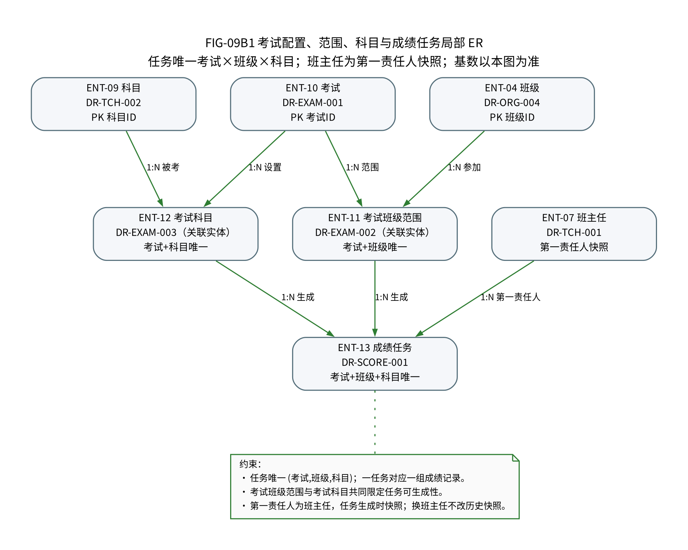

**图 5-1** 表达考试、考试班级范围、考试科目、成绩任务和班主任第一责任人快照；任务唯一“考试×班级×科目”，不是“一考试一任务”。

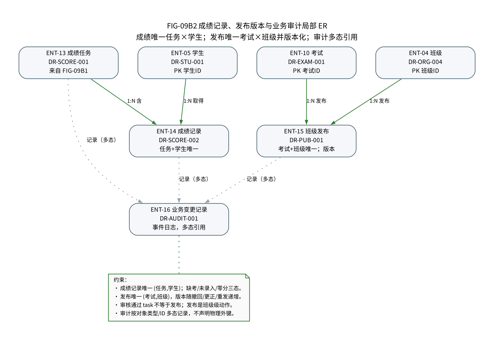

**图 5-2** 表达任务×学生唯一成绩、考试×班级唯一发布、发布版本和审计多态引用。`TASK_APPROVED` 不是 `PUB_PUBLISHED`；发布/撤回/更正的版本必须可追溯。

> 组织/任职/归属和 P1 复核的完整关系见附录 FIG-09A、FIG-09C；总览 FIG-09 仅作实体分区索引，不承担完整基数说明。

### 5.3 核心数据字典（概念级）

| 对象 | 主要属性（概念） | 说明 |
| --- | --- | --- |
| 学年 | 学年编码、起止日期、是否当前、状态 | 当前学年唯一 |
| 班级 | 班级编码、名称、年级、学年、状态 | 班级归属学生/任务/发布 |
| 学生 | 学号、姓名、性别、学籍状态 | 与账号分离；最小字段 |
| 学生班级归属 | 学年、班级、学生、起止、原因、是否有效 | 历史化，不覆盖 |
| 班主任 | 工号、姓名、状态 | 不表示任课教师 |
| 班主任任职 | 班主任、班级、起止、原因、是否有效 | 每班最多一条有效 |
| 科目 | 科目代码、名称、状态 | 不表示任教关系 |
| 考试 | 名称、类型、学期、状态、考试时间 | 考试状态独立 |
| 考试班级范围 | 考试、班级 | 考试×班级唯一 |
| 考试科目 | 考试、科目、满分、及格线、优秀线 | 0.5 分步长；线合法 |
| 成绩任务 | 考试、班级、科目、状态、第一责任人、花名册版本 | 三元组唯一；状态 `TASK_*` |
| 成绩记录 | 任务、学生、状态、分数、版本 | 任务×学生唯一；三态 |
| 班级发布 | 考试、班级、状态、版本、撤回原因、发布时间 | `PUB_*`；版本递增 |
| 业务变更记录 | 事件类型、对象类型/ID/版本、前后值、原因、操作人、角色、时间 | 多态；不可改删 |
| 账号档案关联 | 账号、角色、档案类型、档案 ID、状态 | 账号身份≠业务档案 |
| 复核申请（P1） | 学生、考试、科目、成绩记录/版本、状态、意见、截止时间 | P1；不进入 P0 |

### 5.4 关键唯一性与历史约束

| 约束 | 规则 |
| --- | --- |
| 班级—班主任任职 | 同一班级同一时刻最多一条有效任职；一名班主任可负责多个班；历史保留 |
| 学生—班级归属 | 同一学生同一学年最多一条有效归属；转班新增记录，不覆盖历史成绩 |
| 考试—班级范围 | 同一考试同一班级唯一 |
| 考试—考试科目 | 同一考试同一科目唯一；满分/线属于考试科目 |
| 成绩任务 | 同一考试×班级×科目唯一；任务生成时记录第一责任人快照 |
| 成绩记录 | 同一任务×学生唯一；`SCORE_NORMAL/ABSENT/NOT_ENTERED` 三态 |
| 班级发布 | 同一考试×班级唯一；每次撤回/重发/受控更正版本递增 |
| 审计 | 业务变更与审计同事务；审计失败则业务失败；不可修改/删除 |
| 账号—档案 | 一个学生/班主任档案至多绑定一个账号；一个账号至多绑定一个学生或班主任 |

### 5.5 缺考、未录入、真实零分

| 状态 | 代码 | 显示 | 提交 | 统计/排名 |
| --- | --- | --- | --- | --- |
| 缺考 | `SCORE_ABSENT` | “缺考”，不显示 0 | 允许（任务完整性通过） | 不进入有效人数/总分分母；不排名 |
| 未录入 | `SCORE_NOT_ENTERED` | “未录入”，阻止提交 | 不允许 | 学生不可见；不参与统计 |
| 真实零分 | `SCORE_NORMAL` + `0.0` | `0.0`，明确标注真实零分 | 允许 | 进入有效人数；按规则参与总分/排名 |

系统不得把缺考或未录入自动转为 0 分。

### 5.6 0.5 分精度与排名

- 分数、满分、及格线、优秀线统一 **0.5 分步长、一位小数**；
- 0、0.5、满分合法；0.3、负分、超满分、缺考带分数非法；
- 总分只在该学生所有适用科目完整（正常或缺考按规则）时计算；缺考/未录入不伪造分数；
- 完整总分参与班级排名，采用 **1,2,2,4** 竞争排名；
- 更正/复核更正后重算总分/排名，并保留版本与审计。

### 5.7 发布版本与审计

- 发布前必须所有适用任务 `TASK_APPROVED`、无未录入、至少一科；
- 发布生成 `PUB_PUBLISHED` 版本 v1；
- 撤回为 `PUB_WITHDRAWN`，学生不可见、数据保留；
- 重新发布要求任务仍 `TASK_APPROVED`，版本 +1；
- 受控更正保持 `PUB_PUBLISHED`，生成新的不可变版本，保留原值/新值/原因/操作人/时间；
- 审计记录包含业务对象类型/ID/版本、前后值、原因、操作人/角色、时间、来源；审计不替代发布版本。

## 6. 非功能需求

> 16 条 NFR 的指标均为**课程实验建议验收目标**；除文档级检查外尚未实测。不能将本节表述为性能测试、渗透测试或可用性已通过。

### 6.1 NFR 汇总

| ID | 类别 | 场景/指标 | 测量与验收 | 当前状态 |
| --- | --- | --- | --- | --- |
| NFR-PERF-001 | 性能 | 50 并发学生查询本人成绩：P95≤2s，P99≤5s，最长≤10s | 合成 1500 学生、6 科、3 次考试；记录 P50/P95/P99 | 未验证（建议目标） |
| NFR-PERF-002 | 性能 | 20 并发班主任保存/提交：P95≤3s；失败有明确原因 | 50 学生×6 科；含校验、事务、审计写入 | 未验证（建议目标） |
| NFR-PERF-003 | 性能 | 单班单科统计 P95≤3s；班级总分排名 P95≤5s | 合成数据；人工核对分母/缺考/排名 | 未验证（建议目标） |
| NFR-SEC-001 | 安全 | 受保护接口 100% 认证；越权矩阵 100% 拒绝；不返回超范围数据 | 四角色、列表/详情/统计/导出/写操作 | 未验证 |
| NFR-SEC-002 | 安全 | 密码不明文；停用账号旧令牌失效；重置后旧密码失败 | 若依密码机制；响应/日志抽查 | 未验证 |
| NFR-SEC-003 | 隐私 | P0 不收集身份证/住址/家长电话；日志/导出/审计不泄明文敏感字段 | 字段清单、页面/导出/日志抽样 | 未验证 |
| NFR-REL-001 | 可靠性 | 提交/审核/发布/撤回/更正/复核更正原子生效；业务与审计同事务 | 正常+故障注入 | 未验证 |
| NFR-REL-002 | 可靠性 | 并发保存不静默覆盖；重复提交/发布不产生重复版本；导入全成/全败 | 两会话并发、重复点击 | 未验证 |
| NFR-AVAIL-001 | 可用性 | 2 小时演示窗口无计划外停机；故障 10 分钟内恢复；数据不丢 | 课程实验单机环境；演示/恢复记录 | 未验证（建议目标） |
| NFR-USA-001 | 易用性 | 统一术语；错误定位学生/字段；危险操作二次确认；空数据提示 | 四角色主链路 + 异常/空态走查 | 未验证 |
| NFR-COMP-001 | 兼容性 | 当前稳定版 Chrome/Edge/Firefox 完成 P0 主链路；1366×768 不丢关键内容 | 桌面浏览器手工走查；不支持 IE | 未验证 |
| NFR-MAINT-001 | 可维护性 | 复用若依登录/JWT/RBAC/菜单/字典；P1 不改变 P0 状态名/成绩真值；编号可追踪 | 设计与代码审查 + 追踪矩阵 | 文档级初检 |
| NFR-BAK-001 | 备份恢复 | 每日逻辑备份、保留 7 天、2 小时内恢复；恢复后成绩/审计一致 | 单机实验；恢复演练记录 | 未验证（建议目标） |
| NFR-AUD-001 | 审计 | 关键事件 100% 记录前后值/原因/操作人/角色/时间/版本；审计不可改删 | 覆盖清单 + 事务故障测试 | 未验证 |
| NFR-AUD-002 | 审计权限 | 教务看业务审计；系统管理员只看脱敏元数据；班主任本班；学生不可见 | 四角色列表/详情/导出越权测试 | 未验证 |
| NFR-LEGAL-001 | 合规/伦理 | 仓库/演示/截图不使用真实个人信息；使用合成或脱敏数据 | 初始化脚本、截图、提交包扫描 | 未验证 |

### 6.2 非功能约束说明

- 性能指标不承诺生产 SLA，不声称已完成压测；
- 安全与隐私要求必须由后端重新推导数据范围，前端隐藏不作为安全措施；
- 系统管理员审计视图不能成为成绩明细旁路；
- 关键写操作必须业务与审计同事务；
- 备份/恢复指标是课程实验建议目标，未做演练不得写“通过”；
- 真实上线需补充学校授权、数据治理、合规和运维评审。

## 7. 用户界面需求

> 原型为高保真静态页面，截图是 Chrome 实际渲染的界面原型，不是已上线业务系统运行截图。全部 24 张截图见 [`05-截图索引.md`](../prototype/05-截图索引.md)；本节只选正文需要的 13 张。

### 7.1 界面设计原则

- 桌面后台管理系统布局：顶部栏、左侧角色菜单、面包屑、页面标题、筛选区、表格/详情、分页、弹窗；
- 统一中文字体、蓝色主色、状态标签、空状态、错误提示、危险操作二次确认；
- 以 1600×900 为基准；截图 3200×1800；
- P1 使用紫色“规划功能”标识；
- 不出现任课教师入口、任教分配或按科目授权。

### 7.2 P0 核心界面

#### 7.2.1 登录

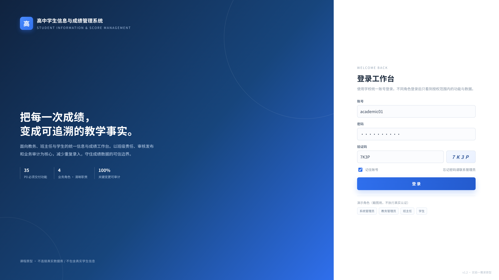

**图 7-1** 对应 UI-01A；账号/密码/验证码均为演示输入。验证码错误状态见附录 UI-01；原型不实现真实认证。

#### 7.2.2 学生信息管理

**图 7-2** 对应 UI-02，展示学年/年级/班级筛选、学生必要字段、学籍状态、账号绑定状态；学生档案与系统账号分离。

#### 7.2.3 考试配置

**图 7-3** 对应 UI-04A，展示考试名称/类型/学期/范围/科目/满分/及格线/优秀线；考试状态为 `EXAM_DRAFT`，与成绩发布状态无关。

#### 7.2.4 班主任成绩录入

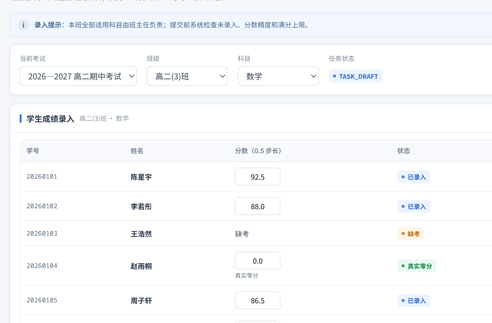

**图 7-4** 对应 UI-05 的内容区局部，展示本班全科任务、正常/缺考/真实零分、0.5 分步长和 `TASK_DRAFT` 状态。

#### 7.2.5 成绩校验错误

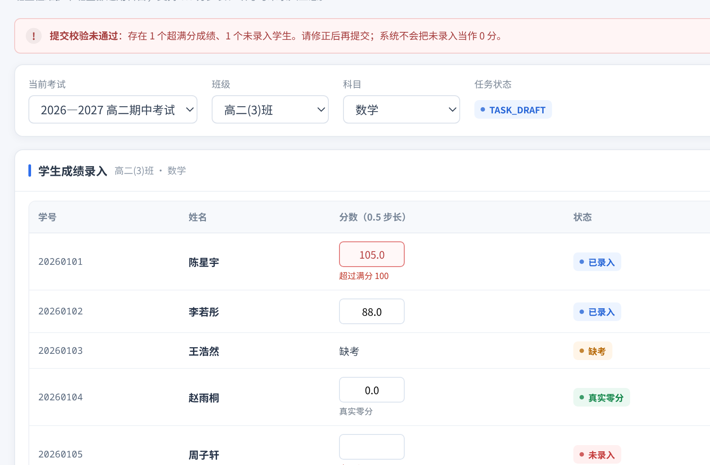

**图 7-5** 对应 UI-05A 的内容区局部：105.0 超满分标红，未录入学生明确显示，提交按钮禁用；缺考不显示 0，零分标注“真实零分”。对应 AC-EDGE-01/02。

#### 7.2.6 审核与发布

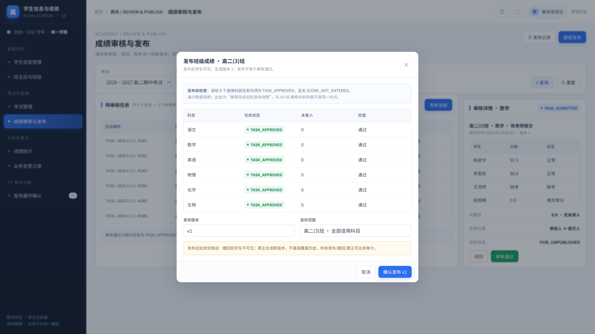

**图 7-6** 对应 UI-06B，展示发布前六科均 `TASK_APPROVED`、无未录入、版本 v1。截图中的“审核完成后的发布快照”与 UI-06 审核中的列表不是同一时点。

#### 7.2.7 撤回与更正

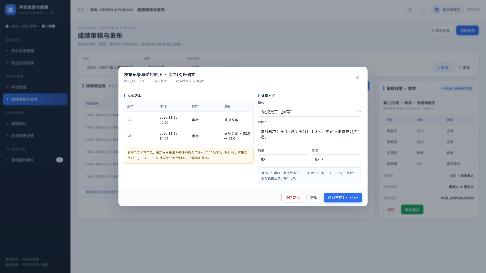

**图 7-7** 对应 UI-06C，展示 v1/v2、撤回原因、更正前后值、审计；更正保持 `PUB_PUBLISHED` 并生成新版本，不覆盖历史。

#### 7.2.8 学生本人成绩查询

**图 7-8** 对应 UI-07：仅本人，六科、总分 521.0、班级排名第 3；无他人数据、班级平均或年级排名。

#### 7.2.9 教务全校统计

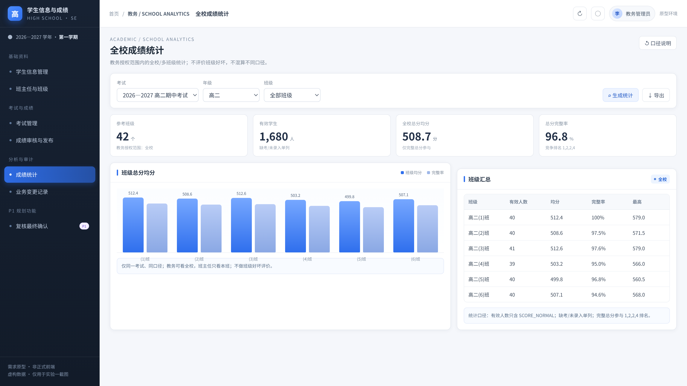

**图 7-9** 对应 UI-08C：教务授权范围内的班级汇总与同口径统计；P1 多班级对比是扩展能力，不等同于本页 P0 基础汇总。

#### 7.2.10 业务审计

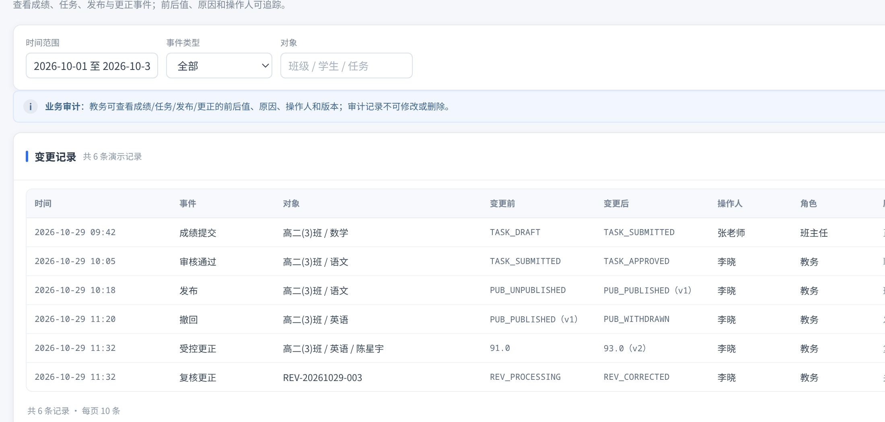

**图 7-10** 对应 UI-08A 的审计表局部：显示变更前后值、原因、操作人、角色、版本；仅教务业务审计可见。

#### 7.2.11 系统管理员脱敏审计

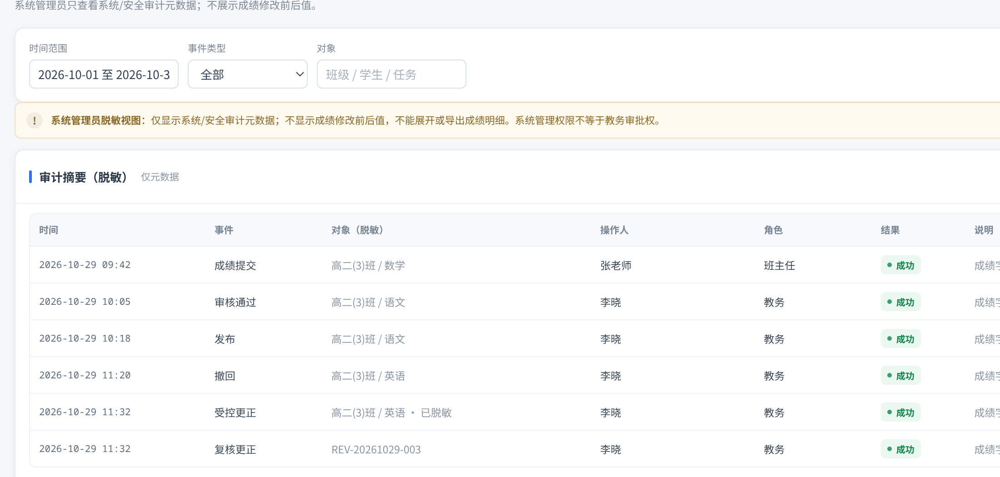

**图 7-11** 对应 UI-08B 的审计表局部：系统管理员只看到系统/安全审计元数据，无成绩前后值/明细，不能展开/导出；系统管理权限不授予教务审批。

### 7.3 P1 复核界面

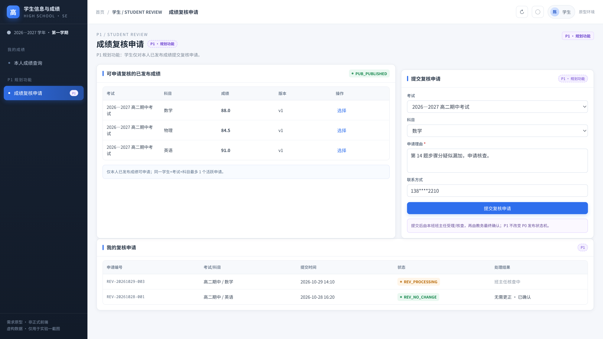

**图 7-12** 对应 UI-09，P1 规划；仅本人已发布成绩，填写理由并查看 `REV_*` 状态。

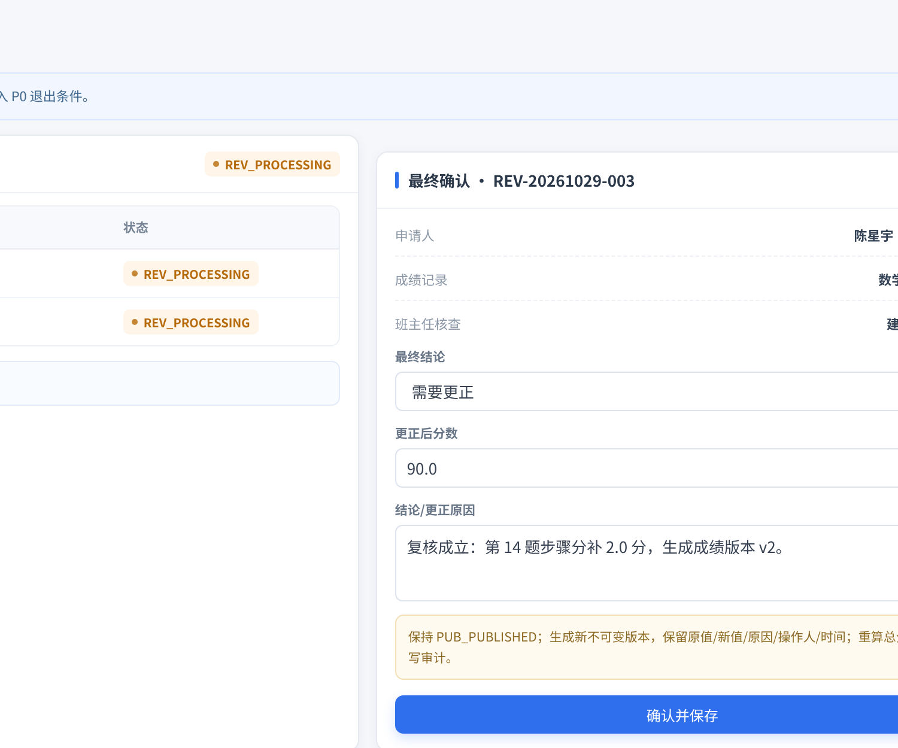

**图 7-13** 对应 UI-10A 的确认区局部，P1 规划；教务最终确认/更正，班主任只受理/核查，不直接改分；更正生成新版本并审计。

### 7.4 截图选用说明

- 正文采用 13 张：正常登录、学生信息、考试配置、成绩录入、校验错误、发布确认、撤回/更正、学生查询、全校统计、业务审计、脱敏审计、P1 申请、P1 最终确认；
- 其余截图（错误登录、班主任变更、退回重提、审核列表、审核退回、本班统计、P1 班主任处理等）放附录/截图索引，不堆入正文；
- 所有截图 3200×1800；插入 Word 单栏时可读，复杂双栏/多列表格建议横向或整页；
- 原型截图中的姓名/学号/电话为虚构/掩码，不含真实个人信息。

## 8. 需求验证与可追踪性

### 8.1 需求编号与追踪机制

- 功能：`FR-模块-序号`；
- 非功能：`NFR-类别-序号`；
- 业务规则：`BR-模块-序号`；
- 数据对象：`DR-模块-序号`；
- 用例：`UC-模块-序号`；
- 验收：`AC-*`；
- 页面：`UI-*`；
- 图表：`FIG-*`。

本 SRS 只使用现行编号，不把历史废止编号列入有效需求清单。

### 8.2 覆盖统计

| 类型 | 数量 | 本文落点 |
| --- | --- | --- |
| P0 FR | **35** | 4.2～4.11 逐条；附录 A 索引 |
| P1 FR | **11** | 4.12；P1 界面/时序；不进入 P0 |
| NFR | **16** | 6.1 全表 |
| BR | **137** | 4 章逐 FR 引用；附录 E 分类索引 |
| DR | **17** | 5.1；另 ENT-08 关联实体 |
| UC | **17** | 3.4、8.3、附录 B |
| AC | 77 个现行标识（含主场景/边界/权限/P1） | 2/4/8 章与验收标准引用 |
| 正式图 | 见 `SRS图表及截图选用清单.md` | 正文/附录分层 |
| 原型截图 | **24** | 第 7 章选 13；附录 D 全量索引 |

### 8.3 关键验收场景

| 场景 | 验收要点 | 关联 |
| --- | --- | --- |
| 四类角色登录/越权 | 合法登录、停用/错误验证码拒绝、越权 403/404 | FR-AUTH、NFR-SEC-001 |
| 班级/任职历史 | 每班最多一名有效班主任；变更留历史；原班主任失权 | FR-ORG-004/005、BR-ORG |
| 学生归属历史 | 同一学年最多一条有效；转班不覆盖历史成绩 | FR-STU-002 |
| 考试配置 | 考试状态与发布状态分离；范围/科目/分值完整才开放 | FR-EXAM |
| 成绩三态 | 缺考/未录入/零分互不混淆；未录入阻止提交 | FR-SCORE-003/004/005、AC-EDGE-01/02 |
| 任务审核 | 提交人不能审核自己的任务；退回后重提再审核 | FR-PUB-001、BR-AUTH-012 |
| 班级发布 | 全部任务通过、无未录入才能发布；版本 v1 | FR-PUB-002、AC-EDGE-03 |
| 撤回/更正 | 撤回后不可见、数据保留；更正新版本/审计 | FR-PUB-003/004 |
| 学生查询 | 只本人已发布；他人/未发布/已撤回不可见 | FR-QUERY-001/002 |
| 审计权限 | 教务看业务前后值；系统管理员只见脱敏元数据 | FR-AUDIT、NFR-AUD-002 |

### 8.4 文档自检与测试边界

**已完成：**

- FR/BR/DR/UC/AC 编号和文件存在性检查；
- 35 P0、11 P1、16 NFR、137 BR、17 DR 文档级覆盖核对；
- 图表路径、截图路径、角色/权限/状态术语一致性检查；
- 原型 24 张 PNG 的 Chrome 实际渲染和视觉抽查。

**未完成/不能声称：**

- 业务代码未全部实现，不能声称功能测试通过；
- 性能、并发、权限渗透、备份恢复未实测；
- 教师/小组未正式评审签字；
- Word 最终排版、页码、图目录未生成；
- 真实学校数据/生产环境未接入。

### 8.5 需求评审状态与待确认事项

| 编号 | 事项 | 状态/影响 | 处理 |
| --- | --- | --- | --- |
| Q-01 | 实验一独立任务书/提交规范未找到 | 可能影响页数/模板；当前以课件+研究记录为准 | 待课程组确认 |
| Q-02 | `ENT-08 班主任任职` 无独立 DR | 概念/物理设计映射待定 | 暂以关联实体保留 |
| Q-03 | 多班班主任跨班合并统计/导出 | 数据范围与 UI 口径待确认 | P0 不默认跨班合并 |
| Q-04 | 复核时限 `D-019` 5 个工作日 | 课程模拟假设 | 待课程组确认 |
| Q-05 | P1 后端状态机/通知 | 本阶段仅规划原型 | P1 实施前确认 |
| Q-06 | UI-08C P0 基础汇总 vs P1 多班级对比 | 必须保持范围区分 | 本文明确：P0 只做授权范围基础汇总；P1 对比另行规划 |
| Q-07 | Word 图表缩放/横向页 | 尚未排版 | 5B-2 处理 |

> 以上问题不阻塞 Markdown SRS 初稿；不得在未确认时改写需求基线。

## 附录 A 功能需求索引

### A.1 P0（35 项）

| 模块 | FR ID / 名称 |
| --- | --- |
| 认证与权限 | FR-AUTH-001 登录、登出、验证码；FR-AUTH-002 用户/角色/菜单/按钮权限配置；FR-AUTH-003 业务角色分配与账号绑定；FR-AUTH-004 业务数据范围过滤；FR-AUTH-005 账号启停与密码重置 |
| 组织和学年 | FR-ORG-001 学年管理；FR-ORG-002 学期管理；FR-ORG-003 年级管理；FR-ORG-004 班级管理；FR-ORG-005 班主任指派与变更 |
| 学生档案 | FR-STU-001 学生档案维护；FR-STU-002 学生班级归属与变更；FR-STU-003 学生账号开通与关联；FR-STU-004 学生状态管理 |
| 班主任/科目 | FR-TCH-001 班主任档案维护；FR-TCH-002 科目维护 |
| 考试 | FR-EXAM-001 考试创建与编辑；FR-EXAM-002 考试范围配置；FR-EXAM-003 考试科目与分值配置；FR-EXAM-004 考试状态管理 |
| 成绩录入 | FR-SCORE-001 任务生成；FR-SCORE-002 录入与暂存；FR-SCORE-003 校验；FR-SCORE-004 提交/重提；FR-SCORE-005 三态维护 |
| 审核发布 | FR-PUB-001 教务审核；FR-PUB-002 班级发布；FR-PUB-003 撤回；FR-PUB-004 更正/版本 |
| 查询 | FR-QUERY-001 本人已发布查询；FR-QUERY-002 明细/总分/排名 |
| 统计 | FR-STAT-001 单场学科统计；FR-STAT-002 班级总分/排名 |
| 审计 | FR-AUDIT-001 业务变更记录；FR-AUDIT-002 发布/撤回记录 |

### A.2 P1（11 项）

`FR-REVIEW-001/002/004/005`、`FR-IMPORT-001～004`、`FR-TREND-001/002`、`FR-COMPARE-001`；详见 4.12，不进入 P0 退出条件。

## 附录 B 用例与追踪索引

| UC | 名称 | 主要角色 | 关联 FR | 图 |
| --- | --- | --- | --- | --- |
| UC-AUTH-001 | 登录与权限校验 | 四类 | FR-AUTH-001～005 | FIG-03A～D |
| UC-ORG-001 | 维护学年/学期/年级/班级 | 教务 | FR-ORG-001～005 | FIG-03B |
| UC-STU-001 | 维护学生档案与归属 | 教务 | FR-STU-001～004 | FIG-03B |
| UC-TCH-001 | 维护班主任与科目 | 教务 | FR-TCH-001/002 | FIG-03B |
| UC-EXAM-001 | 创建考试并设置科目 | 教务 | FR-EXAM-001～004 | FIG-03B |
| UC-SCORE-001 | 录入与暂存成绩 | 班主任 | FR-SCORE-001～003/005 | FIG-03C |
| UC-SCORE-002 | 提交成绩任务 | 班主任 | FR-SCORE-004 | FIG-03C |
| UC-PUB-001 | 审核/退回 | 教务 | FR-PUB-001 | FIG-03B |
| UC-PUB-002 | 按班级发布 | 教务 | FR-PUB-002 | FIG-03B |
| UC-PUB-003 | 撤回/更正 | 教务 | FR-PUB-003/004 | FIG-03B |
| UC-QUERY-001 | 学生查询本人成绩 | 学生 | FR-QUERY-001/002 | FIG-03D |
| UC-STAT-001 | 基础统计 | 教务/班主任 | FR-STAT-001/002 | FIG-03B/C |
| UC-AUDIT-001 | 审计查询 | 管理员/教务/班主任 | FR-AUDIT-001/002 | FIG-03A/B/C |
| UC-REVIEW-001 | P1 复核 | 学生/班主任/教务 | FR-REVIEW-001/002/004/005 | FIG-03、FIG-08 |
| UC-IMPORT-001 | P1 导入导出 | 教务/班主任 | FR-IMPORT-001～004 | FIG-03B/C |
| UC-TREND-001 | P1 趋势 | 学生/班主任/教务 | FR-TREND-001/002 | FIG-03B/C/D |
| UC-COMPARE-001 | P1 多班级对比 | 教务/班主任 | FR-COMPARE-001 | FIG-03B/C |

## 附录 C 图表选用清单

> 详细路径、尺寸、正文/附录选择见 `SRS图表及截图选用清单.md`。

**正文图（12 张模型图）：** FIG-04、FIG-01、FIG-02、FIG-03、FIG-09、FIG-05、FIG-06、FIG-06A、FIG-06B、FIG-07、FIG-09B1、FIG-09B2。  
**附录模型图（21 张）：** FIG-02A1～A3、02B1～B3（6）；FIG-03A～D（4）；FIG-05A～D（4）；FIG-07A～D（4）；FIG-09A、09C（2）；FIG-08（1）。  
**正文 UI 截图（13 张）：** UI-01A、02、04A、05、05A、06B、06C、07、08C、08A、08B、09、10A。  
**附录索引：** 全部 24 张 UI，不重复嵌入全部图片。

## 附录 D 原型截图索引

| UI | 文件 | 角色 | P0/P1 | 正文/附录 |
| --- | --- | --- | --- | --- |
| UI-01 | `UI-01-登录页面.png` | 公共 | P0 | 附录 |
| UI-01A | `UI-01A-登录页面（正常）.png` | 公共 | P0 | 正文 |
| UI-02 | `UI-02-学生信息管理.png` | 教务 | P0 | 正文 |
| UI-02A | `UI-02A-学生信息编辑.png` | 教务 | P0 | 附录 |
| UI-03 | `UI-03-班主任与班级管理.png` | 教务 | P0 | 附录 |
| UI-03A | `UI-03A-班主任变更.png` | 教务 | P0 | 附录 |
| UI-04 | `UI-04-考试管理.png` | 教务 | P0 | 附录 |
| UI-04A | `UI-04A-新建考试.png` | 教务 | P0 | 正文 |
| UI-05 | `UI-05-成绩录入.png` | 班主任 | P0 | 正文 |
| UI-05A | `UI-05A-成绩校验错误.png` | 班主任 | P0 | 正文 |
| UI-05B | `UI-05B-退回后重提.png` | 班主任 | P0 | 附录 |
| UI-06 | `UI-06-成绩审核发布.png` | 教务 | P0 | 附录 |
| UI-06A | `UI-06A-审核退回.png` | 教务 | P0 | 附录 |
| UI-06B | `UI-06B-发布确认.png` | 教务 | P0 | 正文 |
| UI-06C | `UI-06C-撤回与更正.png` | 教务 | P0 | 正文 |
| UI-07 | `UI-07-学生成绩查询.png` | 学生 | P0 | 正文 |
| UI-07A | `UI-07A-成绩未发布.png` | 学生 | P0 | 附录 |
| UI-08 | `UI-08-本班成绩统计.png` | 班主任 | P0 | 附录 |
| UI-08C | `UI-08C-全校成绩统计.png` | 教务 | P0 | 正文 |
| UI-08A | `UI-08A-业务审计.png` | 教务 | P0 | 正文 |
| UI-08B | `UI-08B-系统审计脱敏.png` | 系统管理员 | P0 | 正文 |
| UI-09 | `UI-09-P1成绩复核申请.png` | 学生 | P1 | 正文 |
| UI-10 | `UI-10-P1复核处理（班主任）.png` | 班主任 | P1 | 附录 |
| UI-10A | `UI-10A-P1复核确认（教务）.png` | 教务 | P1 | 正文 |

## 附录 E 业务规则索引

| 规则组 | 数量 | 说明 |
| --- | --- | --- |
| BR-AUTH | 12 | 认证、RBAC、数据范围、职责分离 |
| BR-ORG | 10 | 学年/学期/年级/班级/班主任任职 |
| BR-STU | 9 | 学生档案、归属、账号、状态 |
| BR-TCH | 4 | 班主任档案/指派 |
| BR-SUB | 3 | 科目 |
| BR-EXAM | 12 | 考试、范围、科目、状态 |
| BR-SCORE | 17 | 任务、录入、校验、提交、三态、历史 |
| BR-PUB | 14 | 审核、发布、撤回、更正、版本 |
| BR-QUERY | 9 | 学生查询/可见性 |
| BR-STAT | 10 | 统计口径 |
| BR-CALC | 9 | 总分/排名/精度 |
| BR-AUDIT | 8 | 审计完整性/可见性 |
| BR-IMP | 8 | P1 导入导出 |
| BR-REVIEW | 12 | P1 复核 |
| **合计** | **137** | 以 `baseline/04-核心业务规则.md` 表为准 |

> BR 数量按基线规则表行统计；正文只引用与 FR 相关规则，不复制全部 137 条正文以免重复和漂移。

## 附录 F 变更与待确认事项

| 日期 | 变更 | 影响 |
| --- | --- | --- |
| 2026-10-28 | 完成功能/数据/NFR/权限/UC/AC 初稿 | 形成 SRS 输入 |
| 2026-10-29 | 整合 SRS；修正复核—成绩 1:N、P1 权限、系统管理员审计、活动拆分 | 与第四阶段专项修订一致 |
| 待定 | 实验一独立任务书、Word 模板/页数 | 影响最终排版，不影响业务范围 |
| 待定 | `ENT-08` 无独立 DR、复核时限、多班统计口径、P1 后端 | 见 8.5 |

## 附录 G 参考文件

- [需求基线](../baseline/)
- [功能需求规格](../draft/02-功能需求规格.md)
- [详细用例规约](../draft/02-详细用例规约.md)
- [数据需求与数据字典](../draft/02-数据需求与数据字典.md)
- [角色权限矩阵](../draft/02-角色权限矩阵.md)
- [需求验收标准](../draft/02-需求验收标准.md)
- [结构化分析说明](../analysis/03-结构化需求分析说明.md)
- [图表与原型规划](../图表与原型规划-v1.2.md)
- [原型质量检查](../prototype/05-原型质量检查报告.md)

---

**文档结束。** 本稿为 Markdown 初稿，待小组/教师评审；不得将文档自检表述为业务系统测试通过。
